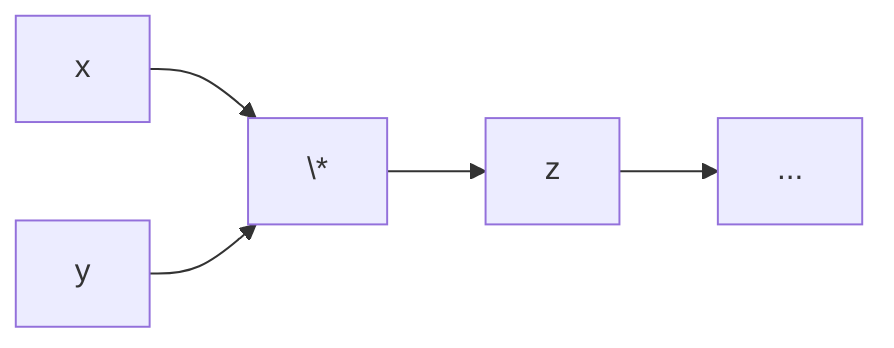
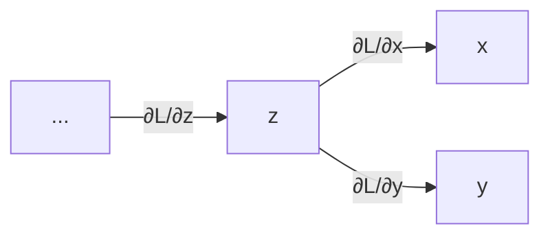
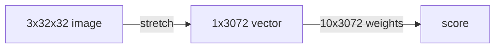
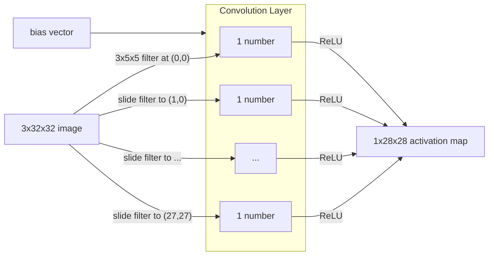
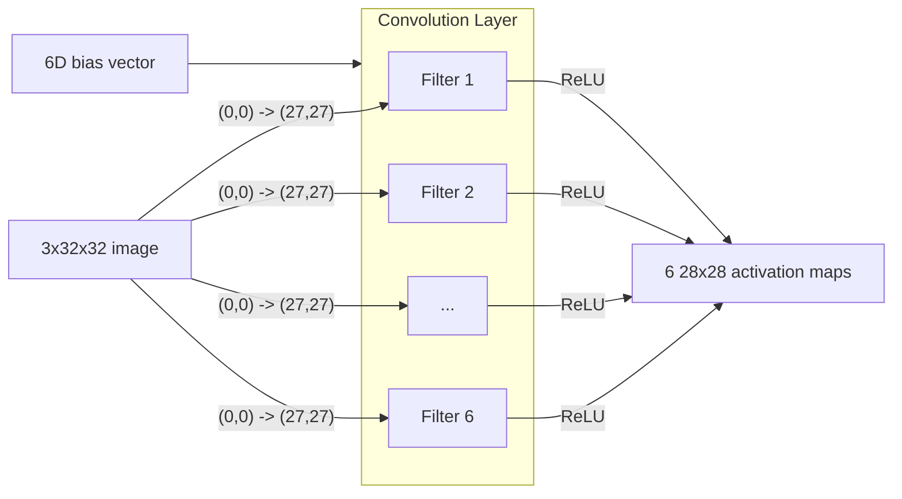
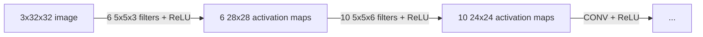
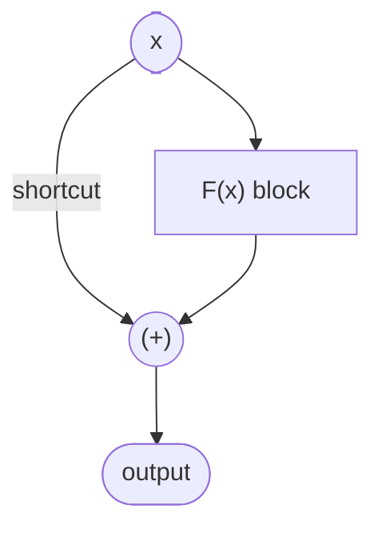

# 1 卷积神经网络
---
## 卷积

卷积（convolution）= 局部加权求和

$$
O[x, y] = \sum_{i,j} I[x+i,\; y+j]\;K[i,j]
$$

其中

- $I$ - 选取图像的一个**局部块**（local patch）
- $K$ - 将每个值乘以卷积核（kernel，也称滤波器/模式，filter/pattern）中定义的**局部权重**（local weights）
- $(x,y)$ - 把它们求和，得到该位置上的一个输出值

> [!NOTE] *滤波器*定义了什么？
> 
> **1. 局部区域**
> 
> 滤波器的范围/尺寸 = 对**局部性**（locality）的定义。
> 
> - 3×3 卷积核 → 观察 3×3 的邻域  
> - 5×5 卷积核 → 观察 5×5 的邻域  
> 
> **2. 局部权重**
> 
> 卷积核的值（$K[i,j]$）本身定义了组合局部像素时所用的**权重**。
> 
> - 边缘滤波器 → 正值 + 负值  
> - 模糊滤波器 → 均匀权重  

为了让计算更适合机器执行，我们可以：

- **构建**一个滤波器
- **滑动** - 按照局部规则扫描输入（即把该滤波器应用到输入上）
- **组织**结果，形成一张新的图

> [!example]- Sobel 水平滤波器
> 
> **输入**
> 
> $$
> I =
> \begin{bmatrix}
> 1 & 2 & 3 & 2 & 1 \\
> 2 & 4 & 5 & 4 & 2 \\
> 3 & 5 & 8 & 5 & 3 \\
> 2 & 4 & 5 & 4 & 2 \\
> 1 & 2 & 3 & 2 & 1
> \end{bmatrix}
> $$
> 
> **卷积核**
> 
> 检测**水平边缘**：
> 
> $$
> K =
> \begin{bmatrix}
> 1 & 2 & 1 \\
> 0 & 0 & 0 \\
> -1 & -2 & -1
> \end{bmatrix}
> $$
> 
> - 顶行 = 正权重  
> - 底行 = 负权重  
> - 度量**竖直方向**上的强度变化 → 突出**水平边界**
> 
> **卷积**
> 
> 计算第一个输出像素 \(O[0,0]\)
> 
> - 卷积核覆盖的块：
> 
> $$
> \begin{bmatrix}
> 1 & 2 & 3 \\
> 2 & 4 & 5 \\
> 3 & 5 & 8
> \end{bmatrix}
> $$
> 
> - 逐元素相乘：
> 
> $$
> \begin{aligned}
> O[0,0] &= 
> (1\cdot1 + 2\cdot2 + 3\cdot1) \\
> &\quad + (2\cdot0 + 4\cdot0 + 5\cdot0) \\
> &\quad + (3\cdot(-1) + 5\cdot(-2) + 8\cdot(-1))
> \end{aligned}
> $$
> 
> - 计算：
> 
> $$
> O[0,0] = (1 + 4 + 3) + 0 + (-3 -10 -8) = -13
> $$
> 
> 把卷积核滑过所有位置之后：
> 
> $$
> O =
> \begin{bmatrix}
> -13 & -16 & -13 \\
> 0 & 0 & 0 \\
> 13 & 16 & 13
> \end{bmatrix}
> $$
> 

结果告诉我们：

- 模式出现在哪里  
- 它出现得有多强  
- 它在空间上如何变化  

---
## 感知机 → 线性分类器

**线性分类器**（linear classifier）是**感知机**（perceptron）的现代用法，用于把图像特征映射到多个类别。

### 分类器（评分函数）

线性边界：

$$
s_{x_i} = f(x_i, W) = Wx_i
$$

### 损失函数

交叉熵（cross-entropy）+ softmax

$$
L_i = - \log \frac{\exp(s_{y_i})}{\sum_j \exp(s_j)}
$$

- 正则化损失（regularisation loss，L2）：

$$
R(W) = \lambda ||W||^2
$$

- 完整损失：

$$
L = \frac{1}{N} \sum_{i=1}^{N} L_i + R(W)
$$

### 优化

**RMSProp**：针对不同梯度动态调整学习率。

维护梯度平方的加权平均：

$$
E[g^2] \gets \beta E[g^2] + (1 - \beta)g^2
$$

更新参数：

$$
W \gets W - \frac{\alpha}{\sqrt{E[g^2]}+\epsilon}g
$$

---
## 线性分类器 → 全连接网络

### 激活函数 

*目标* - 为模型引入***非线性***（non-linearities）。

$$
\underbrace{\text{Linear Operators} \to \textcolor{red}{\text{Activate Function}}}_{\text{Feedforward/Linear Layer, Convolutional Layer, etc.}} \to \ldots
$$

**Sigmoid**

$$
\sigma(x) = \frac{1}{1+e^{-x}}
$$
$$
L_i = \sum_{j \ne y_i}\big[1-\sigma(s_{y_i}-s_j)\big]
$$

> [!NOTE] Sigmoid 的效果
> 
> - 把数值压缩到 $[0, 1]$ 范围内
> - 可以很好地解释为生物神经元趋于饱和的"放电率"（历史上很流行）✅
> - 很大的正值/负值容易"杀死"梯度 ❌

**ReLU**（Rectified Linear Unit，修正线性单元）

$$
L_i = \sum_{j \ne y_i} \max (0, s_j - s_{y_i} + 1)
$$

> [!NOTE] ReLU 的效果
> 
> - 不会饱和 ✅
> - 计算非常高效 ✅
> - 实践中收敛速度比 sigmoid 快得多 ✅
> - $\mu \ne 0$ ⚠️
> - 当所有 $x < 0$ 时会"死亡" ❌

**GELU**（Gaussian Error Linear Unit，高斯误差线性单元）

$$
\Phi(x) = \frac{1}{\sqrt{2\pi}}\int_{-\infty}^x \,e^{-t^2/2}\,dt
$$

$$
\text{GELU}(x) = x\,\Phi(x)
$$

$$
L_i = \sum_{j \ne y_i} \text{GELU}(1 - (s_{y_i}-s_j))
$$

> [!NOTE] GELU 的效果
> 
> - 在 0 附近表现非常好 ✅
> - 平滑性在实践中有利于训练 ✅
> - 计算成本比 ReLU 高 ☹️
> - 部分饱和 → 很大的负值仍然容易"杀死"梯度 ❌

**其他激活函数**

$$
\text{Leaky ReLU}(x)=\max(0.1x,\,x)
$$

$$
\text{ELU}(x) =
\begin{cases}
x, & x \ge 0 \\
\alpha(e^x-1), & x \lt 0
\end{cases}
$$

$$
\text{SiLU}(x) = x \cdot \sigma(x)
$$

---

### 反向传播

每个节点都知道自己的***局部梯度***（local gradients）：

$$
z = x \cdot y, \; \textcolor{green}{\frac{\partial z}{\partial x}} = y
$$

它从下一层获得***上游梯度***（upstream gradient）：

$$
\textcolor{red}{\frac{\partial L}{\partial z}}
$$

然后，它只需乘上自己的局部梯度（链式法则，chain rule），就能得到***下游梯度***（downstream gradients），并把它传给前一层：

$$
\frac{\partial L}{\partial x} = \textcolor{green}{\frac{\partial z}{\partial x}} \cdot \textcolor{red}{\frac{\partial L}{\partial z}}
$$

---
### 权重初始化

*目标* - 平衡输出的**分布**，包括：

- 前向传播中的激活值
- 反向传播中的梯度
- 训练中的收敛

*问题* - 如果初始权重：

- 太小 → 梯度消失（vanishing gradients）
- 太大 → 梯度爆炸（exploding gradients）

*解决方案* - Kaiming/MSRA 初始化

$$
\text{Input Variance} = \text{Output Variance}
$$

对于 ReLU：

$$
\text{std} = \sqrt\frac{2}{D_\text{in}}
$$

设为高斯分布：

$$
W \sim \mathcal{N}\,(0, \frac{2}{D_\text{in}})
$$

即 $\bar{w} = 0$，$s^2 = \frac{2}{D_\text{in}}$。

---
## 全连接网络 → 卷积网络（CNNs）

> [!warning] 全连接网络在计算机视觉上的关键局限
> 
> 图像的***空间结构***（spatial structure）被破坏了。
> 
> - 全连接网络（FCNs）的神经元只能处理 **1D 向量**结构的数据。
> - 图像在送入网络之前必须先被展平（flatten）。
> 
> 结果：
> 
> - **像素邻接关系**（pixel adjacency）丢失
> - 图像中的**几何**（geometry）与**拓扑**（topology）消失
> 
> 这个问题在全连接网络的框架内几乎**不可能**解决。
> 
> - 重新学习空间结构效率低下，并且需要庞大的数据集
> - 可能需要过多参数，导致过拟合和泛化能力差

CNN 的解决方案：**卷积** + **下采样**（downsample）

- **卷积**层 - 用视野有限的滤波器提取特征，以尊重二维图像结构。
- **池化**（pooling）层（**下采样**）- 扩大感受野（receptive field，即视野）并降低分辨率，以加快计算。
- **全连接**层 - 在末端组成一个 MLP，用于预测分数并输出类别。

CNN 就是带有卷积层的神经网络。

---
## 卷积层

*假设一张 32x32 像素的彩色（RGB）图像*

**全连接网络**：通过*拉伸*（stretch）把图像转成一维向量。

**卷积**：

- 使用视野较小的*滤波器*（例如只关心像素的一个局部范围、只关心对比度、只关心边缘……）。
- 在图像的所有空间位置上进行卷积（滑动）。
- 应用激活函数（ReLU）。
- 把结果存入一张激活图（activation map）。

单个滤波器：

多个滤波器：

一个卷积层：

- 输入：$C_\text{in} \times H \times W$
- 滤波器：$C_\text{out} \times C_\text{in} \times K_h \times K_w$ 
- 输出：$C_\text{out} \times (H - K_h + 1) \times (W - K_w + 1)$

多个卷积层：

---
### 填充

*问题* - 特征图每经过一层就会**缩小**。

$$
W' = W - K + 1 \lt W
$$

*解决方案* - 在滑动滤波器之前，先在输入周围添加填充（padding）。

- 原始输入：$W \times W$
- 填充：$P$
- 填充后的输入：$(W+2P) \times (W+2P)$
- 滤波器：$K \times K$
- 输出：$(W - K + 1 + 2P) \times (W - K + 1 + 2P)$

**Same 填充**（same padding）：实践中，我们用填充让输出尺寸与输入尺寸保持一致。

$$
P = \frac{K - 1}{2}
$$

---
## 下采样

### 池化

*问题* - **平移变化性**（translation variance）

视觉特征不应依赖于绝对坐标

$$
\text{Conv}(\text{Translate}(X)) = 
\text{Translate}(\text{Conv}(X))
$$

**平移变化性**：输入图像在空间上的轻微平移可能会让得到的特征图产生显著变化，从而导致分类器预测不稳定。

*解决方案* - 用一个采用固定采样规则的池化滤波器进行下采样。

**最大池化**（max pool）

$$
O[i,j]=\max_{u,v \in R} I[u,v]
$$

**平均池化**（average pool）

$$
O[i,j]=\frac{1}{|R|}\sum_{u,v \in R}I[u,v]
$$

其中

- $R$ - 池化滤波器的视野

### 步幅

*问题* - 卷积运算的开销很大。

$$
\text{ConvOps}_{S=1} = (W - K + 2P +1)^2
$$

*解决方案* - 通过增大**步幅**（stride）来下采样。

- 不再连续地滑动滤波器（$S = 1$），而是以一定距离跳跃前进（$S \ge 2$））。

$$
\text{ConvOps}_{S} = (\frac{W - K + 2P}{S} +1)^2
$$

现代计算机视觉设计（ResNet、MobileNet）使用带步幅的卷积（strided convolution）来代替池化。

> [!faq]- 为什么带步幅的卷积正在取代池化？
> 
> - **可学习的下采样** — 步幅在缩小空间尺寸的*同时学习*如何组合特征，而不像固定的最大/平均规则。
> - **更好地保留信息** — 池化会生硬地丢弃细节；步幅则可以保留有意义的结构。
> - **端到端优化** — 步幅融入卷积层之中，使整个流水线可微且更稳定。
> - **更简洁的架构** — 独立的层更少

> [!tip] 总结
> 
> 输入：$C_{in} \times H\times W$
> 
> 超参数：
> - 卷积核尺寸：$K_H\times K_W$
> - 滤波器数量：$C_{out}$
> - 填充：$P$
> - 步幅：$S$
> 
> 权重矩阵：$C_{out} \times C_{in} \times K_H\times K_W$
> 
> 偏置向量：$C_{out}$
> 
> 输出尺寸：$C_{out} \times H'\times W'$ 
> 
> 其中：
> 
> - $H'=\frac{H-K+2P}{S}+1$
> - $W'=\frac{W-K+2P}{S}+1$

> [!example]- 常见设置
> 
> - $K_H=K_W$（小的方形滤波器）
> - $P=\frac{K-1}{2}$（same 填充）
> - $C_{in}, C_{out} =32,64,128,256$（2 的幂）
> - $K=3,P=1,S=1$（3×3 滤波器）
> - $K=5,P=2,S=1$（5×5 滤波器）
> - $K=1,P=0,S=1$（1×1 滤波器）
> - $K=3,P=1,S=2$（下采样为原来的 1/2）

---
## 归一化层

### 归一化

*动机* - 稳定由层间应用激活函数所造成的**内部协变量偏移**（internal covariate shift），它会导致

- 梯度不稳定
- 收敛更慢
- 优化深层模型更困难

对每个输入向量：

$$
\hat{x}_i = \frac{x_i-\mu}{\sigma+\varepsilon}
$$

- 结果：$\bar{x} = 0$，$s^2_x = 1$。

> [!faq] $i$ 的统计维度是什么
> 
> - 批归一化（Batch Norm）：$H, W, N$ - 在样本之间归一化
> - 层归一化（Layer Norm）：$H, W, C$ - 在通道之间归一化
> - 实例归一化（Instance Norm）：$H, W$ - 对每个样本的每个通道分别归一化
> - 组归一化（Group Norm）：$H, W, c$ - 把通道划分成若干组
> 
> *通道（channel）= 每个像素的深度/特征*

---

### 仿射变换

*问题* - 直接使用归一化会**限制网络的表示能力**，使模型**无法**：

- 改变特征的**尺度**
- **平移**激活值的分布
- 保留重要的**幅值信息**

*解决方案* - 引入专门用于**优化**原始数据**分布**的可学习参数。

$$
y_i = \gamma \hat{x}_i + \beta
$$

- 结果：$\bar{x} = \beta^\ast$，$s^2 = \gamma^\ast$。
- 如果原始分布就是最优的，那么：

$$
\gamma = \sigma,\; \beta = \mu
$$

---
### Dropout

*问题* - 特征的**共适应**（co-adaption）导致过拟合：

- 一组神经元同时工作
- 即使扩大网络，泛化能力依然有限
- 训练损失为零，但验证损失很高

*解决方案* - 在每一步中，随机地（按一个超参数）丢弃（屏蔽）一部分神经元（置为零概率）。

在训练时丢弃（前向传播）：

$$
\text{Conv} \to \text{GELU} \to \textcolor{red}{\text{Dropout}} \to \text{Next Layer}
$$

- 以概率 $p$（通常为 0.5）采样一个二值掩码 $m_i \in \{0, 1\}$

$$
m_i \sim \text{Bernoulli}(p)
$$

- *原始 Dropout*（很少使用）

$$
\tilde{x}_i = m_i \cdot x_i
$$

- *反向 Dropout*（inverted dropout）

$$
\tilde{x}_i = \frac{m_i}{p} x_i
$$

在测试时缩放：

$$
\text{Output at test time} = \text{Expected output at training time}
$$

- *原始 Dropout* - 神经元的输出 $\ast \,p$
- *反向 Dropout* - 无需额外步骤

> 在 CNN 架构中并非必需（甚至并不常用）。

---
## 残差学习

*问题* - 深度学习中的***梯度消失/爆炸***问题

*解决方案* - 让每一层只学习相对其输入的**变化**（残差，residual），而不是完整的映射。

**前向传播：**

把 $x$ 加到每一层的原始输出上。

$$
H(x) = F(x) + x
$$

**反向传播：**

加上 $1$，以确保梯度能够传播到更早的层而不发生**退化**（degradation）。

$$
\frac{\partial L}{\partial x} = \frac{\partial L}{\partial H}\left(1+\frac{\partial F}{\partial x}\right)
$$

> [!NOTE] 残差学习的效果
> 
> - 网络**至少不比**简单的 $H(x) = x$ **差**。✅
> 	- 如果 $F(x)$ 学不到新东西，它至少能保持与什么都不做时相同的输出质量。
> 	- 让方差/分布至少与前一层一样好。
> - 反向传播依然容易 ✅

---