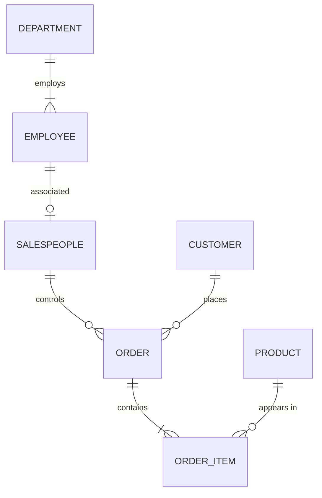

# INFO90002 Week 2 - Conceptual Modelling: the Entity-Relationship Model

Sources: `lecture/INFO90002_Week2-1_DataModelIntro.pdf`, `lecture/INFO90002_Week3-2_ToyLibraryExplanation.pdf`, `lecture/Week2_slide20_solution.jpg`, `lecture/Week2_Slides30-31_SelectedSolns.jpg`, `lecture/Library_BookVsCopies.jpg`; `tutorial/Week2_Tute_Modelling with MySQL Workbench.pdf`, `tutorial/Week3_Tute_Logical and Physical Modelling.pdf`; Apple Notes: CS/25S1/DB — "FE - ER Model".

This lecture asks: **given a business description, how do you draw an entity-relationship diagram (ERD) that expresses the business rules?**

Learning path: [What the ER model is](#topic-1) → [Entities, attributes and identifiers](#topic-2) → [Relationships: connectivity and cardinality](#topic-3) → [Foreign keys, strong and weak entities](#topic-4) → [Resolving many-to-many](#topic-5) → [Modelling steps and the Toy Library case](#topic-6).

Key points: reading Crow's foot symbols, weak entities and PFKs, resolving many-to-many. Hard parts: the difference between connectivity and cardinality; judging whether an identifier is really unique. Common mistakes: putting the foreign key on the wrong side; putting a column that may be empty into the primary key.

Screenshot numbers are PDF page numbers: W2-1 is the Week 2 lecture deck, W3-2 is the supplementary Toy Library explanation. The file names of the three photos of the lecturer's handwritten answers keep the page numbers of an older version: slide 20 corresponds to the exercises on pages 18 and 21 of this version, and slides 30–31 correspond to pages 31–32.

## 1. Data models and the ER model

### Why model first

Data modelling is the process of building a data model for a particular problem domain; it is iterative and progressively refined. A data model is a simplified representation of complex real-world data structures, and it is also a communication tool: programmers, managers and end users see the data from different angles, but with a good database blueprint those differences do not affect the design.
<!-- Sources: W2-1 p.4 -->

In the [development lifecycle from 01](01-introduction.en.md#topic-5), this lecture covers the first step inside the Database Design box: conceptual design.

### An ER model is a "plan" and stores no data

- An ER model (Entity-Relationship model) is a plan; it does not itself store any data;
- An ER diagram (ERD) is the graphical representation of an ER model;
- It uses entities to represent people, objects, events and so on, and relationships to represent the associations between entities;
- Everything revolves around the organisation's business rules: for example, "a student may enrol in at most 5 subjects per semester" is a constraint the model must express.
<!-- Sources: W2-1 p.6, p.15; Apple Notes FE - ER Model -->

The integrity constraints marked in red at the bottom of the page are what business rules look like once they land in the database. Business rules differ between organisations: at the University of Melbourne a grade can only be H1, H2A, H2B, H3, P, N or NH, while another university may use HD, D, C, P, N. An ERD must match the rules of **this** organisation.
<!-- Sources: W2-1 p.8, p.15 -->

## 2. Entities, attributes and identifiers

### Entities

An entity is a real-world object that can be distinguished from other objects and is described by a set of attributes. An entity in an ERD means the **entity set** (e.g. all students), which corresponds to a table in a relational database, not to a row. Both Chen notation and Crow's foot notation draw an entity as a rectangle.
<!-- Sources: W2-1 p.7 -->

Compare the two drawings at the bottom: on the left, Chen notation draws `STUDENT` as a rectangle with its attributes as a ring of ovals; on the right, Crow's foot lists the attributes directly inside the rectangle. From now on this subject uses Crow's foot.

### Ways to classify attributes

Look at `CAR` at the top right: `CarVIN` is underlined, so it is the identifier; `Make` and `Model` are single-valued attributes; the oval of `carColor` has a double border, marking a multi-valued attribute — one car can have three colours, for the body, the roof and the trim.

| Classification | Meaning | Example |
| --- | --- | --- |
| Domain | The set of values an attribute may take, set by business rules; different attributes may share a domain | A mark lies between 0 and 100; staff and customer phone numbers follow the same format |
| Required / optional | A required attribute cannot be `NULL`; an optional one may be left blank | In Workbench a filled diamond is required, a hollow diamond is optional |
| Single / multi-valued | A multi-valued attribute can hold several values in one row | A car's colours can be body, roof and trim |
| Simple / composite | A composite attribute can be split further | An address splits into street number, street, city, state, postcode, country |
| Derived | Can be computed from other attributes or functions | Age is computed from date of birth and `CURDATE()` |
<!-- Sources: W2-1 p.8-10, p.12; Apple Notes FE - ER Model -->

This page shows the Workbench conventions, which Tutorial 2 uses for drawing. Look at the sample entities at the bottom left: a yellow key is an identifier (two keys mean the two partial identifiers are only unique together), a filled blue diamond is required, a hollow diamond is optional, and the last few rows show the bracket notation for derived, multi-valued and composite attributes.

Attribute names cannot contain spaces; use letters, digits, underscores or CamelCase. In a Workbench conceptual diagram, `[Age]` marks a derived attribute, `{CarColour}` a multi-valued one, and `Name (First, Middle, Last)` a composite one. Multi-valued attributes must be "flattened" in logical design, for example into `carBodyColor`, `carRoofColor`, `carTrimColor`; but if the number of values cannot be known in advance (for example an employee's qualifications), splitting into a fixed number of columns is unsuitable and a separate entity should be considered.
<!-- Sources: W2-1 p.8-9, p.12; W3-1 p.24 -->

### Identifiers (primary keys)

An identifier is an attribute (or combination of attributes) that uniquely identifies one instance of an entity, i.e. the primary key (PK). The rules:

- Every entity must have an identifier;
- Each instance's identifier is unique, with no duplicates;
- The value of an identifier cannot be empty (`NULL`).

Chen notation underlines the identifier; Crow's foot marks it `PK`.
<!-- Sources: W2-1 p.11; Apple Notes FE - ER Model -->

The "cannot be empty" rule directly decides how the primary key is chosen in the Toy Library case in [Section 6](#topic-6).

## 3. Relationships: connectivity and cardinality

### Relationships and relationship sets

A relationship is an association between two or more entities, e.g. "John places a pizza order"; a collection of relationships of the same kind is a relationship set, e.g. "customers place orders". The entities taking part are called participants. A relationship can always be read in both directions: a customer places orders; an order belongs to a customer.
<!-- Sources: W2-1 p.13; Apple Notes FE - ER Model -->

The page asks "What notation is used here?": the diamond `places` is a relationship set in Chen notation, and the underlined `cID` and `orderID` are the identifiers on each side.

### Connectivity and cardinality are not the same thing

**Hard part:**

- **Connectivity** describes the type of relationship: 1:1, 1:M, M:N;
- **Cardinality** gives the specific minimum and maximum: a customer can place 0 to many orders; an order must belong to exactly 1 customer; a credit card account has at least 1 and at most 2 cards (written `1..2`).
<!-- Sources: W2-1 p.14, p.20; Apple Notes FE - ER Model -->

Each oval is an entity set, the dots inside are instances, and the lines show which instances are related. On the left, many-to-many: dots on both sides have more than one line; in the middle, one-to-many: one dot on the left links to several dots on the right, but each dot on the right has only one line; on the right, one-to-one: each dot has at most one line. The note at the bottom reminds us that these diagrams **do not show cardinality**.

The three rows above are many-to-many (students enrol in subjects), one-to-many (customers place orders) and one-to-one (a school is headed by one principal). Look at the two ends of each line: the end with the "crow's foot" (three prongs) means "many", the end with a single bar means "one". Note that this diagram only expresses connectivity, not yet cardinality.
<!-- Sources: W2-1 p.16-17 -->

### Participation: optional and mandatory

The four symbols on the right are read in pairs: the symbol next to the entity gives the maximum (bar = one, crow's foot = many), and the symbol a little further from the entity gives the minimum (circle = 0, i.e. optional; bar = 1, i.e. mandatory). So from top to bottom they are 0 to many, 1 to many, 0 or 1, and exactly 1; a minimum of 0 is called partial participation and a minimum of 1 is called total participation.
<!-- Sources: W2-1 p.19; Apple Notes FE - ER Model -->

- Optional: an instance does not require a corresponding instance. For example, a customer "may" place several orders, so 0 is also fine;
- Mandatory: an instance must have a corresponding instance. For example, every order must belong to a customer.

**Key point:** the minimum at the parent entity's end decides whether the foreign key can be empty. The symbol at the customer end is "exactly 1" (each order belongs to exactly one customer), so `customerID` in an order cannot be `NULL`; if the customer end were "0 or 1", this foreign key could be empty (foreign keys are covered in [Section 4](#topic-4)).

**Note:** the slide asks whether "every customer must place at least one order" can be implemented: the customer record has to be created before their first order, so this two-way mandatory participation is hard to implement directly in a database.
<!-- Sources: W2-1 p.19 -->

### Writing cardinality as (min, max)

Some notations write cardinality as a pair of numbers (x, y): the first is the minimum and the second the maximum. In the diagram, the (1,4) next to `CLASS` means a professor teaches 1 to 4 classes; the (1,1) next to `PROFESSOR` means each class is taught by exactly one professor. **Common mistake:** the numbers are written beside "the side being counted", and you read them starting from one instance on the opposite side. The top right corner says that the subject's solutions do not write number pairs and use only Crow's foot symbols.

#### In-class exercise: from business sentences to crow's feet

The in-class exercise was: "a department employs several employees, and an employee belongs to only one department; a customer may place several orders, and each order belongs to only one customer; an order contains several products, and a product can appear in several orders". In the lecturer's handwritten answer, department–employee and customer–order are both one-to-many; order–product is first drawn as many-to-many and then split with an order-line entity (see [Section 5](#topic-5)).
<!-- Sources: W2-1 p.18, p.21; lecture/Week2_slide20_solution.jpg -->

Read the photo from top to bottom:

- `Department` and `Employee` (employs): the department end is exactly 1, the employee end is 1 to many;
- `Employee` and `Salespeople` (associated): salespeople are also employees; each salesperson corresponds to exactly one employee, and an employee may or may not be a salesperson;
- `Salespeople` and `Order` (control), and `Customer` and `Order` (places): in both, the "one" end is exactly 1 and the order end is 0 to many;
- The contains line between `Order` and `Product` is crossed out: the many-to-many cannot stay, so it is replaced by `OrderItem`, with exactly 1 at the order end and 1 to many at the order-item end; between order item and product, the product end is exactly 1 and the order-item end is 0 to many.

Here is a tidied-up version of the photo:

## 4. Foreign keys, strong and weak entities

### The foreign key always goes on the "many" side

Look at the two red circles: on the left, Customer ID in the `Customer` table is the primary key; on the right, the `Order` table also has a Customer ID column, where orders 3224, 3236 and 3248 all point to C2045, and the blue arrows link them back to the customer. This column is the foreign key.

To show which customer an order belongs to, put `customerID` into `Order`, where it becomes a foreign key (FK) of `Order`. A foreign key is an attribute that references the primary key of another entity and links the two entities. **In one-to-many, the foreign key goes on the "many" side**: one customer has many orders, so the foreign key is in the order. Doing it the other way round, putting order numbers into the customer table, would give one cell several values.
<!-- Sources: W2-1 p.22-23; Apple Notes FE - ER Model -->

The page ends by asking whether the cardinality in the diagram is reasonable. The customer end is "exactly 1", and the order end is a bar plus a crow's foot, i.e. "1 to many": every customer must have at least one order. This is exactly the hard-to-implement two-way mandatory participation from page 19 in the previous section, and the order end should usually be changed to a circle plus a crow's foot (0 to many).

### Strong entities and non-identifying relationships

A strong entity exists independently of other entities and can form a unique identifier from its own attributes, e.g. department, employee, student, subject. Two strong entities are linked by a **non-identifying relationship**, drawn as a **dashed line** in Crow's foot.
<!-- Sources: W2-1 p.24; Apple Notes FE - ER Model -->

Both small diagrams at the bottom right use dashed lines: in the upper one the order end is 1 to many, in the lower one 0 to many, which makes them a handy comparison for the question on the previous page. `Order` has its own `OrderID`; `CustomerID` is only an ordinary `FK`, not part of the primary key.

### Weak entities and PFKs

A weak entity meets both of these conditions:

1. It cannot exist without the entity it is related to;
2. Its unique identifier comes partly or entirely from the parent entity.

Between a weak entity and its parent there is an **identifying relationship**, drawn as a **solid line**; the weak entity must participate totally in this relationship, and usually one parent has many weak entities.
<!-- Sources: W2-1 p.25; Apple Notes FE - ER Model -->

Look at `Room` on the right: `roomNo` cannot be the identifier on its own, because different buildings all have a room 4.05. The fix is to borrow `bCode` from `Building` and form the composite primary key `bCode + roomNo`. The borrowed `bCode` is both part of the primary key and a foreign key, so it is marked **PFK (Primary Foreign Key)**: PK + FK = PFK. The solid line in the middle is the identifying relationship. A weak entity can itself be the parent of another weak entity.
<!-- Sources: W2-1 p.26-28; Apple Notes FE - ER Model -->

**Common mistake:** a weak entity is not "an entity with few attributes". The tests are "can it exist without its parent?" and "is its identifier borrowed from the parent?".

#### Case: cinema theatres (Tut W3)

In the tutorial case, a cinema chain has several cinemas, and the theatres in each cinema are numbered from 1. Every cinema has a "theatre 3", so a theatre cannot be identified by its number alone and must borrow the cinema number to form its primary key — exactly the sign of a weak entity. Each theatre has only one projector, a one-to-one relationship; for which side gets the foreign key, see [03](03-logical-physical-design.en.md#topic-3).
<!-- Sources: Tut W3 p.1-2 -->

## 5. Resolving many-to-many

### Why many-to-many must be split

Both ends of `contains` in the diagram are crow's feet: the order end is a circle plus a crow's foot (a pizza can appear in 0 to many orders), and the pizza end is a bar plus a crow's foot (an order contains at least one pizza).

An order can contain several pizzas, and a pizza can appear in several orders: this is M:N. It can be drawn this way in a conceptual model, but neither the logical nor the physical model can represent M:N, and a database cannot implement it directly; moreover the "quantity ordered" has nowhere to go — it belongs neither to the order nor to the pizza.
<!-- Sources: W2-1 p.29; Apple Notes FE - ER Model -->

Read the three steps from top to bottom:

1. Replace the one M:N with two 1:M;
2. Insert a weak entity `OrderItem` in the middle that borrows one primary key from each side, giving two PFKs (`OrderID`, `PizzaCode`);
3. Decide whether this weak entity has attributes of its own — here `Quantity` goes neatly into `OrderItem`.
<!-- Sources: W2-1 p.30 -->

**Key point:** attributes that describe "a particular combination" go into this associative entity. Quantity describes "a particular pizza in a particular order"; likewise, a grade in student enrolment describes "a particular student in a particular subject", and putting it in either `Student` or `Subject` would give one cell several values.

### The parent is itself a weak entity

**Note: a parent entity can itself be a weak entity.** In the in-class equipment assignment exercise, `Room` (primary key `bCode + roomNo`) and `Equipment` are M:N, resolved with `AssignedEquipment`. In the lecturer's handwritten answer, `AssignedEquipment` has three PFKs: `SerialNo` comes from equipment, and `bCode` and `RoomNo` both come from the room — `bCode` is borrowed indirectly through `Room`.
<!-- Sources: W2-1 p.31; lecture/Week2_Slides30-31_SelectedSolns.jpg -->

The cloud on page 31 asks "What makes PK?", and the top diagram of the photo fills in these three PFKs by hand. The two lower diagrams in the photo answer the exercise on page 32, "which one is the weak entity":

- Between A and B there is a solid line and B is at the "many" end, so B borrows `aID`, marked PFK — B is the weak entity;
- With the three entities A–B–C, B is at the "many" end of two solid lines, so it borrows a key from each side, and both `aID` and `cID` are PFKs of B.

The method is the same as for `Room`: check whether the line is solid (an identifying relationship), then see who is at the "many" end.

### Books and book copies (the lecturer's handwritten example)

In the lecturer's handwritten library example, `Book` (primary key ISBN) and `BookCopy` are separate: the same book can have several physical copies, a copy is identified by `CopyNo + ISBN`, and ISBN is a borrowed PFK, so `BookCopy` is a weak entity of `Book`; authors and books are many-to-many, resolved by `AuthoredBook(AuthorID, ISBN)` with two PFKs.
<!-- Sources: lecture/Library_BookVsCopies.jpg -->

Each of the two structures appears once in the photo: on the left, `Author`–`AuthoredBook`–`Book` resolves a many-to-many (both outer ends are "exactly 1", both inner ends are crow's feet); at the bottom right, `Book`–`BookCopy` is a one-to-many weak entity, with the copy end drawn as a circle plus a crow's foot, meaning a book may temporarily have no copies.

## 6. Modelling steps and the Toy Library case

### Eight steps to draw an ERD

The eight steps can be grouped into four rounds:

1. Find the entities and draw them (steps 1–2), then find the relationships between them (step 3);
2. Add attributes to each entity and fix the primary key (step 4);
3. For each pair, decide the connectivity, then the minimum and maximum participation (steps 5–6);
4. Find weak entities, resolve M:N, go back and adjust connectivity and cardinality where needed, and finally check every item against the business rules (steps 7–8).
<!-- Sources: W2-1 p.33 -->

This is an iterative process: once step 7 inserts an associative entity, the symbols drawn in steps 5–6 often have to change too.

### Design choices

ER design is subjective, and the same scenario often has several reasonable models. A starting point is **noun-verb analysis**: nouns are candidate entities or attributes, verbs are candidate relationships. Common trade-offs:

- Entity or attribute? If each customer has several "addresses" (delivery, billing, postal), or their structure (city, street) matters, address should be an entity;
- Is a relationship unary, binary, ternary or n-ary (see [03 Logical and physical design](03-logical-physical-design.en.md#topic-4))?
<!-- Sources: W2-1 p.34-36 -->

Entities can also be good or bad: a good entity has many instances, consists of several attributes, and is an object the system needs in order to work (a person, place, object, event, concept). **The users of the system, the outputs of the system (reports) and the system as a whole are not entities** — for example, in a medical practice database, "the practice itself" and "the receptionist who enters the data" are usually not modelled as entities.
<!-- Sources: W3-1 p.3 -->

### Toy Library: from narrative to ERD

The bold words in the narrative are the candidates for noun-verb analysis. Page 38 asks you to classify each word as a strong entity, weak entity, attribute, calculated or ignore; following the rules above, you can reason like this:

- "Community Toy Library" is the system itself, so ignore it;
- Member and Toy each have many instances and their own numbers, so they are strong entities; name, email, description and year acquired are their attributes;
- The verb "loan" links members and toys: a member borrows many toys and a toy is borrowed by many people, which is M:N, so a loan entity is needed; the loan date and return date are attributes of each loan;
- The number of days borrowed can be computed from the two dates, so it is a derived attribute and need not be stored.

Page 2 of W3-2 gives the corresponding conceptual model: `Loan` is inserted between `Member` and `Toy`, with optional participation at both ends (a member may not have borrowed anything yet, and a toy may never have been borrowed); `MemberNo` and `ToyNo` in `Loan` are both PFKs. The diagram also has no column for days borrowed.

### Testing identifiers with sample data

The three pages follow the order of the attempts:

- **Page 4**: with only `MemberNo, ToyNo` as the primary key, member 131 borrows toy 19 twice, in June and in July, and the red circle marks the duplicated primary key;
- **Page 5**: add `DateBorrowed` to the primary key and test again with a set of sample rows — each loan has a different borrow date, so the rows can be told apart;
- **Page 7**: when `DateReturned` is also added to the primary key, the last row has not been returned yet, so that cell is empty, and the red dashed circle marks it as breaking "a primary key cannot be empty". The table on this page is misaligned: the `ToyNo` values (81, 19, 19) have been pushed under the `DateBorrowed` column, so map them back to their own column when reading.

Conclusion: the primary key of `Loan` is `MemberNo, ToyNo, DateBorrowed`, and `DateReturned` stays an ordinary attribute that may be empty.
<!-- Sources: W3-2 p.2-7 -->

**Common mistake:** once you have designed a primary key, make up a few rows of sample data and try them; it is the quickest way to find a key that "looks unique but is not".

## Self-check

1. "A doctor may see 0 to many patients each day; each visit must involve one doctor and one patient." Draw the Crow's foot diagram and say which entity holds the foreign keys.
2. In an apartment building, each apartment is identified by its building number and apartment number. Is `Apartment` a weak entity? How is its primary key written, and which columns are marked PFK?
3. Student enrolment is M:N; where should the grade go? Draw the three entities after resolution and mark each column as PK, FK or PFK.
4. Someone sets the primary key of `Loan` to `MemberNo, ToyNo, DateBorrowed, DateReturned`. Make up one row of sample data that shows the problem.
