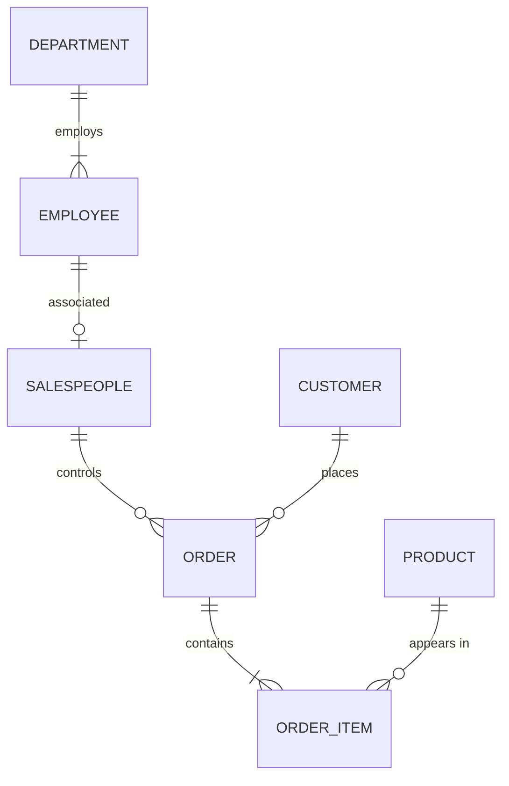

# INFO90002 Week 2 - Conceptual Modelling: the Entity-Relationship Model

来源：`lecture/INFO90002_Week2-1_DataModelIntro.pdf`、`lecture/INFO90002_Week3-2_ToyLibraryExplanation.pdf`、`lecture/Week2_slide20_solution.jpg`、`lecture/Week2_Slides30-31_SelectedSolns.jpg`、`lecture/Library_BookVsCopies.jpg`；`tutorial/Week2_Tute_Modelling with MySQL Workbench.pdf`、`tutorial/Week3_Tute_Logical and Physical Modelling.pdf`；Apple Notes：CS/25S1/DB — "FE - ER Model"。

这篇讲的是：**拿到一段业务描述，怎样画出一张能表达业务规则的实体-联系图（ERD）？**

学习路线：[ER 模型是什么](#topic-1) → [实体、属性与标识符](#topic-2) → [联系：连接性与基数](#topic-3) → [外键、强实体与弱实体](#topic-4) → [消解多对多](#topic-5) → [建模步骤与 Toy Library 案例](#topic-6)。

重点：鸦脚符号（Crow's foot）读法、弱实体与 PFK、多对多的消解。难点：连接性（connectivity）与基数（cardinality）的区别；判断标识符是否真的唯一。易错：外键放错一侧、把可能为空的列放进主键。

截图编号是 PDF 页码：W2-1 是 Week 2 讲义，W3-2 是 Toy Library 补充讲解。三张讲师手写答案照片的文件名沿用旧版页码：slide 20 对应本版第 18、21 页的练习，slides 30–31 对应本版第 31–32 页。

## 1. 数据模型与 ER 模型

### 为什么先建模

数据建模（data modelling）是为某个问题领域构造数据模型的过程，是迭代、逐步细化的。数据模型是对复杂现实数据结构的简化表示，也是沟通工具：程序员、经理、终端用户看数据的角度不同，但有了一份好的数据库蓝图，这些差异就不影响设计。
<!-- Sources: W2-1 p.4 -->

在 [01 的开发生命周期](01-introduction.md#topic-5) 里，这一讲做的是 Database Design 框中的第一步：概念设计。

### ER 模型是“计划”，不存数据

- ER 模型（Entity-Relationship model）是一份计划，本身不存任何数据；
- ER 图（ERD）是 ER 模型的图形表示；
- 它用实体表示人、物、事件等，用联系表示实体之间的关联；
- 一切围绕组织的业务规则（business rules）：例如“每学期一个学生最多选 5 门课”就是一条要在模型里体现的约束。
<!-- Sources: W2-1 p.6, p.15; Apple Notes FE - ER Model -->

页面最后用红字标出的 integrity constraints（完整性约束），就是业务规则落到数据库里的样子。业务规则因组织而异：墨尔本大学的成绩只能是 H1、H2A、H2B、H3、P、N、NH，别的大学可能是 HD、D、C、P、N。ERD 必须符合 **这个** 组织的规则。
<!-- Sources: W2-1 p.8, p.15 -->

## 2. 实体、属性与标识符

### 实体

实体（entity）是能与其他对象区分开的现实对象，用一组属性描述。ERD 里的实体指的是 **实体集**（例如所有学生），对应关系数据库中的一张表，而不是一行。Chen 记法和鸦脚记法都用矩形画实体。
<!-- Sources: W2-1 p.7 -->

对比下方两种画法：左边 Chen 记法把 `STUDENT` 画成矩形，属性画成一圈椭圆；右边鸦脚记法把属性直接列在矩形里。本课以后都用鸦脚记法。

### 属性的几种分类

看右上的 `CAR`：`CarVIN` 带下划线，是标识符；`Make`、`Model` 是单值属性；`carColor` 的椭圆是双线框，表示多值属性——一辆车可以有车身、车顶、饰条三种颜色。

| 分类 | 说明 | 例子 |
| --- | --- | --- |
| 域（domain） | 属性允许取值的集合，由业务规则决定；不同属性可以共享域 | 分数在 0 到 100 之间；员工和客户电话遵守同一格式 |
| 必填 / 可选（required / optional） | 必填属性不能为 `NULL`；可选属性可留空 | Workbench 中实心菱形为必填，空心菱形为可选 |
| 单值 / 多值（single / multi-valued） | 多值属性一行可有多个值 | 车的颜色可以有车身、车顶、饰条三种 |
| 简单 / 复合（simple / composite） | 复合属性可再拆分 | 地址拆成门牌号、街道、城市、州、邮编、国家 |
| 派生（derived） | 可由其他属性或函数算出 | 年龄由出生日期和 `CURDATE()` 算出 |
<!-- Sources: W2-1 p.8-10, p.12; Apple Notes FE - ER Model -->

这一页是 Workbench 里的写法，Tutorial 2 就用它画图。看左下的示例实体：黄色钥匙是标识符（两把钥匙表示两个部分标识符合起来才唯一），蓝色实心菱形是必填，空心菱形是可选，后面几行演示了派生、多值、复合属性的括号写法。

属性名不能有空格，用字母、数字、下划线或驼峰命名（CamelCase）。Workbench 概念图里用 `[Age]` 标派生、`{CarColour}` 标多值、`Name (First, Middle, Last)` 标复合。多值属性到逻辑设计时必须“摊平”，例如拆成 `carBodyColor`、`carRoofColor`、`carTrimColor`；但如果值的个数无法预知（例如员工的资格证书），拆成固定几列就不合适，应考虑另建实体。
<!-- Sources: W2-1 p.8-9, p.12; W3-1 p.24 -->

### 标识符（主键）

标识符（identifier）是能唯一识别实体一个实例的属性（或属性组合），也就是主键（primary key, PK）。规则：

- 每个实体都必须有标识符；
- 每个实例的标识符唯一，不能重复；
- 标识符的值不能为空（`NULL`）。

Chen 记法用下划线标识符；鸦脚记法标 `PK`。
<!-- Sources: W2-1 p.11; Apple Notes FE - ER Model -->

“不能为空”这一条在 [第 6 节](#topic-6) 的 Toy Library 案例里会直接决定主键怎么选。

## 3. 联系：连接性与基数

### 联系与联系集

联系（relationship）是两个或多个实体之间的关联，例如“John 下了一张比萨订单”；同类联系的集合叫联系集（relationship set），例如“顾客下订单”。参与联系的实体叫参与者（participants）。联系总是双向可读：顾客下订单；订单属于顾客。
<!-- Sources: W2-1 p.13; Apple Notes FE - ER Model -->

页面问“What notation is used here?”：菱形 `places` 是 Chen 记法里的联系集，带下划线的 `cID`、`orderID` 是两边的标识符。

### 连接性和基数不是一回事

**难点：**

- **连接性（connectivity）** 说的是联系的类型：1:1、1:M、M:N；
- **基数（cardinality）** 说的是具体的最小值和最大值：一个顾客可以下 0 到多张订单；一张订单必须且只能属于 1 个顾客；一个信用卡账户最少 1 张、最多 2 张卡（写作 `1..2`）。
<!-- Sources: W2-1 p.14, p.20; Apple Notes FE - ER Model -->

每个椭圆是一个实体集，里面的点是实例，连线表示哪些实例相关。左边多对多：两边的点都连出不止一条线；中间一对多：左边一个点连右边多个点，但右边每个点只连一条；右边一对一：每个点最多一条线。底部提醒：这些图 **不表达基数**。

上图三行分别是多对多（学生选科目）、一对多（顾客下订单）、一对一（学校由一位校长领导）。看线的两端：带“鸦脚”（三叉）的一端表示“多”，单竖线一端表示“一”。注意这张图只表达连接性，还没表达基数。
<!-- Sources: W2-1 p.16-17 -->

### 参与：可选与必选

右侧四个符号要成对读：靠近实体的符号表示最大值（竖线 = 一，鸦脚 = 多），离实体远一点的符号表示最小值（圆圈 = 0，即可选；竖线 = 1，即必选）。所以从上到下依次是 0 到多、1 到多、0 或 1、恰好 1；最小值为 0 叫部分参与（partial participation），最小值为 1 叫完全参与（total participation）。
<!-- Sources: W2-1 p.19; Apple Notes FE - ER Model -->

- 可选（optional）：一个实例不要求有对应实例。例如顾客“可以”下多张订单，即 0 张也行；
- 必选（mandatory）：一个实例必须有对应实例。例如每张订单必须属于一个顾客。

**重点：** 父实体那一端的最小值决定了外键能不能为空。顾客端的符号是“恰好 1”（每张订单恰好属于一位顾客），订单里的 `customerID` 就不能为 `NULL`；如果顾客端是“0 或 1”，这个外键允许为空（外键见 [第 4 节](#topic-4)）。

**补充：** 课件追问“每个顾客至少要下一张订单”能否实现：顾客记录在第一张订单之前就要建立，所以这种双向必选在数据库里很难直接实现。
<!-- Sources: W2-1 p.19 -->

### 用 (min, max) 写基数

有些记法把基数写成数字对 (x, y)：前一个是最小值，后一个是最大值。图中 `CLASS` 旁边的 (1,4) 表示一位教授教 1 到 4 门课；`PROFESSOR` 旁边的 (1,1) 表示每门课恰好由一位教授讲授。**易错：** 数字写在“被数的那一方”旁边，读的时候从对面的一个实例出发。右上角说明本课的答案不写数字对，只用鸦脚符号表达。

#### 课堂练习：从业务句子到鸦脚

课上练习“一个部门雇用多名员工，一名员工只属于一个部门；一位顾客可下多张订单，每张订单只属于一位顾客；一张订单含多种产品，一种产品可出现在多张订单中”。讲师手写答案中：部门–员工、顾客–订单都是一对多；订单–产品先画成多对多，再用一个订单明细实体拆开（见[第 5 节](#topic-5)）。
<!-- Sources: W2-1 p.18, p.21; lecture/Week2_slide20_solution.jpg -->

照片从上往下读：

- `Department` 与 `Employee`（employs）：部门端恰好 1，员工端 1 到多；
- `Employee` 与 `Salespeople`（associated）：销售员也是员工，每个销售员恰好对应一名员工，一名员工可以是也可以不是销售员；
- `Salespeople` 与 `Order`（control）、`Customer` 与 `Order`（places）：都是“一”端恰好 1、订单端 0 到多；
- `Order` 与 `Product` 的 contains 线被涂掉了：多对多不能保留，换成 `OrderItem`，订单端恰好 1、明细端 1 到多，明细与产品之间产品端恰好 1、明细端 0 到多。

下面是照片的整理版：

## 4. 外键、强实体与弱实体

### 外键总是放在“多”的一侧

看两个红圈：左边 `Customer` 表的 Customer ID 是主键；右边 `Order` 表也有一列 Customer ID，订单 3224、3236、3248 都指向 C2045，蓝色箭头把它们连回顾客。这一列就是外键。

要表示订单属于哪个顾客，就把 `customerID` 放进 `Order`，成为 `Order` 的外键（foreign key, FK）。外键是引用另一个实体主键的属性，用来把两个实体连起来。**一对多时，外键放在“多”的一侧**：一个顾客对应多张订单，所以外键在订单里。反过来把订单号放进顾客表，就会出现一格多值。
<!-- Sources: W2-1 p.22-23; Apple Notes FE - ER Model -->

页面最后问图中的基数是否合理。顾客端是“恰好 1”，订单端是竖线加鸦脚，即“1 到多”：每个顾客至少要有一张订单。这正是上一节第 19 页说的难以实现的双向必选，通常应把订单端改成圆圈加鸦脚（0 到多）。

### 强实体与非标识联系

强实体（strong entity）独立于其他实体存在，能用自己的属性组成唯一标识符，例如部门、员工、学生、科目。两个强实体之间是 **非标识联系（non-identifying relationship）**，鸦脚图里画 **虚线**。
<!-- Sources: W2-1 p.24; Apple Notes FE - ER Model -->

右下两张小图都是虚线：上面订单端为 1 到多，下面为 0 到多，正好可以用来对照上一页的问题。`Order` 有自己的 `OrderID`，`CustomerID` 只是普通 `FK`，不是主键的一部分。

### 弱实体与 PFK

弱实体（weak entity）同时满足两个条件：

1. 离开与它有联系的那个实体就不能存在；
2. 它的唯一标识符部分或全部来自父实体。

弱实体和父实体之间是 **标识联系（identifying relationship）**，画 **实线**；弱实体在这个联系中必须是完全参与，通常是一个父实体对多个弱实体。
<!-- Sources: W2-1 p.25; Apple Notes FE - ER Model -->

看右边的 `Room`：`roomNo` 不能单独做标识符，因为不同楼里都有 4.05 号房。解决办法是从 `Building` 借来 `bCode`，用 `bCode + roomNo` 组成复合主键。借来的 `bCode` 既是主键的一部分，又是外键，所以标 **PFK（Primary Foreign Key）**：PK + FK = PFK。中间那条实线就是标识联系。弱实体本身也可以再做另一个弱实体的父实体。
<!-- Sources: W2-1 p.26-28; Apple Notes FE - ER Model -->

**易错：** 弱实体不等于“属性少的实体”。判断依据是“能否离开父实体存在”和“标识符是否借自父实体”。

#### 案例：电影院的放映厅（Tut W3）

教程案例里，连锁影院有多家影院，每家影院的放映厅从 1 开始编号。“3 号厅”在每家影院都有，所以放映厅单靠厅号无法识别，要借影院编号组成主键——这正是弱实体的信号。每个放映厅只放一台放映机，这是一个一对一联系，外键该放哪一侧见 [03](03-logical-physical-design.md#topic-3)。
<!-- Sources: Tut W3 p.1-2 -->

## 5. 消解多对多

### 为什么多对多必须拆开

图中 `contains` 两端都是鸦脚：订单端是圆圈加鸦脚（一种比萨可以出现在 0 到多张订单里），比萨端是竖线加鸦脚（一张订单至少含一种比萨）。

一张订单可含多种比萨，一种比萨可出现在多张订单中，这是 M:N。概念模型里可以这样画，但逻辑模型和物理模型都不能表示 M:N，数据库也无法直接实现；而且“订购数量”无处可放——它既不属于订单，也不属于比萨。
<!-- Sources: W2-1 p.29; Apple Notes FE - ER Model -->

从上往下看三步：

1. 把一条 M:N 换成两条 1:M；
2. 中间插入一个弱实体 `OrderItem`，从两边各借一个主键，成为两个 PFK（`OrderID`、`PizzaCode`）；
3. 判断这个弱实体有没有自己的属性——这里 `Quantity` 正好放在 `OrderItem` 里。
<!-- Sources: W2-1 p.30 -->

**重点：** 描述“某个组合”的属性都放进这个关联实体。数量描述的是“某订单里的某种比萨”；同理，学生选课的成绩描述的是“某学生在某科目”，放在 `Student` 或 `Subject` 任一边都会一格多值。

### 父实体本身是弱实体

**补充：父实体可以本身是弱实体。** 课上的设备分配练习中，`Room`（主键 `bCode + roomNo`）和 `Equipment` 是 M:N，用 `AssignedEquipment` 消解。讲师手写答案里 `AssignedEquipment` 的 PFK 有三个：`SerialNo` 来自设备，`bCode` 和 `RoomNo` 都来自房间——`bCode` 是经由 `Room` 间接借来的。
<!-- Sources: W2-1 p.31; lecture/Week2_Slides30-31_SelectedSolns.jpg -->

第 31 页的云朵问“What makes PK?”，照片最上面一张图手写补上了这三个 PFK。照片下面两张图是第 32 页练习“哪个是弱实体”的答案：

- A 与 B 之间是实线，B 在“多”的一端，于是 B 借来 `aID`，标 PFK——B 是弱实体；
- A–B–C 三个实体时，B 同时在两条实线的“多”端，就从两边各借一个键，`aID` 和 `cID` 都是 B 的 PFK。

判断方法和 `Room` 一样：看线是不是实线（标识联系），再看谁在“多”的一端。

### 书和书的副本（讲师手写例子）

讲师手写的图书馆例子里，`Book`（主键 ISBN）和 `BookCopy` 分开：同一本书可以有多个实体副本，副本用 `CopyNo + ISBN` 识别，ISBN 是借来的 PFK，所以 `BookCopy` 是 `Book` 的弱实体；作者与书是多对多，用 `AuthoredBook(AuthorID, ISBN)` 两个 PFK 消解。
<!-- Sources: lecture/Library_BookVsCopies.jpg -->

照片里两种结构各出现一次：左边 `Author`–`AuthoredBook`–`Book` 是消解多对多（两端都是“恰好 1”，中间两端都是鸦脚）；右下 `Book`–`BookCopy` 是一对多的弱实体，副本端画成圆圈加鸦脚，表示一本书可以暂时没有副本。

## 6. 建模步骤与 Toy Library 案例

### 画 ERD 的八个步骤

八步可以归成四轮：

1. 找实体并画出来（第 1–2 步），再找它们之间的联系（第 3 步）；
2. 给每个实体加属性并定主键（第 4 步）；
3. 逐对确定连接性，再确定最小与最大参与（第 5–6 步）；
4. 找弱实体、消解 M:N，必要时回头改连接性和基数，最后逐项对照业务规则检查（第 7–8 步）。
<!-- Sources: W2-1 p.33 -->

这是一个迭代过程：第 7 步插入关联实体后，第 5–6 步画的符号往往要跟着改。

### 设计选择

ER 设计带主观性，同一场景常有多种合理模型。起点可以用 **名词-动词分析（noun-verb analysis）**：名词候选为实体或属性，动词候选为联系。常见取舍：

- 实体还是属性？“地址”如果每位顾客有多个（送货、账单、邮寄），或者其结构（城市、街道）很重要，就应建成实体；
- 联系是一元、二元、三元还是 n 元（见 [03 逻辑与物理设计](03-logical-physical-design.md#topic-4)）。
<!-- Sources: W2-1 p.34-36 -->

实体也有好坏之分：好的实体有很多实例、由多个属性组成、是系统运行所需的对象（人、地点、物品、事件、概念）。**系统的用户、系统的输出（报表）、系统整体都不是实体**——例如诊所数据库里“诊所本身”和“录入数据的前台”通常都不建成实体。
<!-- Sources: W3-1 p.3 -->

### Toy Library：从叙述到 ERD

叙述里的粗体词就是名词-动词分析的候选。第 38 页让大家把每个词归为强实体、弱实体、属性、可计算或忽略；按上面的规则可以这样想：

- “社区玩具图书馆”是系统本身，忽略；
- 会员（Member）和玩具（Toy）各有很多实例和自己的编号，是强实体；姓名、邮箱、描述、购入年份是它们的属性；
- 动词“借出”连接会员和玩具，一个会员会借多件玩具，一件玩具也会被多人借，是 M:N，于是需要一个借阅实体；借出日期、归还日期是每次借阅的属性；
- 借了几天可以由两个日期算出，是派生属性，不必存储。

W3-2 第 2 页给出了对应的概念模型：`Member` 和 `Toy` 之间插入 `Loan`，两端都是可选参与（会员可以还没借过东西，玩具也可以从没被借过）；`Loan` 的 `MemberNo`、`ToyNo` 都是 PFK。图里也没有借阅天数这一列。

### 用样例数据检验标识符

三页按尝试顺序排列：

- **第 4 页**：主键只有 `MemberNo, ToyNo` 时，会员 131 在 6 月和 7 月两次借 19 号玩具，红圈标出主键重复；
- **第 5 页**：把 `DateBorrowed` 加进主键，再用一组样例行检验——每次借出日期不同，可以区分；
- **第 7 页**：再把 `DateReturned` 也加进主键时，最后一行还没归还，这一格是空的，红色虚线圈标出它违反“主键不能为空”。这一页的表格排版错位：`ToyNo` 的数值（81、19、19）被挤到了 `DateBorrowed` 一栏下面，读的时候要对回原列。

结论：`Loan` 的主键取 `MemberNo, ToyNo, DateBorrowed`，`DateReturned` 留作可以为空的普通属性。
<!-- Sources: W3-2 p.2-7 -->

**易错：** 设计完主键后，编几行样例数据试一试，是发现“看似唯一其实不唯一”最快的方法。

## 本讲自测

1. “一名医生每天可以看 0 到多名病人；每次就诊必须对应一名医生和一名病人。”画出鸦脚图，并说明外键放在哪个实体里。
2. 公寓楼里每套公寓用楼号和门牌号识别。`Apartment` 是弱实体吗？它的主键怎么写，哪些列标 PFK？
3. 学生选课是 M:N，成绩应该放在哪里？画出消解后的三个实体，并标出每一列是 PK、FK 还是 PFK。
4. 有人把 `Loan` 的主键定为 `MemberNo, ToyNo, DateBorrowed, DateReturned`。编一行样例数据说明问题。
