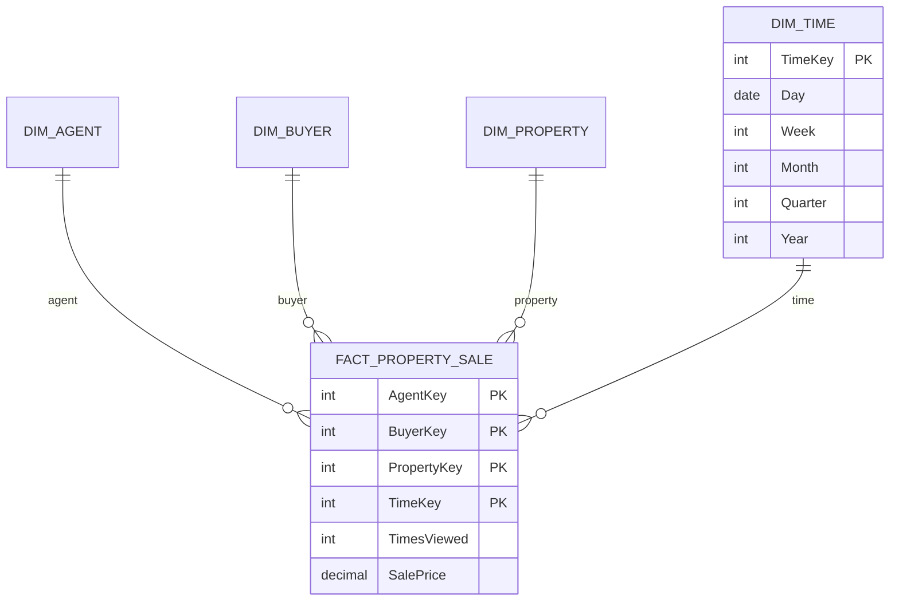

# INFO90002 Week 9 - Data Warehousing and Dimensional Modelling

Sources: `lecture/INFO90002_Week9-1_DW.pdf`; `tutorial/Week10_Tute_DW.pdf`, `tutorial/Week10_Tute_DW_Solutions.pdf`; Apple Notes: CS/25S1/DB — "FE - Data Warehouse".

This lecture asks: **everyday business databases are good at bookkeeping but poor at answering analytical questions such as "which kind of customer is most profitable?". How does a data warehouse organise data to support decisions, and how is a star schema designed?**

Learning path: [Transactional and informational databases](#topic-1) → [Characteristics and architecture of a data warehouse](#topic-2) → [Dimensional modelling: fact tables, dimension tables and the star schema](#topic-3) → [Granularity and design steps](#topic-4).

Key points: OLTP versus OLAP; splitting facts from dimensions in a star schema. Hard parts: choosing the grain; the fact table's primary key is made of dimension foreign keys. Common mistakes: a data warehouse is denormalised and read-only; it is not designed to 3NF.

## 1. Transactional and informational databases

### What a manager wants to know

The six bubbles are questions a manager asks: which customers have the highest or lowest margins, which promotions have the biggest impact on revenue, which customers are most likely to go to the competition… The blue "BUT HOW?" at bottom right is the starting point of the whole lecture: the data for these questions is in the company's operational databases, yet it is hard to answer them directly from there.

### OLTP: running the daily business

Relational databases were first used to automate routine business processes: accounting, inventory, purchasing, sales, creating huge efficiencies. **OLTP (OnLine Transaction Processing)** supports daily, repetitive operations: a collection of read and write operations processed as one unit, reliably and efficiently, with no data lost to interference or failures.
<!-- Sources: W9-1 p.4-5; Apple Notes FE - Data Warehouse -->

OLTP data is transaction oriented (many inserts, updates, deletes); may be inconsistent and incomplete (different date formats, online customers entering wrong details); volatile; and reflects only "today's" state of the business.
<!-- Sources: W9-1 p.6 -->

### The trouble with too many databases

Every department wanted its own database and chose the product that suited it best (IBM, Oracle, Access, Microsoft), which re-created the very problems databases were meant to solve: duplicated, inaccessible and inconsistent data. Yet this data is valuable for analysis and decisions. The answer is an **informational database**: a central repository holding the whole organisation's data, optimised for decision making, populated from operational databases and external sources, with the data integrated and transformed into a **Single Point of Truth (SPOT)**.
<!-- Sources: W9-1 p.7-8 -->

### OLTP versus OLAP

**OLAP (Online Analytical Processing)** is purpose-built for analytical queries: fewer but more complex queries, mostly `SELECT` and aggregates. OLTP and OLAP complement each other.
<!-- Sources: W9-1 p.9 -->

**Key point:** be able to walk through this comparison table row by row. The left column is the characteristic, the middle is transactional (OLTP), the right is informational (OLAP, the data warehouse):

- primary purpose: run the day-to-day business ↔ support decision making;
- type of data: current data representing the state of the business ↔ historical data, snapshots and predictions;
- primary users: thousands or millions of customers and clerks ↔ hundreds of managers and analysts;
- scope of usage: narrow, planned, fixed interfaces, stressing fast processing and integrity with many users ↔ broad, ad hoc, complex interfaces, stressing response time for complex queries over lots of history;
- design goal: performance and availability, **data stored in 3NF** ↔ flexible use and data accessibility, **data denormalised to improve query performance**;
- volume: many constant updates and queries on a few tables or rows ↔ periodic batch updates, complex queries over many or all rows.
<!-- Sources: W9-1 p.11; Apple Notes FE - Data Warehouse -->

#### How the two kinds of question differ

A customer-service question: "I forgot my membership card, what is my membership number?" The SQL in the cloud looks up one row in `MEMBER_INDEX` by phone number. The bottom of the page counts 1 table and 1 row (with an index).

A marketing question: "How many customers bought more than $500 of alcohol in our Melbourne stores this year?" All six tables carry a blue star, with row counts beside them: 150 stores, over a million store visits, over 48 million item scans, over 5 million members, over 400 thousand item descriptions, nearly ten thousand subcategories. One question joins 6 tables and scans millions of rows.
<!-- Sources: W9-1 p.12-13 -->

Managers care about numeric aggregations (how many, average, total cost) and dimensions (sales by state by customer type, sales by product by store by quarter), and a data warehouse is built to answer exactly these.
<!-- Sources: W9-1 p.14 -->

## 2. Characteristics and architecture of a data warehouse

A **data warehouse** is a single repository of an organisation's historical data: it integrates data from several sources (extracted, transformed, loaded into the warehouse) for managers and users to analyse and decide on; it is **read only** and often holds terabytes, petabytes or even exabytes.
<!-- Sources: W9-1 p.10 -->

| Characteristic | Meaning |
| --- | --- |
| Subject oriented | Organised around subjects such as sales, customers, products, not around applications |
| Validated, integrated | Data from different systems converted to a common format and validated before loading, so it can be compared and combined |
| Time variant | Holds historical data as a series of time-stamped "snapshots", supporting trend analysis |
| Non-volatile | Read-only for users; all updating is done automatically by ETL or periodically by a DBA |
<!-- Sources: W9-1 p.15-16; Apple Notes FE - Data Warehouse -->

Data must be cleaned before loading: **incomplete errors** (missing fields; some information is not recorded by design, e.g. the type of buyer is not recorded when a street magazine is sold) and **incorrect errors** (wrong data entered in the source system; manual entry always has some percentage of mistakes).
<!-- Sources: W9-1 p.15 -->

Read the four red column headings from left to right: data from internal source systems (CRM, sales, production, HR, finance) and external sources (stock market, currency, ABS, news) is **extracted** into a staging area; there it is **transformed**: cleaned, derived, matched, combined, de-duplicated, standardised; then **loaded** into the green enterprise data warehouse in the centre and further into the coloured data marts below it; the far right lists the consumers: ad hoc querying, dashboards, scorecards, report writers, data mining, visualisation tools. ETL is the name for these three steps together.
<!-- Sources: W9-1 p.16-17 -->

The figure on the right draws the same idea more concretely: internal databases (marketing, sales, inventory, billing) and external databases pass through ETL into the data warehouse in the middle, which feeds, again through ETL, three data marts for marketing, sales and inventory.

- **Data mart**: a subset of the data warehouse's information, usually for one department;
- **Data mining**: applying algorithms to data to uncover patterns and relationships that are otherwise hard to see.
<!-- Sources: W9-1 p.18 -->

## 3. Dimensional modelling: fact tables, dimension tables and the star schema

### Facts and dimensions

Dimensional modelling, popularised by Ralph Kimball in the 1990s, is based on the multi-dimensional model of data and designed for retrieval-only databases. It is simple and intuitive, also called **star schema** design. It consists of one fact table, several dimension tables and (sometimes) hierarchies within dimensions; in essence it is a simple, restricted kind of ER model.
<!-- Sources: W9-1 p.21; Apple Notes FE - Data Warehouse -->

When you take an analytical question apart, "what is measured" is the fact and "what it is viewed by" are the dimensions. The red circles on the page already mark them: "how much revenue did product G generate in the last three months, broken down by month, by the south-eastern sales region, by store, by promotion": revenue is the fact; product, time, region, store and promotion are dimensions. The bottom of the page shows the same split on a short question: revenue per product per promotion per location.
<!-- Sources: W9-1 p.22 -->

On the first page the braces split the `Sale` table into two groups: four underlined "keys" at the top (time, store, customer, product) and two "facts" below (dollar sales, unit sales). The second page shows a few rows of real data: each row is four dimension IDs plus two numbers. The blue text stresses that **granularity** is a key issue, discussed in [Section 4](#topic-4).

| | Fact table | Dimension table |
| --- | --- | --- |
| Holds | Business measures (facts), usually additive numbers such as dollar sales and unit sales | Description and context: time, customer, product, location |
| Keys | Foreign keys to each dimension, which together form the primary key | Its own dimension key |
| Shape | Many rows, few columns | Relatively few rows, many descriptive columns |
<!-- Sources: W9-1 p.24-25; Tut W10 Sol p.1-2; Apple Notes FE - Data Warehouse -->

### The star schema

The blue `Sale` in the middle is the fact table: four keys (time, store, customer, product) plus two facts (`Dollar sales`, `Unit sales`); the four grey tables around it are dimension tables, labelled Dimension 1–4 in red. The lines radiate from the centre like a star, which gives the schema its name.
<!-- Sources: W9-1 p.26 -->

Drawn as an ER model, the fact table is an **intersection table** (the box at bottom right): its four keys are all marked PFK, and each line is "one and only one" on the dimension side and "many" on the fact side. This is the same structure as the associative entity that resolves a many-to-many in [02](02-conceptual-er-modelling.en.md#topic-5).
<!-- Sources: W9-1 p.29 -->

### Hierarchies in dimensions

In the `Product` dimension, name → type → group is a hierarchy, with the example hammer → tool → hardware. The data table on the second page makes the hierarchy visible: P10 Hammer and P56 Nails both belong to the Hardware group, but to different subgroups (Tool, Nails).

Dimension tables often contain hierarchies: sequences of attributes of the same dimension at different levels of detail. For example product: name (hammer) → type (tool) → group (hardware); time: day → week → month → quarter → year; location: city → state → country. Hierarchies let you select and summarise data at the level of detail needed ("slice and dice").
<!-- Sources: W9-1 p.27-28, p.31-32; Tut W10 Sol p.1-2 -->

On the right are all the columns of a customer dimension; on the left they are drawn out as three hierarchies: green market segment (sector → segment), blue industry (group → sector → class), and yellow location (country → state → city). In a star schema all three are "embedded" in the single `Customer` table.

Splitting a dimension's hierarchies into separate tables gives a **snowflake schema**: around the yellow fact table in the middle, the customer dimension branches into a chain of small tables for industry, market and city–state–country, and product, date and store branch out too, like a snowflake.
<!-- Sources: W9-1 p.33; Tut W10 Sol p.2 -->

### Normalise or denormalise

| Normalised | Denormalised |
| --- | --- |
| Eliminates redundancy | Fewer tables (fewer joins) |
| Storage efficiency | Fast querying |
| Referential integrity | Design tuned for end-user analysis |
<!-- Sources: W9-1 p.34 -->

A data warehouse chooses denormalisation: for example the product dimension in the Tut W10 solution keeps a transitive dependency such as `WineryName → WineryCity`, because a warehouse is read-only and batch-loaded, so update anomalies cannot arise, while queries are dominated by large aggregations, where fewer joins matter more than saving space. OLTP, by contrast, has many concurrent updates, and redundancy causes the update anomalies covered in [04](04-normalisation.en.md).
<!-- Sources: Tut W10 Sol p.7; Tut W12 Sol p.4 -->

## 4. Granularity and design steps

### Granularity

**Granularity (grain)** is the level of detail of the fact table, determined by the finest level of each dimension. A fact table can hold one row per business event (e.g. one row per sale line) or summarise many events into one row (one row per hour or per day). The finer the grain, the more precise the questions it can answer.
<!-- Sources: W9-1 p.25; Tut W10 Sol p.2; Apple Notes FE - Data Warehouse -->

#### Illustrative example: one data set, two grains (adapted from Tut W10)

The fact table's dimensions are time, region and product. The source has 5 sale lines: on one day, Melbourne has two sales of the same product at different times and one of a different product, Sydney has one, and Melbourne has another on the next day.

| Grain | Fact rows | Why |
| --- | --- | --- |
| Hourly | 5 | No two lines share the same hour, region and product, so none can be merged |
| Daily | 4 | The two same-day, same-region, same-product sales merge into one row (sales and quantity added); different products or regions cannot merge |
<!-- Sources: Tut W10 Sol p.5-6 -->

The daily table no longer keeps the hour, so it cannot answer "sales per hour"; the hourly table can answer per hour and can also `GROUP BY` the 24 hours into a day at query time. **A fine grain can be rolled up; a coarse grain cannot be broken down.**
<!-- Sources: Tut W10 Sol p.6 -->

### Steps for designing a dimensional model

1. Choose a business process (e.g. product sales);
2. choose the measured facts (usually numeric, additive quantities);
3. choose the granularity of the fact table;
4. choose the dimensions;
5. complete the dimension tables.
<!-- Sources: W9-1 p.30 -->

The tutorial compresses this into Kimball's four steps: select the business process, declare the grain, identify the dimensions, identify the facts. Facts need not all be additive: the "discounted or not" flag in the tutorial example is a **non-additive fact**.
<!-- Sources: Tut W10 Sol p.4-5 -->

#### Lecture exercise: a star schema for a real-estate agency

Read the task through the five steps: the business process is property sales; the measures in bold are "the number of times a property is viewed" and "sales price"; the views are by agent, buyer, property and time (day, week, month, quarter, year). One design follows (illustrative example (our own), not the slides' model answer):

<!-- Sources: W9-1 p.35 -->

The fact table's four keys are all PFKs to the dimensions; `TimesViewed` and `SalePrice` are the facts; day–week–month–quarter–year in the time dimension is a hierarchy. The agent dimension holds licence number, name and phone; the buyer dimension holds buyer ID, name and phone; the property dimension holds property number, address and listed price.

## Self-check

1. Does each need suit OLTP or a data warehouse: a customer order reducing stock; comparing quarterly sales trends by state over five years; a cashier looking up an item's current price?
2. A gym chain wants to analyse "class attendance and revenue by branch, membership type and month". Name the facts, dimensions and a sensible grain.
3. Why can a data warehouse accept the redundancy of denormalisation, while an OLTP database is usually normalised to 3NF?
4. With a monthly grain, a manager asks "do more people attend on Mondays or Saturdays?". Can you answer? Why?
