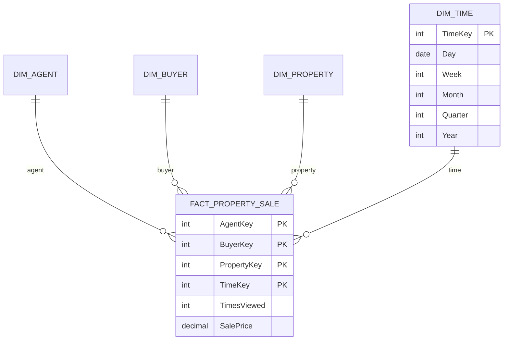

# INFO90002 Week 9 - Data Warehousing and Dimensional Modelling

来源：`lecture/INFO90002_Week9-1_DW.pdf`；`tutorial/Week10_Tute_DW.pdf`、`tutorial/Week10_Tute_DW_Solutions.pdf`；Apple Notes：CS/25S1/DB — "FE - Data Warehouse"。

这篇讲的是：**日常业务数据库擅长记账，却不擅长回答“哪类客户利润最高”这类分析问题。数据仓库怎样组织数据来支持决策？星型模式怎么设计？**

学习路线：[事务型与信息型数据库](#topic-1) → [数据仓库的特征与体系结构](#topic-2) → [维度建模：事实表、维度表与星型模式](#topic-3) → [粒度与设计步骤](#topic-4)。

重点：OLTP 与 OLAP 的对比；星型模式中事实与维度的划分。难点：选择粒度；事实表的主键由维度外键组成。易错：数据仓库是去规范化的、只读的，不按 3NF 设计。

## 1. 事务型与信息型数据库

### 经理想知道的问题

六个气泡都是经理会问的问题：哪些客户利润率最高或最低、哪种促销对收入影响最大、哪些客户最可能流失到竞争对手……右下角的蓝字 “BUT HOW?” 是整讲的出发点：这些问题的数据都在公司的业务数据库里，却很难直接从那里回答。

### OLTP：跑日常业务

关系数据库最早用于自动化例行业务流程：会计、库存、采购、销售，带来巨大效率。**OLTP（OnLine Transaction Processing，联机事务处理）** 支持日常、重复的操作：一组读写操作作为一个单元，可靠、高效地处理，不因干扰或故障丢数据。
<!-- Sources: W9-1 p.4-5; Apple Notes FE - Data Warehouse -->

OLTP 数据的特点：面向事务（大量插入、更新、删除）；可能不一致、不完整（日期格式不统一、在线客户填错信息）；易变；只反映“今天”的业务状态。
<!-- Sources: W9-1 p.6 -->

### 数据库太多带来的问题

每个部门都想要自己的数据库，各自选了最适合自己的产品（IBM、Oracle、Access、Microsoft），结果又回到了数据库本来要解决的问题：数据重复、难以访问、彼此不一致。可是这些数据对分析和决策很有用。解决办法是建一个 **信息型数据库**：一个集中存放全组织数据、为决策优化的仓库，由各业务数据库和外部数据源填充，数据经过整合和转换，成为数据的 **单一事实来源（Single Point of Truth, SPOT）**。
<!-- Sources: W9-1 p.7-8 -->

### OLTP 与 OLAP 对比

**OLAP（Online Analytical Processing，联机分析处理）** 专为分析查询优化，处理的查询更少但更复杂，以 `SELECT` 和聚合为主。OLTP 和 OLAP 互为补充。
<!-- Sources: W9-1 p.9 -->

**重点：** 这张对照表要能逐行说出来。左列是特征，中间是事务型（OLTP），右边是信息型（OLAP，数据仓库）：

- 主要目的：运行日常业务 ↔ 支持决策；
- 数据类型：当前数据，反映业务现状 ↔ 历史数据：快照与预测；
- 主要用户：成千上万甚至数百万的客户和职员 ↔ 几百位经理和分析师；
- 使用范围：窄而固定的界面，强调快速处理和多用户环境下的完整性 ↔ 广泛、临时、复杂的界面，强调对大量历史数据复杂查询的响应时间；
- 设计目标：性能与可用性，**数据按 3NF 存储** ↔ 灵活使用和数据可访问性，**数据去规范化以提高查询性能**；
- 数据量：对少数表、少数行的持续更新和查询 ↔ 定期批量更新，跨多张表或全部行的复杂查询。
<!-- Sources: W9-1 p.11; Apple Notes FE - Data Warehouse -->

#### 两类问题的差别

客服问题：“我忘带会员卡了，我的会员号是多少？”云朵里的 SQL 按电话号码在 `MEMBER_INDEX` 里查一行。页底数出：涉及 1 张表、1 行（有索引时）。

营销问题：“今年在墨尔本门店买酒超过 500 元的客户有多少？”六张表上都打了蓝星，旁边是各表行数：门店 150、到店记录一百多万、商品扫描四千八百多万、会员五百多万、商品描述四十多万、子类别近一万。一个问题要连接 6 张表、扫描几百万行。
<!-- Sources: W9-1 p.12-13 -->

经理关心的是数值汇总（多少、平均、总成本）和维度（按州按客户类型的销售额、按产品按门店按季度的销售额），数据仓库就是为回答这类问题而建。
<!-- Sources: W9-1 p.14 -->

## 2. 数据仓库的特征与体系结构

**数据仓库（data warehouse）** 是组织历史数据的单一存储库：整合多个来源的数据（抽取、转换、加载进仓库），供经理和用户分析、决策，**只读**，常有 TB、PB 乃至 EB 级的数据量。
<!-- Sources: W9-1 p.10 -->

| 特征 | 含义 |
| --- | --- |
| 面向主题（subject oriented） | 围绕销售、客户、产品等主题组织，而不是围绕应用 |
| 经过验证和整合（validated, integrated） | 不同系统的数据转换成统一格式，入库前验证，便于比较和合并 |
| 随时间变化（time variant） | 保存历史数据，由带时间戳的一系列“快照”组成，支持趋势分析 |
| 非易失（non-volatile） | 用户只读；更新全部由 ETL 过程自动完成，或由 DBA 定期执行 |
<!-- Sources: W9-1 p.15-16; Apple Notes FE - Data Warehouse -->

数据进仓库前要清洗：**不完整错误**（字段缺失；有些信息按设计根本没记录，例如街头杂志售卖时不记录买家类型）和 **不正确错误**（源系统里录入了错误数据，人工录入总会有一定比例出错）。
<!-- Sources: W9-1 p.15 -->

从左往右读四列红色标题：内部源系统（CRM、销售、生产、人事、财务）和外部来源（股市、汇率、统计局、新闻）的数据被 **抽取（Extract）** 到暂存区；在那里 **转换（Transform）**——清洗、派生、匹配、合并、去重、标准化；再 **加载（Load）** 到中心绿色的企业数据仓库，并继续加载到下方彩色的各个数据集市；最右边是使用者：即席查询、仪表盘、计分卡、报表、数据挖掘、可视化工具。ETL 就是这三步的合称。
<!-- Sources: W9-1 p.16-17 -->

右图把同一思路画得更具体：内部数据库（市场、销售、库存、账单）和外部数据库经 ETL 进入中间的数据仓库，再经 ETL 分出市场、销售、库存三个数据集市。

- **数据集市（data mart）**：数据仓库信息的一个子集，通常面向某个部门；
- **数据挖掘（data mining）**：对数据应用算法，发现难以直接看出的模式和关系。
<!-- Sources: W9-1 p.18 -->

## 3. 维度建模：事实表、维度表与星型模式

### 事实与维度

维度建模（dimensional modelling）由 Ralph Kimball 在 1990 年代推广，基于多维数据模型，专为只读检索设计，结构简单直观，也叫 **星型模式（star schema）** 设计。它由一张事实表、若干维度表、（有时）维度中的层次组成，本质上是一种简单而受限的 ER 模型。
<!-- Sources: W9-1 p.21; Apple Notes FE - Data Warehouse -->

拆分析问题时，“度量什么”是事实，“按什么来看”是维度。页上的红圈已经标好：“产品 G 最近三个月的收入，按月、按东南销售区、按门店、按促销拆开”——收入（revenue）是事实；产品、时间、地区、门店、促销是维度。页底再用一句简短的问题示范同样的拆法：每个产品、每次促销、每个地点的收入。
<!-- Sources: W9-1 p.22 -->

第一页的 `Sale` 表用大括号分成两组：上面四个带下划线的“键”（时间、门店、客户、产品），下面两个“事实”（销售额、销量）。第二页给出几行真实数据：每行就是四个维度编号加两个数值。蓝字强调 **粒度（granularity）** 是关键问题，[第 4 节](#topic-4) 专门讨论。

| | 事实表（fact table） | 维度表（dimension table） |
| --- | --- | --- |
| 存什么 | 业务度量（facts），通常是可加总的数值，例如销售额、销量 | 描述和上下文：时间、客户、产品、地点 |
| 键 | 指向各维度的外键；这些外键合起来组成主键 | 各自的维度键 |
| 形状 | 行很多、列很少 | 行相对少、描述性列多 |
<!-- Sources: W9-1 p.24-25; Tut W10 Sol p.1-2; Apple Notes FE - Data Warehouse -->

### 星型模式

中间蓝色的 `Sale` 是事实表：四个键（时间、门店、客户、产品）加两个事实（销售额 `Dollar sales`、销量 `Unit sales`）；四周灰色的是四个维度表，红字分别标为 Dimension 1–4。连线从中心向外辐射，像一颗星，这就是名字的由来。
<!-- Sources: W9-1 p.26 -->

画成 ER 模型时，事实表就是一个 **交叉表（intersection table）**（右下角方框）：它的四个键都标 PFK，每条线在维度一侧是“一且仅一”，在事实表一侧是“多”。这和 [02](02-conceptual-er-modelling.md#topic-5) 里消解多对多的关联实体是同一种结构。
<!-- Sources: W9-1 p.29 -->

### 维度中的层次

`Product` 维度里的 名称 → 类型 → 大类 是一条层次，例子是锤子 → 工具 → 五金。第二页的数据表把层次显示出来：P10 锤子和 P56 钉子同属 Hardware 组，但子组不同（Tool、Nails）。

维度表里常带层次（hierarchy）：同一维度在不同细节层次上的属性序列。例如产品：名称（锤子）→ 类型（工具）→ 大类（五金）；时间：日 → 周 → 月 → 季度 → 年；地点：城市 → 州 → 国家。层次用来在需要的细节层次上选择和汇总数据（“切片和切块”）。
<!-- Sources: W9-1 p.27-28, p.31-32; Tut W10 Sol p.1-2 -->

右边是一个客户维度的全部列，左边把这些列拆成三条层次：绿色的市场细分（市场大类 → 细分）、蓝色的行业（行业组 → 行业部门 → 行业类别）、黄色的地点（国家 → 州 → 城市）。在星型模式里，三条层次都“嵌入”在同一张 `Customer` 表中。

把维度中的层次拆成单独的表，就成了 **雪花模式（snowflake schema）**：中间黄色的事实表外，客户维度又分出行业、市场、城市—州—国家等一串小表，产品、日期、门店也各自分出枝杈，像雪花。
<!-- Sources: W9-1 p.33; Tut W10 Sol p.2 -->

### 规范化还是去规范化

| 规范化 | 去规范化 |
| --- | --- |
| 消除冗余 | 表更少（连接更少） |
| 存储高效 | 查询快 |
| 参照完整性 | 设计面向终端用户的分析 |
<!-- Sources: W9-1 p.34 -->

数据仓库选择去规范化：例如 Tut W10 答案中的产品维度保留了 `WineryName → WineryCity` 这样的传递依赖，因为数据仓库只读、批量加载，不会出现更新异常，而查询以大规模聚合为主，少连接比省空间更重要。OLTP 则有大量并发更新，冗余会造成 [04](04-normalisation.md) 讲的更新异常。
<!-- Sources: Tut W10 Sol p.7; Tut W12 Sol p.4 -->

## 4. 粒度与设计步骤

### 粒度

**粒度（granularity, grain）** 是事实表的细节层次，由各维度的最细层次决定。事实表可以每个业务事件一行（例如每笔销售明细一行），也可以把多个事件汇总成一行（每小时或每天一行）。粒度越细，能回答的问题越精确。
<!-- Sources: W9-1 p.25; Tut W10 Sol p.2; Apple Notes FE - Data Warehouse -->

#### 理解用例：同一批数据，不同粒度（改写自 Tut W10）

事实表维度为时间、地区、产品。源数据有 5 条销售明细：同一天里，墨尔本有两笔不同时间的销售买了同一产品，另有一笔是不同产品，悉尼有一笔，第二天墨尔本还有一笔。

| 粒度 | 事实表行数 | 原因 |
| --- | --- | --- |
| 按小时 | 5 | 没有两条明细同时具有相同的小时、地区和产品，无法合并 |
| 按天 | 4 | 同一天、同地区、同产品的两笔合并成一行（销售额和数量相加）；不同产品或不同地区的不能合并 |
<!-- Sources: Tut W10 Sol p.5-6 -->

按天粒度的表不再保存小时信息，所以回答不了“每小时销售”；按小时粒度的表则既能回答每小时、也能在查询时用 `GROUP BY` 把 24 个小时汇总成一天。**细粒度可以向上汇总，粗粒度无法向下拆分。**
<!-- Sources: Tut W10 Sol p.6 -->

### 设计维度模型的步骤

1. 选择业务过程（例如产品销售）；
2. 选择要度量的事实（通常是数值、可加总的量）；
3. 选择事实表的粒度；
4. 选择维度；
5. 补全维度表的属性。
<!-- Sources: W9-1 p.30 -->

教程版本把它压缩为 Kimball 四步：选业务过程、声明粒度、确定维度、确定事实。事实不一定都可加总：教程例子里的“是否打折”标志就是 **不可加总的事实（non-additive fact）**。
<!-- Sources: Tut W10 Sol p.4-5 -->

#### 课件练习：房产中介的星型模式

按五个步骤读题：业务过程是房产销售；粗体标出的度量是“房产被看的次数”和“成交价”；分析角度是经纪人、买家、房产和时间（日、周、月、季、年）。下面是一种设计（理解用例（自拟），不是课件给出的标准答案）：

<!-- Sources: W9-1 p.35 -->

事实表的四个键都是指向维度的 PFK；`TimesViewed` 和 `SalePrice` 是事实；时间维度里的日—周—月—季—年就是层次。经纪人维度存执照号、姓名、电话，买家维度存买家编号、姓名、电话，房产维度存房产编号、地址、标价。

## 本讲自测

1. 判断下列需求更适合 OLTP 还是数据仓库：顾客下单扣库存；比较过去五年各州季度销售趋势；收银员查询某商品当前价格。
2. 一家连锁健身房想分析“各分店、各会员类型、各月份的上课人次和收入”。写出事实、维度和合理的粒度。
3. 为什么数据仓库可以接受去规范化带来的冗余，而 OLTP 数据库通常要规范化到 3NF？
4. 粒度选“按月”后，经理问“周一和周六哪天上课的人多”，能回答吗？为什么？
