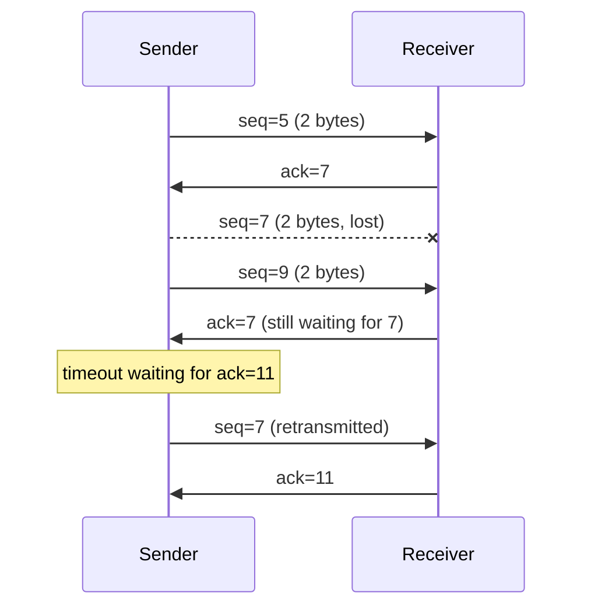
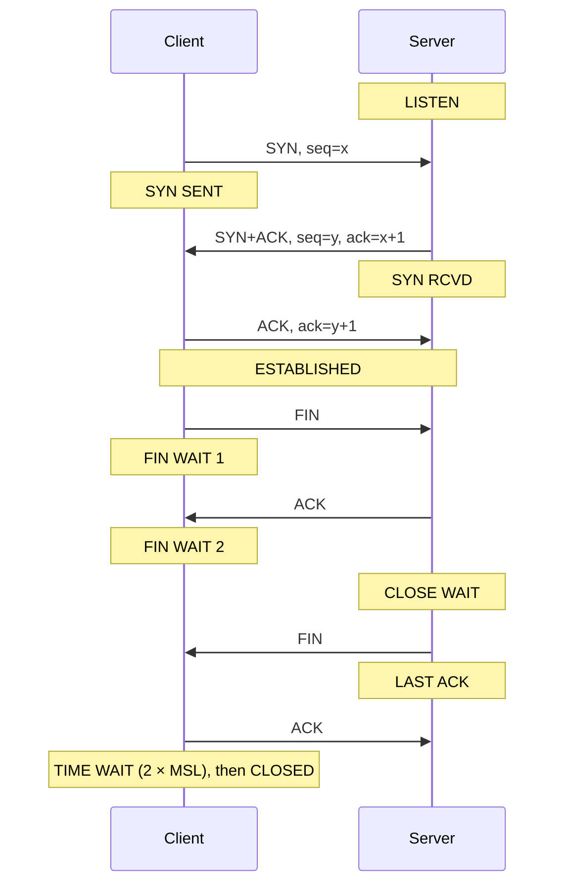

# COMP90007 Weeks 8–9 - Transport Layer: Connection Management, UDP and TCP

Sources: `lecture/Week12-Review-Lecture3.pdf` p.3–6, p.9 (the transport pages of Review (2)) and p.7–8, p.10–11 (review questions, concepts only); the Transport Layer (1) and (2) lecture PDFs were not recovered, so the remaining pages come from the student's screenshots `note-XX`; Apple Notes: CS/25S1/IT — "WEEK 8 - Transport Layer", "WEEK 8-9 - Transport2 - UDP & TCP", "WEEK 9 - Transport3 - TCP Management"; CS/25S1/IT/Review — "Transport Layer".

This lecture asks: **the network layer only tries its best to get packets to another host; how do we build on it a reliable, ordered, duplicate-free data transfer between two processes?**

Learning path: [What the transport layer provides](#topic-1) → [Addressing, multiplexing and sockets](#topic-2) → [Establishing and releasing connections](#topic-3) → [UDP](#topic-4) → [TCP](#topic-5).

Key points: the three-way handshake, TCP sequence and acknowledgement numbers, choosing between UDP and TCP. Hard parts: why old duplicate packets are dangerous, and why releasing a connection is hard. Common mistakes: the acknowledgement number is "the next byte expected"; TIME_WAIT lasts twice the maximum segment lifetime.

## 1. What the transport layer provides

### Transport entities and TPDUs

The transport layer provides the interface between the application layer and the network layer. Each host in the figure has a **transport entity**, which deals with the application through a "transport address" above and uses the network layer through a "network address" below; the unit exchanged between two transport entities is the **TPDU (Transport Protocol Data Unit)**, called a **segment** in TCP/IP. The student's analogy: the network layer is the road, the transport layer is the carriage.
<!-- Sources: rev2 p.3; Apple Notes WEEK 8 Transport Layer; Apple Notes Review Transport Layer -->

This screenshot from the student's notes shows the nesting: the segment's header and payload together sit in the packet's payload, and the packet sits in the frame's payload. It is the same idea as [01 Encapsulation](01-introduction-and-reference-models.en.md#topic-2).
<!-- Sources: Apple Notes WEEK 8 Transport Layer (screenshot of an unrecovered lecture slide) -->

### Why another layer

Data delivered by the transport layer goes straight to applications, so it must be far more reliable than the network layer. The goal is to **provide reliability even if the underlying network is unreliable**:

| Goal | Means |
| --- | --- |
| No loss | Request / acknowledgement (ACK) and retransmission |
| No duplicates | Sequence numbers |
| No corruption | Checksums |
| In order | Sequence numbers |
<!-- Sources: Apple Notes WEEK 8 Transport Layer -->

The sequence number space must be large enough not to wrap around, and a sequence number must not be reused within a segment's lifetime; otherwise a delayed old segment could be mistaken for a new one.

### Transport service primitives

Read the five primitives across three columns: the primitive, the segment sent when it runs, and its meaning. LISTEN and RECEIVE send nothing and just block; CONNECT sends a CONNECTION REQ., SEND sends DATA, and DISCONNECT sends a DISCONNECTION REQ.
<!-- Sources: Apple Notes WEEK 8 Transport Layer (screenshot of an unrecovered lecture slide) -->

A typical run: the server executes LISTEN; the client executes CONNECT, sending a connection request and receiving "connection accepted"; both exchange data with SEND and RECEIVE; finally each side calls DISCONNECT. This continues from [01 Service primitives](01-introduction-and-reference-models.en.md#topic-2).

This is the state diagram of a simple transport protocol. Solid lines (right) are the client's active sequence: IDLE → active establishment pending → ESTABLISHED → active disconnect pending → IDLE; dashed lines (left) are the server's passive sequence. Transitions labelled in italics are caused by segment arrivals; the others by the local side executing a primitive.
<!-- Sources: Apple Notes WEEK 8 Transport Layer (screenshot of an unrecovered lecture slide) -->

## 2. Addressing, multiplexing and sockets

### TSAP and NSAP

- **NSAP (Network Service Access Point)**: network-layer addressing, i.e. the IP address, identifying a host;
- **TSAP (Transport Service Access Point)**: transport-layer addressing, which on the Internet is the **port**, identifying a process on a host.

In the figure, a process on host 1 is bound to TSAP 1208. Its messages to host 2 port 1522 (red) and port 1836 (blue) share the same NSAP: **multiplexing**; on arrival at host 2 they are handed to Server 1 or Server 2 by port number: **demultiplexing**. The student added the red and blue arrows for the two directions.
<!-- Sources: Apple Notes WEEK 8 Transport Layer (screenshot with the student's annotations) -->

**Key point**: for a process on one host to connect to a process on another, it needs **the other host's IP address and the port number to which the destination process's socket is bound**.
<!-- Sources: rev2 p.7-8; Apple Notes Review Transport Layer -->

### Sockets

A **socket** is a transport endpoint. **Berkeley sockets** dominate Internet applications: they add SOCKET, BIND and ACCEPT to the earlier primitives. When reading the table, note the three new ones: SOCKET creates a communication endpoint, BIND associates a local address (port) with the socket, and ACCEPT passively takes an incoming connection; LISTEN now also gives the length of the waiting queue, and DISCONNECT is renamed CLOSE.
<!-- Sources: rev2 p.6 -->

The server's order is SOCKET → BIND → LISTEN → ACCEPT → RECEIVE/SEND → CLOSE; the client's is SOCKET → CONNECT → SEND/RECEIVE → CLOSE.

## 3. Establishing and releasing connections

### The three-way handshake

Connections are set up with a **three-way handshake**, because at this point neither side has any state from a previous connection, and both sides must contribute fresh sequence numbers:

1. Host 1 sends a CR (Connection Request) with sequence number $x$ ;
2. host 2 replies with an ACK carrying its own sequence number $y$ and acknowledging $x$ ;
3. host 1 sends the first DATA with sequence number $x$ , acknowledging $y$ .
<!-- Sources: rev2 p.4; Apple Notes WEEK 8 Transport Layer -->

### Old duplicate packets

Networks delay and duplicate packets. With only a two-way handshake, a long-outdated connection request arriving late would make the server think someone wants a new connection. The third step of the handshake lets the initiator confirm "this really is what I just sent, with a fresh sequence number".

- **Case a**: an old duplicate CR (seq = $x$ ) reaches host 2. Host 2 replies with ACK (seq = $y$ , ACK = $x$ ) as usual, but host 1 never requested a connection, so it replies REJECT (ACK = $y$ ), and host 2 gives up.
- **Case b**: an old duplicate CR is followed by an old duplicate DATA. The CR is rejected the same way; the old DATA acknowledges some long-gone sequence number $z$ rather than $y$ , so host 2 knows it is stale and discards it.
<!-- Sources: Apple Notes WEEK 8 Transport Layer (screenshot of an unrecovered lecture slide) -->

### Releasing a connection

- **Asymmetric release**: either side hangs up whenever it likes, like a phone call. Efficient, but data still in flight from the other side may be lost;
- **Symmetric release**: each side confirms it has no more data before disconnecting. More reliable.
<!-- Sources: Apple Notes WEEK 8 Transport Layer -->

The normal release: host 1 sends a DR (Disconnect Request) and starts a timer; host 2 replies with a DR and starts a timer; host 1 releases the connection and sends an ACK; host 2 releases on receiving the ACK. Both DRs are acknowledged by the other side. The strategy listed on the left is **three-way handshake + finite retry + timeouts**.
<!-- Sources: rev2 p.5 -->

The timers are there for lost packets: on the left the final ACK is lost, and host 2 releases anyway when its timer expires; on the right host 2's DR is lost, host 1 times out and resends its DR, and the second handshake succeeds.
<!-- Sources: Apple Notes WEEK 8 Transport Layer; Apple Notes Review Transport Layer -->

In the extreme case the DRs keep getting lost: host 1 resends its DR at every timeout and gives up and releases after $N$ retries; host 2, hearing nothing back, releases on its own timeout too. That is what "finite retry" is for: neither side may wait forever.
<!-- Sources: Apple Notes WEEK 8 Transport Layer (screenshot of an unrecovered lecture slide) -->

## 4. UDP

The student's rule of thumb: **efficiency first, use UDP; reliability first, use TCP**.
<!-- Sources: Apple Notes WEEK 8-9 Transport2 -->

### The UDP segment format

**UDP (User Datagram Protocol)** is connectionless. The ruler at the top marks 32 bits per row, and the header has only two rows: source port, destination port, UDP length and UDP checksum, 16 bits each, 8 bytes in total, followed by the payload.
<!-- Sources: Apple Notes WEEK 8-9 Transport2 (screenshot of an unrecovered lecture slide) -->

- Compared with raw IP, UDP's main value is **addressing processes with ports, enabling multiplexing**;
- apart from the optional checksum, UDP provides no reliability, flow control or congestion control, so it has less overhead and lower delay;
- it suits applications that need high speed or want precise control over packet flow, errors and timing, e.g. DNS and RPC (Remote Procedure Call).
<!-- Sources: Apple Notes WEEK 8-9 Transport2 (screenshot of an unrecovered lecture slide) -->

**Key point: when UDP is the better choice.** The review lecture discussed the choice for RPC. If the remote procedure is **idempotent**, i.e. running it several times does no harm, UDP fits better: if no reply arrives before a timeout, just call again, and save the RTT of setting up a TCP connection plus the system overhead of maintaining it. If the procedure is not idempotent (say, "transfer $100"), choose TCP, which detects and discards duplicate segments so that each is delivered exactly once.
<!-- Sources: rev2 p.10-11; Apple Notes Review Transport Layer -->

### Port numbers

Port numbers are 16 bits, ranging over 0–65 535: well-known ports 0–1023, registered ports 1024–49 151, dynamic ports 49 152–65 535. The table lists well-known ports only, each row giving port, protocol and use: for example 25 is SMTP for sending mail, 110 and 143 are POP-3 and IMAP for fetching mail, and 80 and 443 are HTTP and HTTPS.
<!-- Sources: Apple Notes WEEK 8-9 Transport2 (screenshot of an unrecovered lecture slide) -->

**Common mistake**: the screenshot gives RTSP as port 543, but the well-known port IANA actually assigns to RTSP is 554 (543 is assigned to klogin); this correction is an extension beyond the slides, and worth knowing when quoting the course table.

## 5. TCP

### Features of TCP connections

**TCP (Transmission Control Protocol)** is a connection-oriented reliable protocol: it reassembles segments into the correct order, retransmits lost segments, discards duplicates, detects corrupted segments by checksum and discards them, and also supports flow control and congestion control. The screenshot lists four features of TCP connections:

- **Full duplex**: data flows in both directions simultaneously;
- **Point-to-point**: each connection has exactly one sender–receiver pair;
- **Byte stream**: message boundaries are not preserved; two 512-byte writes may be read by the other side as one 1024-byte read;
- **Buffer options**: TCP may buffer before sending or send immediately (e.g. `TCP_NODELAY`, Java's `Socket.setTcpNoDelay`).
<!-- Sources: Apple Notes WEEK 8-9 Transport2 -->

### The TCP segment header

A fixed 20-byte header, plus options and data. A segment (including the TCP header) must fit in the IP payload (65 515 bytes), and in practice usually in an Ethernet frame payload (about 1500 bytes). Reading the figure from top to bottom:

| Field | Purpose |
| --- | --- |
| Source / Destination port | Identify the processes at each end |
| Sequence number | Number of the first data byte in this segment |
| Acknowledgement number | Number of the next byte expected |
| TCP header length | Header length (including options) |
| Flags | See the next table |
| Window size | How many more bytes the receiver can accept (flow control) |
| Checksum | Error check |
| Urgent pointer | Where urgent data is |
<!-- Sources: rev2 p.9; Apple Notes WEEK 8-9 Transport2; Apple Notes Review Transport Layer -->

The row of vertically written letters to the right of TCP header length is the 8 flag bits:

| Flag (set to 1 to activate) | Meaning |
| --- | --- |
| ACK | The acknowledgement number is valid |
| SYN | Request or reply to establish a connection: request has SYN = 1, ACK = 0; reply has SYN = 1, ACK = 1 |
| FIN | Request or reply to release a connection |
| RST | Reset a connection |
| ECE, CWR | Signal congestion and its reply when ECN is used |
| PSH | Push data immediately without buffering |
| URG | Urgent data needs processing |
<!-- Sources: Apple Notes WEEK 8-9 Transport2 -->

### Sequence and acknowledgement numbers

TCP numbers every **byte**. The student's rule:

$$
\text{ACK}=\text{segment seq}+\text{data length},
$$

which can also be read as "please send me data starting from this number". For example, a segment with seq = 5 carrying 2 bytes is acknowledged with 7.

This is the student's hand-drawn "data lost" case, with 2 bytes per segment. The segment with seq = 7 (bytes 7, 8) is lost and the one with seq = 9 (bytes 9, 10) arrives; the receiver can only acknowledge the highest byte received in order, so it still replies ack = 7. The sender never gets an acknowledgement covering 9 and 10 (the red "waiting for ACK"), times out and retransmits from 7; once 5–10 are complete the receiver acknowledges up to 11 at once. The sequence diagram below redraws the same run cleanly:

<!-- Sources: Apple Notes WEEK 8-9 Transport2 (student's hand-drawn traces) -->

The other case is a **lost ACK**: both the seq = 5 and seq = 7 segments arrive, the ack = 7 sent back for them is lost on the way, but the following ack = 9 arrives. The sender need not care about the lost one, because acknowledgements are **cumulative**: ack = 9 means every byte before 9 has arrived.

### Establishing and releasing a TCP connection

TCP implements the three-way handshake above with the SYN and FIN flags. The student's two screenshots are the two halves of one TCP finite state machine; each transition is labelled "event/reaction", solid lines are the client and dashed lines the server; the student crossed out rare paths such as simultaneous open and simultaneous close.

Setup: the client, in CLOSED, executes CONNECT and sends SYN, entering SYN SENT (step 1 of the handshake); the server, after LISTEN, receives the SYN, replies SYN + ACK and enters SYN RCVD (step 2); the client receives the SYN + ACK, replies ACK and enters ESTABLISHED (step 3); on receiving that ACK the server enters ESTABLISHED too.

Release: the side that closes actively (the client in the figure) does CLOSE and sends FIN, entering FIN WAIT 1; on the ACK it enters FIN WAIT 2; on the other side's FIN it replies ACK and enters TIME WAIT (marked by the student's red arrow), and after a timeout it is CLOSED. The passive side receives the FIN, replies ACK and enters CLOSE WAIT; when it also does CLOSE and sends FIN it enters LAST ACK; on the final ACK it is CLOSED.

<!-- Sources: Apple Notes WEEK 9 Transport3 TCP Management -->

Each direction is closed with its own FIN, so release takes four segments. The side that closes actively ends in **TIME_WAIT**, waiting **twice the Maximum Segment Lifetime (MSL)** before really closing, so that all old segments of this connection die off in the network and cannot be mistaken by a new connection on the same pair of ports.
<!-- Sources: Apple Notes WEEK 9 Transport3 TCP Management -->

### Window management

TCP's Window field tells the other side "at most this many bytes in your next segments", preventing receive-buffer overflow. Top to bottom (a 4 KB receive buffer):

1. The sender writes 2 KB, seq = 0; the buffer holds 2 KB, and the receiver replies ACK = 2048, WIN = 2048;
2. the sender writes another 2 KB, seq = 2048; the buffer is full, the reply is ACK = 4096, WIN = 0, and the sender is blocked;
3. the receiving application reads 2 KB; the reply is ACK = 4096, WIN = 2048;
4. the sender may send up to 2 KB; it sends 1 KB, seq = 4096.

The student wrote the acknowledgement contents onto the figure in red (one of them as 2049, which should be 2048).

**Common mistake**: after WIN = 0 the sender may not send ordinary data; it resumes only when the receiving application has read data and the receiver sends a new window update (WIN > 0). The sending application's writes and the segments on the network are two different things.
<!-- Sources: Apple Notes WEEK 9 Transport3 TCP Management (annotated screenshot of an unrecovered lecture slide) -->

Extension (optional): two exceptions when the window is 0

By the TCP specification, two kinds of segment may still be sent when the window is 0: urgent data (for example, to let the other side kill a process), and a 1-byte **window probe** that forces the receiver to re-announce the acknowledgement number and window size. The probe prevents a deadlock in which the new window update is lost and both sides wait for each other.

### Timer management

The retransmission timer cannot be fixed: too short causes needless retransmissions, too long makes reaction to loss sluggish. TCP sets its timeout **dynamically** from measured network performance, based on the **smoothed round-trip time (SRTT)** and the variation of the round-trip time.
<!-- Sources: Apple Notes WEEK 9 Transport3 TCP Management -->

Extension (optional): the usual timeout calculation

The common method (RFC 6298): for each round-trip sample $R$ ,

$$
\text{SRTT}\leftarrow\alpha\,\text{SRTT}+(1-\alpha)R,\qquad
\text{RTTVAR}\leftarrow\beta\,\text{RTTVAR}+(1-\beta)\lvert\text{SRTT}-R\rvert,
$$

$$
\text{RTO}=\text{SRTT}+4\times\text{RTTVAR},
$$

usually with $\alpha=7/8$ and $\beta=3/4$ . The larger the variation, the more margin the timeout leaves.

## Self-check

1. With only a two-way handshake, what harm could a delayed old connection request do? How does the third step prevent it?
2. Host A sends a segment with seq = 1000 carrying 500 bytes, and B receives it correctly. What acknowledgement number does B send?
3. A remote call that queries "the current temperature" and one that "places an order": which suits UDP and which TCP?
4. The receive buffer is 8 KB; starting from seq = 0 the sender sends two 3 KB segments in a row and the receiving application reads nothing. What are ACK and WIN in the second acknowledgement? How many more bytes may the sender send?
