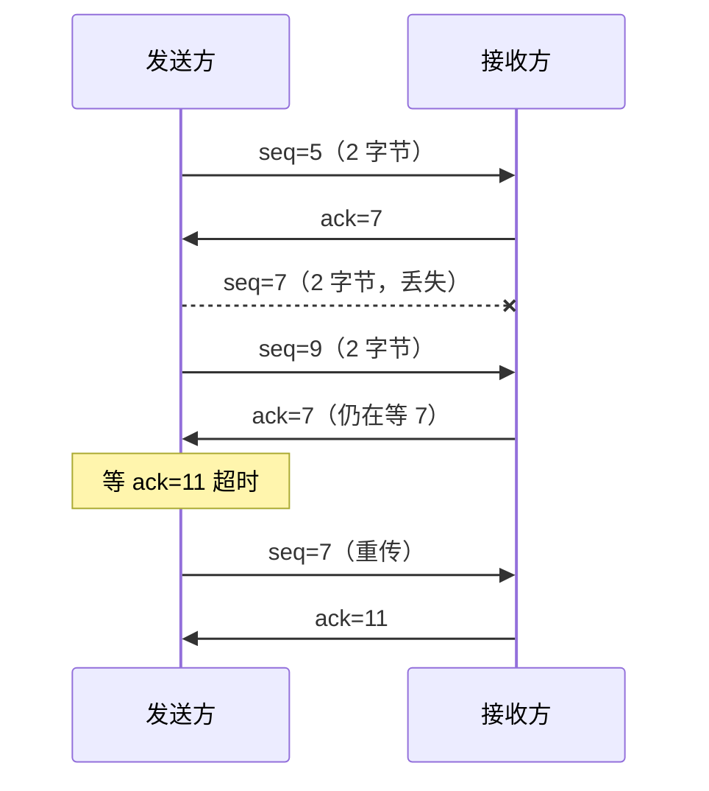
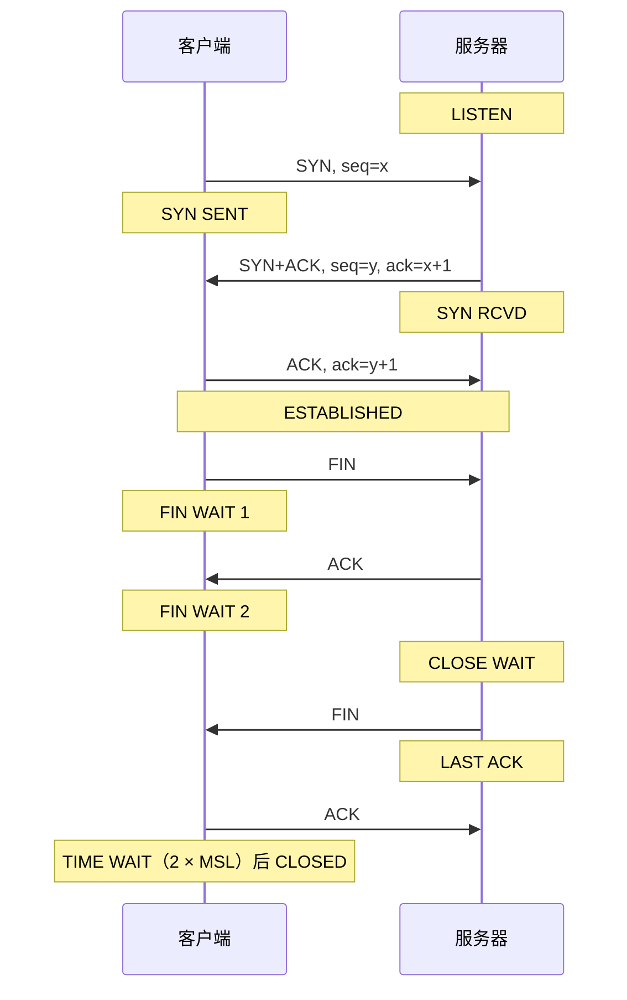

# COMP90007 Weeks 8–9 - Transport Layer: Connection Management, UDP and TCP

来源：`lecture/Week12-Review-Lecture3.pdf` p.3–6、p.9（Review (2) 的传输层页）与 p.7–8、p.10–11（复习题，只取概念）；Transport Layer (1)、(2) 讲义 PDF 未恢复，其余页面以学生笔记截图 `note-XX` 补足；Apple Notes：CS/25S1/IT — "WEEK 8 - Transport Layer"、"WEEK 8-9 - Transport2 - UDP & TCP"、"WEEK 9 - Transport3 - TCP Management"；CS/25S1/IT/Review — "Transport Layer"。

这篇讲的是：**网络层只尽力把分组送到另一台主机；怎样在它上面为两个进程提供可靠、有序、不重复的数据传送？**

学习路线：[传输层提供什么服务](#topic-1) → [编址、复用与 socket](#topic-2) → [连接的建立与释放](#topic-3) → [UDP](#topic-4) → [TCP](#topic-5)。

重点：三次握手、TCP 的序号与确认号、UDP 与 TCP 的取舍。难点：旧的重复分组为什么危险、释放连接为什么难。易错：确认号是"期望收到的下一个字节号"；TIME_WAIT 等待的是 2 倍最大段寿命。

## 1. 传输层提供什么服务

### 传输实体与 TPDU

传输层在应用层与网络层之间提供接口。图中每台主机里有一个 **传输实体（transport entity）**，上面通过"传输地址"与应用交接，下面通过"网络地址"使用网络层；两个传输实体之间交换的单位叫 **TPDU（Transport Protocol Data Unit）**，在 TCP/IP 中称为 **段（segment）**。学生笔记的比喻是：网络层是道路，传输层是车厢。
<!-- Sources: rev2 p.3; Apple Notes WEEK 8 Transport Layer; Apple Notes Review Transport Layer -->

这张学生截图展示了嵌套关系：段的头部和载荷整体放在分组的载荷里，分组又整体放在帧的载荷里。这与 [01 封装](01-introduction-and-reference-models.md#topic-2) 是同一回事。
<!-- Sources: Apple Notes WEEK 8 Transport Layer (screenshot of an unrecovered lecture slide) -->

### 为什么还要一层

传输层交付的数据直接给应用使用，所以它对可靠性的要求比网络层高得多。目标是 **即使底层网络不可靠，也提供可靠性**：

| 目标 | 手段 |
| --- | --- |
| 不丢失 | 请求 / 确认（ACK）与重传 |
| 不重复 | 序号 |
| 不损坏 | 校验和 |
| 按序 | 序号 |
<!-- Sources: Apple Notes WEEK 8 Transport Layer -->

序号空间要留得足够大，避免回绕；一个序号在段的寿命内不能被重复使用。否则延迟到达的旧段可能被误当成新段。

### 传输服务原语

表中五个原语分三列读：原语名、执行时发出的段、含义。LISTEN 和 RECEIVE 不发段，只是阻塞等待；CONNECT 发连接请求（CONNECTION REQ.），SEND 发 DATA，DISCONNECT 发断开请求（DISCONNECTION REQ.）。
<!-- Sources: Apple Notes WEEK 8 Transport Layer (screenshot of an unrecovered lecture slide) -->

典型过程：服务器执行 LISTEN；客户端执行 CONNECT，发出连接请求并收到"连接已接受"；双方用 SEND 和 RECEIVE 交换数据；最后各自 DISCONNECT。这与 [01 服务原语](01-introduction-and-reference-models.md#topic-2) 一脉相承。

这是简单传输协议的状态图。实线（右侧）是客户端主动发起的顺序：IDLE → 主动建立等待 → ESTABLISHED → 主动断开等待 → IDLE；虚线（左侧）是服务器被动响应的顺序。斜体标注的转换由段的到达触发，正体的由本方执行原语触发。
<!-- Sources: Apple Notes WEEK 8 Transport Layer (screenshot of an unrecovered lecture slide) -->

## 2. 编址、复用与 socket

### TSAP 与 NSAP

- **NSAP（Network Service Access Point）**：网络层的编址，即 IP 地址，标识一台主机；
- **TSAP（Transport Service Access Point）**：传输层的编址，在 Internet 中就是 **端口（port）**，标识主机上的一个进程。

图中主机 1 的进程绑定 TSAP 1208。它发给主机 2 端口 1522 的消息（红色）与发给端口 1836 的消息（蓝色）共用同一个 NSAP，这叫 **复用（multiplexing）**；到达主机 2 后按端口号分给 Server 1 或 Server 2，这叫 **解复用（demultiplexing）**。学生用红蓝箭头补上了这两个方向。
<!-- Sources: Apple Notes WEEK 8 Transport Layer (screenshot with the student's annotations) -->

**重点**：一台主机上的进程要连接另一台主机上的进程，需要知道 **对方的 IP 地址，以及对方进程的 socket 所绑定的端口号**。
<!-- Sources: rev2 p.7-8; Apple Notes Review Transport Layer -->

### Socket

**Socket** 是传输端点。Internet 应用中占主导的是 **Berkeley sockets**：在前面的原语基础上增加了 SOCKET、BIND 和 ACCEPT。读表时注意三个新原语：SOCKET 创建通信端点，BIND 把本地地址（端口）关联到 socket，ACCEPT 被动地接受一条传入连接；LISTEN 这里还要给出等待队列的长度，DISCONNECT 改名为 CLOSE。
<!-- Sources: rev2 p.6 -->

服务器的顺序是 SOCKET → BIND → LISTEN → ACCEPT → RECEIVE/SEND → CLOSE；客户端是 SOCKET → CONNECT → SEND/RECEIVE → CLOSE。

## 3. 连接的建立与释放

### 三次握手

建立连接时用 **三次握手（three-way handshake）**，因为此时双方没有任何以前连接留下的状态，而且双方都要贡献新的序号：

1. 主机 1 发 CR（Connection Request），序号 $x$ ；
2. 主机 2 回 ACK，自己的序号为 $y$ ，并确认 $x$ ；
3. 主机 1 发第一个 DATA，序号 $x$ ，并确认 $y$ 。
<!-- Sources: rev2 p.4; Apple Notes WEEK 8 Transport Layer -->

### 旧的重复分组

网络会延迟、复制分组。如果只用两次握手，一个早已过时的连接请求晚到时，服务器会误以为有人要建立新连接。三次握手的第三步就是让发起方确认"这确实是我刚发的、用的是新的序号"。

- **情形 a**：一个旧的重复 CR（seq = $x$ ）到达主机 2。主机 2 照常回 ACK（seq = $y$ ，ACK = $x$ ），但主机 1 并没有请求连接，于是回 REJECT（ACK = $y$ ），主机 2 便放弃。
- **情形 b**：旧的重复 CR 之后又来了旧的重复 DATA。CR 同样被拒绝；旧 DATA 确认的是很久以前的序号 $z$ 而不是 $y$ ，主机 2 知道它是过时的，丢弃。
<!-- Sources: Apple Notes WEEK 8 Transport Layer (screenshot of an unrecovered lecture slide) -->

### 释放连接

- **非对称释放（asymmetric）**：任何一方说断就断，像挂电话。高效，但可能丢掉对方还在途中的数据；
- **对称释放（symmetric）**：双方各自确认无数据再发，才断开。更可靠。
<!-- Sources: Apple Notes WEEK 8 Transport Layer -->

正常的释放：主机 1 发 DR（Disconnect Request）并启动定时器；主机 2 回 DR 并启动定时器；主机 1 释放连接、回 ACK；主机 2 收到 ACK 后释放。两个 DR 都被对方确认。左边列出的策略是 **三次握手 + 有限次重试 + 超时**。
<!-- Sources: rev2 p.5 -->

定时器就是为丢包准备的：左图最后的 ACK 丢了，主机 2 等到超时也会释放；右图主机 2 回的 DR 丢了，主机 1 超时后重发 DR，第二轮握手成功。
<!-- Sources: Apple Notes WEEK 8 Transport Layer; Apple Notes Review Transport Layer -->

最极端时 DR 一直丢：主机 1 每次超时就重发 DR，重试 $N$ 次后放弃并释放；主机 2 收不到任何回应，也靠自己的超时释放。这就是"有限次重试"的意义：不能无限等下去。
<!-- Sources: Apple Notes WEEK 8 Transport Layer (screenshot of an unrecovered lecture slide) -->

## 4. UDP

学生笔记的取舍口诀：**效率优先用 UDP，可靠优先用 TCP**。
<!-- Sources: Apple Notes WEEK 8-9 Transport2 -->

### UDP 段格式

**UDP（User Datagram Protocol）** 是无连接的。图上方的刻度是 32 位一行，头部只有两行：源端口、目的端口、UDP 长度、UDP 校验和，各 16 位，共 8 字节，后面接载荷。
<!-- Sources: Apple Notes WEEK 8-9 Transport2 (screenshot of an unrecovered lecture slide) -->

- 相对于直接用 IP，UDP 的主要价值是 **用端口为进程编址，实现复用**；
- 除了可选的校验和，UDP 不提供可靠性、流量控制和拥塞控制，因此开销小、时延低；
- 适合需要高速、或要自己精确控制分组流、差错与时序的应用，例如 DNS 和 RPC（Remote Procedure Call，远程过程调用）。
<!-- Sources: Apple Notes WEEK 8-9 Transport2 (screenshot of an unrecovered lecture slide) -->

**重点：什么时候宁选 UDP。** 复习课讨论了 RPC 的选择。如果远程过程是 **幂等的（idempotent）**，即重复执行多次也无害，那么 UDP 更合适：超时没收到回复就直接再调用一次，还省去建立 TCP 连接的一个 RTT 和维持连接的系统开销。如果过程不幂等（例如"转账 100 元"），就应选 TCP，因为它能识别并丢弃重复段，保证每段只交付一次。
<!-- Sources: rev2 p.10-11; Apple Notes Review Transport Layer -->

### 端口号

端口号 16 位，范围 0–65 535：知名端口（well-known）0–1023，注册端口 1024–49 151，动态端口 49 152–65 535。表中列的都是知名端口：每行是端口、协议和用途，例如 25 是发邮件的 SMTP，110 和 143 是取邮件的 POP-3 和 IMAP，80 和 443 分别是 HTTP 和 HTTPS。
<!-- Sources: Apple Notes WEEK 8-9 Transport2 (screenshot of an unrecovered lecture slide) -->

**易错**：截图中 RTSP 的端口写作 543，但 IANA 实际分配给 RTSP 的知名端口是 554（543 分配给 klogin）；这一更正属于延伸内容，引用课程表格时要知道这一处差异。

## 5. TCP

### TCP 连接的特点

**TCP（Transmission Control Protocol）** 是面向连接的可靠协议：把段重组成正确顺序；重传丢失的段；丢弃重复段；用校验和发现损坏段并丢弃；另外支持流量控制和拥塞控制。截图列出 TCP 连接的四个特点：

- **全双工（full duplex）**：两个方向同时传数据；
- **点到点（point-to-point）**：每条连接恰有一对收发方；
- **字节流（byte stream）**：不保留消息边界，两次各写 512 字节可能被对方一次读出 1024 字节；
- **缓冲选项**：TCP 可以先缓冲再发，也可以立即发（如 `TCP_NODELAY`、Java 的 `Socket.setTcpNoDelay`）。
<!-- Sources: Apple Notes WEEK 8-9 Transport2 -->

### TCP 段头部

固定 20 字节头部，加选项和数据。一个段（含 TCP 头）必须装进 IP 载荷（65 515 字节），实际上通常还要装进以太网帧载荷（约 1500 字节）。按图从上往下读：

| 字段 | 作用 |
| --- | --- |
| Source / Destination port | 标识两端进程 |
| Sequence number | 本段第一个数据字节的编号 |
| Acknowledgement number | 期望收到的下一个字节编号 |
| TCP header length | 头部长度（含选项） |
| 标志位 | 见下表 |
| Window size | 接收方还能接收多少字节（流量控制） |
| Checksum | 校验 |
| Urgent pointer | 紧急数据的位置 |
<!-- Sources: rev2 p.9; Apple Notes WEEK 8-9 Transport2; Apple Notes Review Transport Layer -->

图中 TCP header length 右边那一排竖写的字母就是 8 个标志位：

| 标志（置 1 生效） | 含义 |
| --- | --- |
| ACK | 确认号有效 |
| SYN | 请求或回应建立连接：请求时 SYN = 1、ACK = 0；回应时 SYN = 1、ACK = 1 |
| FIN | 请求或回应释放连接 |
| RST | 重置连接 |
| ECE、CWR | 使用 ECN 时用于通告拥塞及其回应 |
| PSH | 立即推送数据，不要缓冲 |
| URG | 有紧急数据需要处理 |
<!-- Sources: Apple Notes WEEK 8-9 Transport2 -->

### 序号与确认号

TCP 给每个 **字节** 编号。学生笔记的口诀：

$$
\text{ACK}=\text{本段 seq}+\text{数据长度},
$$

也可以理解为"请从这个编号开始发给我"。例如 seq = 5、带 2 字节数据的段，确认号为 7。

这是学生手画的"数据丢失"情形，每段 2 字节。seq = 7 的段（字节 7、8）丢了，seq = 9 的段（字节 9、10）到了；接收方只能确认按序收到的最高字节，于是仍回 ack = 7。发送方等不到对 9、10 的确认（红字 "waiting for ACK"），超时后从 7 开始重传；接收方补齐 5–10 后一次确认到 11。下面的时序图把同一过程画干净：

<!-- Sources: Apple Notes WEEK 8-9 Transport2 (student's hand-drawn traces) -->

另一种情形是 **ACK 丢失**：seq = 5 和 seq = 7 两段都到了，回给它们的 ack = 7 在途中丢失，但随后的 ack = 9 到了。发送方无需理会丢掉的那个，因为确认是 **累积的（cumulative）**：ack = 9 表示 9 以前的字节都已收到。

### TCP 连接的建立与释放

TCP 用 SYN 和 FIN 标志实现前面讲的三次握手。学生的两张截图是同一张 TCP 状态机（finite state machine）的两半，每条转换标成"事件/动作"（event/reaction），实线是客户端、虚线是服务器；学生把同时打开、同时关闭等少见路径划掉了。

建立连接：客户端从 CLOSED 执行 CONNECT 并发 SYN，进入 SYN SENT（握手第 1 步）；服务器 LISTEN 后收到 SYN、回 SYN + ACK，进入 SYN RCVD（第 2 步）；客户端收到 SYN + ACK 后回 ACK，进入 ESTABLISHED（第 3 步）；服务器收到这个 ACK 后也进入 ESTABLISHED。

释放连接：主动关闭的一方（图中是客户端）CLOSE 并发 FIN，进入 FIN WAIT 1；收到 ACK 进入 FIN WAIT 2；再收到对方的 FIN、回 ACK，进入 TIME WAIT（学生用红箭头标出），超时后 CLOSED。被动关闭的一方收到 FIN、回 ACK，进入 CLOSE WAIT；自己也 CLOSE 并发 FIN，进入 LAST ACK；收到最后的 ACK 后 CLOSED。

<!-- Sources: Apple Notes WEEK 9 Transport3 TCP Management -->

两个方向各自用 FIN 关闭，所以释放共要四个段。主动关闭的一方最后进入 **TIME_WAIT**，等待 **2 倍最大段寿命（Maximum Segment Lifetime，MSL）** 才真正关闭，目的是让网络中这条连接的旧段全部消失，以免它们被同一对端口上的新连接误收。
<!-- Sources: Apple Notes WEEK 9 Transport3 TCP Management -->

### 窗口管理

TCP 的 Window 字段告诉对方"下一段最多还能发多少字节"，防止接收缓冲区溢出。按图从上往下（接收缓冲区 4 KB）：

1. 发送方写 2 KB，seq = 0；接收方缓冲区存了 2 KB，回 ACK = 2048、WIN = 2048；
2. 发送方再写 2 KB，seq = 2048；缓冲区满，回 ACK = 4096、WIN = 0，发送方被阻塞；
3. 接收方应用读走 2 KB，回 ACK = 4096、WIN = 2048；
4. 发送方可再发最多 2 KB，它发了 1 KB，seq = 4096。

学生在图上用红笔补写了确认段的内容（其中一处写成 2049，应为 2048）。

**易错**：WIN = 0 之后发送方不能再发普通数据，要等接收方应用读走数据、发出新的窗口通告（WIN > 0）才恢复；发送方自己的应用读写与网络上的段是两件事。
<!-- Sources: Apple Notes WEEK 9 Transport3 TCP Management (annotated screenshot of an unrecovered lecture slide) -->

延伸内容（可选）：窗口为 0 时的两个例外

按 TCP 规范，窗口为 0 时仍允许发两类段：紧急数据（例如让对方中止某个进程），以及 1 字节的 **窗口探测（window probe）**，迫使接收方重新通告确认号和窗口大小。后者防止"新的窗口通告丢失、双方互相等待"的死锁。

### 定时器管理

重传定时器不能固定：设得太短会造成不必要的重传，太长则丢包后反应迟钝。TCP **动态地** 根据测得的网络性能设定超时，依据是 **平滑往返时间（smoothed round-trip time，SRTT）** 以及往返时间的波动。
<!-- Sources: Apple Notes WEEK 9 Transport3 TCP Management -->

延伸内容（可选）：常见的超时计算

常用做法（RFC 6298）：每测得一个往返时间样本 $R$ ，

$$
\text{SRTT}\leftarrow\alpha\,\text{SRTT}+(1-\alpha)R,\qquad
\text{RTTVAR}\leftarrow\beta\,\text{RTTVAR}+(1-\beta)\lvert\text{SRTT}-R\rvert,
$$

$$
\text{RTO}=\text{SRTT}+4\times\text{RTTVAR},
$$

通常 $\alpha=7/8$ 、 $\beta=3/4$ 。波动越大，超时留的余量越大。

## 本讲自测

1. 如果只用两次握手，一个延迟到达的旧连接请求会造成什么后果？第三步怎样避免它？
2. 主机 A 发出 seq = 1000、含 500 字节数据的段，B 正确收到。B 回的确认号是多少？
3. 一个查询"当前温度"的远程调用，和一个"下订单"的远程调用，分别更适合跑在 UDP 还是 TCP 上？
4. 接收缓冲区 8 KB，发送方从 seq = 0 起连续发出两段各 3 KB 的数据，接收方应用一直没读。第二个确认段里的 ACK 和 WIN 分别是多少？发送方接下来最多还能发多少字节？
