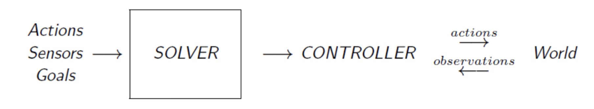

# 2 规划
---
## AI 求解器

> [!note]- 求解器的三个层次的目标
> 
> **目标**：编写一个程序来解决所有经典搜索问题
> 
> - **目标 1.0**（问题求解，problem solving）编写一个程序来解决一个问题
> - **目标 2.0**（问题生成，problem generation）编写一个程序来解决一大类问题
> - **目标 3.0**（元问题求解，meta problem solving）编写一个程序来**高效地**解决一大类问题

基于编程的（programming-based）：

- 使用由程序员设计的静态程序
- 例如 Pac-man

基于学习的（learning-based）：

- 无监督/强化学习：使用奖励与惩罚
- 有监督：使用带标签的数据
- 进化式：让原有的控制器变异和重组，以构建更好的控制器
- 例如 OpenAI-Five

基于模型的（model-based，即规划）：

- 为某一特定类别的问题构建模型
- 不同的模型会产生不同类型的**控制器**（controller）

> [!NOTE] 优点与缺点
> 
> 基于编程的
> 
> - 领域知识易于表达✅
> - 灵活性较差☹️ 
> - 无法处理程序员未预料到的情况❌
> 
> 基于学习的
> 
> - 原则上不需要太多知识✅
> - 较慢；很难知道应该学习哪些特征☹️
> 
> 基于模型的
> 
> - 强大；快速；灵活；清晰；智能；与领域无关✅
> - 需要一个模型（有时非常困难）；效率有损失☹️

> [!tip]
> 要设计一个好的求解器，总是要在"自动且通用"与"手工但高效"之间取得平衡

---
## 规划的模型
### 经典规划模型 

描述环境的最基本模型，目标输出是一个把 $I$ 映射到 $G$ 的动作序列。

$$
M = \langle S, A, T, I, G \rangle
$$

其中

- $S$ - 状态空间 
- $A(s)$ - 对 $s \in S$ 适用的动作
- $T$ - 确定性转移函数（deterministic transition function）：$s’ = T(A(s), s)$ 给出 $s$ 的一个后继 $s’$
- $I$ - 初始状态
- $G$ - 目标状态
- 一致的动作代价 $c(A(s), s) = 1$

> [!NOTE] 经典规划模型的性质
> 
> - 简单；直观✅
> - **非常严格的假设**❗️❗️
> 	- 确定性
> 	- 完全可观测
> 	- 静态世界
> 	- 离散时间 & 有限动作
> 	- 一致代价

---
### 一致性规划模型

源自暴力方法，实现了处理随机性的能力：

- 初始状态 → 一组可能的初始状态
- 确定性转移函数 → **非**确定性

> [!NOTE] 效果：一致性规划（conformant）
> - **保证达成目标** ✅
> - **无观测** - 没有新信息；必须预先规划⚠️
> - **很少是最优的** ⚠️
> 	- 必须把任何可能的 $s_0$ 映射到 $g$，有太多不必要的工作
> 	- 对最坏/特殊情况敏感 

---
## 规划的语言
### *STRIPS*

*STRIPS* = "STanford Research Institute Problem Solver"（斯坦福研究所问题求解器），它设计了一种语言，用于：

- **规约**（specification）- 简洁的模型描述
- **计算**（computation）- 为启发函数揭示有用的信息/结构

所有符合以下格式的问题都可以用 *STRIPS* 求解：

$$
P = \langle P,A,I,G \rangle
$$

其中

- $P$ - 所有可能的谓词（predicate）
- $A$ - 动作
- $I$ - 初始状态：初始时为 `TRUE` 的谓词
- $G$ - 目标条件：最终需要为 `TRUE` 的谓词

**动作**

$$
a \in A, a = \langle Pre(a), Add(a), Del(a) \rangle
$$

其中

- $Pre(a)$ - 前提条件（precondition），执行动作前需要为 `TRUE`
- $Add(a)$ - 添加效果（add effects）：执行后被设为`TRUE` 的前提条件
- $Del(a)$ - 删除效果（delete effects）：执行后被设为 `FALSE` 的前提条件

**结果函数（应用/转移函数）**

$$
Result(s, a) = (s - Del(a)) \cup Add(a)
$$

***STRIPS* 的目标**

找到一个动作列表 $[a_1,a_2,a_3,\ldots]$，使其满足：

$$
Result(Result(\ldots Result(I,a_1​) \ldots ,a_n−1​),a_n​) \models G
$$

> [!NOTE] 效果：*STRIPS*
> 
> 它把"解决一个问题"变成了"搜索解"。
> 
> 仍然是 _PSPACE 完全_（PSPACE-complete）的，但问题现在更加简洁直观：
> 	- 显式搜索
> 		- 例如盲目/启发式搜索
> 		- 保证得到最优解✅；不高效❌
> 
> 并且现在也可以应用"***近似***"（approximation）了：
> 	- 近似分解（near decomposition）
> 		- 例如松弛（relaxation）
> 		- 高效✅；可能失败❌
