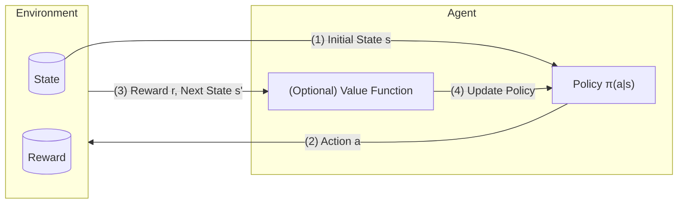

# 5 强化学习
---
## 强化学习

关键：策略 + 奖励 + 试错式交互

### 规划 vs 学习

| 维度                         | **规划**                                                      | **学习**                                                                                |
| --------------------------------- | ----------------------------------------------------------------- | ------------------------------------------------------------------------------------------- |
| **环境模型**             | 模型是**已知的**                                                | 模型是**未知的**                                                                        |
| **学习方式**                 | 离线计算                                               | 在线试错                                                                      |
| **智能体–环境交互** | 不与真实环境交互；使用内部模拟器 | 必须在真实环境中行动以收集经验                                       |
| **策略改进**            | 通过搜索、深思熟虑、规划与内省         | 通过奖励驱动的学习                                                              |
| **适用场景**            | 存在精确的模型且模拟代价低廉                    | 模型未知或难以刻画                                                     |
| **优点**                    | 安全、可解释、没有现实世界的风险                           | 自适应，能在复杂/未知环境中冒险工作                                     |
| **缺点**                 | 需要准确的模型；建模可能代价高昂                | 需要探索；可能代价高昂或有风险                                                |
| 示例 - Atari 游戏              | 智能体可以查询模拟器以获得完美模型（源代码）          | 智能体只能看到屏幕上的像素和分数 → 必须通过试错来玩游戏 |

### 强化学习 vs. 规划 vs. 其他机器学习

| 维度                      | 强化学习                                            | 自动规划                             | 其他机器学习                                                     |
| :----------------------------- | :---------------------------------------------------------------- | :--------------------------------------------- | :----------------------------------------------------------- |
| **动作结果**            | **非确定性** — 动作导致概率性的转移 | 确定性 — 结果完全可由模型得知 | 通常不被建模为序列决策                 |
| **环境表示** | 状态、转移和奖励的**概率模型**       | 符号或逻辑模型（例如 STRIPS）       | 没有显式的环境                                      |
| **学习信号**            | **奖励信号**（reward signal）- 来自环境的反馈                     | 预先定义的目标或规划器目标           | 标签或自身结构                                    |
| **数据结构**             | **序列 / 时间序列**（非 i.i.d.）                         | 规划领域中的离散步骤            | 通常是 i.i.d. 样本（独立同分布） |
| **搜索与优化**      | 试错搜索 + 奖励驱动                            | 状态空间搜索 + 预先定义的策略         | 基于梯度或统计拟合                        |
| **信用分配**（credit assignment）          | **需要** — 奖励可能在时间上延迟                    | 不相关 — 目标是先验已知的             | **不需要** - 没有延迟                                  |

##### 示例 - 常见应用
- 让人形机器人行走
- 利用人类/AI 反馈微调 LLM
- 优化操作系统例程
- 控制发电站
- 管理投资组合

---
## 强化学习的过程

---
## 环境

### 状态 - $S, P$

**所有**强化学习算法都假设状态具有**马尔可夫性**（Markov）：

$$
P(s' \mid s + H(s), a) = P(s' \mid s, a)
$$
	
- 一旦知道了 $S$，就可以丢弃 $H$

任何强化学习问题都可以通过扩展状态变成马尔可夫的：

- 把历史加入当前状态
- 加入信念状态（belief state，POMDP → belief-MDP）
- 加入隐状态（latent state，基于模型的强化学习）

---
### 奖励 - $R$

一个标量反馈信号，表示智能体在某一步做得有多好。

> [!info] **奖励假设**（reward hypothesis）
> 
> _所有_目标都可以描述为对期望累积奖励的 $maximisation$（最大化）

---
## 智能体

- **预测**（prediction）：评估状态-动作的未来奖励
	- → *价值函数*
- **控制**（control）：找到最优策略
	- → *策略函数*

---
### 模型 - 隐含的 $P, R$

- 一个用于预测环境接下来会如何变化的内部模拟器
	- **转移模型**（transition model）：$P_{ss'}^a$ - 每个动作如何改变状态
	- **奖励模型**（reward model）：$R_{s}^a$ - 每个状态的即时奖励
	- 模型可以不完美，但它支持规划和预测
- 对强化学习而言，模拟**不是**必需的 
	- → 基于模型/无模型（model-based/model-free）

---
### 价值函数 - $V, Q$

- 基于*对未来奖励的期望*来定义和预测状态的价值
- 状态价值函数（state-value function）
	- 输出当前状态的价值
		$$
		V_\pi(s) = \mathbb{E}_\pi\big[G_t \mid S_t = s\big]
		$$

- 状态-动作价值函数（state-action-value function）
	- 输出在当前状态下采取某个确定动作时的价值
		$$
		Q_\pi(s,a) = \mathbb{E}_\pi \big[\, G_t \mid S_t = s,\, A_t = a \,\big]
		$$

---
#### 回报 - $G_t$
- 未来的折扣奖励总和
	$$
	G_t = R_{t+1} + \gamma (R_{t+2} + \gamma (R_{t+3} + \ldots)) = \sum_{k=0}^{\infty} \gamma^k R_{t+k+1}
	$$

---
#### 贝尔曼期望方程 
- **贝尔曼方程**（Bellman equation）：给出**回报**的递归形式
		$$ G_t = R_{t+1} + \gamma G_{t+1} $$
	
	- 基于"*向前看再回传*"（look-ahead then back-up）的计算机制
		- **向前看**：看向下一步 → $r, s'$
		- **回传**：回到当前状态 → $v(s) = f(r,s')$

- 状态价值函数（推导贝尔曼期望方程，BEE）

$$
\begin{aligned}
v_\pi(s)
&= \mathbb{E}\!\left[r + \gamma v_\pi(s')\right] \\[6pt]
&= \sum_a \pi(a\mid s)\Bigl[\sum_r p(r\mid s,a)\,r + \gamma \sum_{s'} p(s'\mid s,a) \, v_\pi(s')\Bigr]
\end{aligned}
$$

- 状态-动作价值函数（推导 BEE）

$$
\begin{aligned}
q_\pi(s,a)
&= \mathbb{E}\!\left[\, r + \gamma\, \mathbb{E}_{a'\sim\pi(\cdot\mid s')} \bigl[q_\pi(s',a')\bigr] \right] \\[6pt]
&= \sum_{s',r} p(s',r\mid s,a)\left[ r + \gamma \sum_{a'} \pi(a'\mid s')\, q_\pi(s',a') \right]
\end{aligned}
$$
	
- 求解 BEE
	- 直接计算 $O(n^3)$
		$$
		v = R + \gamma Pv \to v = (I - \gamma P)^{-1}R
		$$

		- 只对较小的 $P$ 矩阵可行

	- 动态规划（dynamic programming）
	- 蒙特卡洛评估（Monte-Carlo evaluation）
	- 时序差分学习（temporal-difference learning）

---
#### 折扣因子 - $\gamma$

| Gamma（$0 \le \gamma \le 1$） | 行为                                    |
| ---------------------------- | -------------------------------------------- |
| $\gamma = 0$                 | 贪婪                                       |
| $\gamma \to 0$               | 短视                                       |
| $\gamma \to 1$               | 有远见                                  |
| $\gamma = 1$                 | 只有当所有序列都会终止时才有**保证** |

> [!faq]- 为什么要使用折扣？
> 
> **技术原因**
> 
> - 让建模和计算更容易（贝尔曼方程能干净地收敛）
> - 防止循环马尔可夫过程中出现无限回报
> - 反映了对遥远未来结果的不确定性
> 
> **现实原因**
> 
> - 在金融场景中，即时奖励可以再投资（货币的时间价值）
> - 人类和动物的行为都表现出相对延迟奖励更偏好即时奖励

---
### 策略 - $\pi$

完全定义了智能体的行为

- **平稳的**（stationary，与时间无关）：只依赖于当前状态

---
### 强化学习算法

- 马尔可夫决策过程
	- 价值迭代
	- 策略迭代

**基于模型 → 无模型**

- 蒙特卡洛（Monte Carlo）

**非增量式 → 增量式**

- 时序差分（temporal difference）
	- SARSA
	- Q-Learning

**表格表示 → 函数表示**

- 价值函数近似（value function approximation）

**确定性策略 → 随机策略**

- 有限差分（finite difference）
- 策略梯度（policy gradient）
	- REINFORCE
	- Actor-Critic

---
