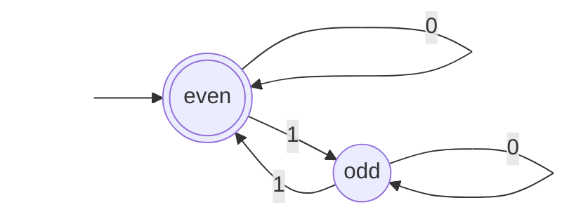

# COMP30026 Lectures 11–12 - Finite Automata and Regular Languages

Sources: `lecture/w6l1-slides.pdf` (Lecture 11, 14 pages), `lecture/w6l2-slides.pdf` (Lecture 12, 15 pages of handwritten board notes); Apple Notes: CS/25S2/MoC — "LEC11-12 Finite Automata".

This lecture asks: **if a machine "cannot allocate new memory" and can remember the past only through finitely many states, which problems can it solve?**

Learning path: [What is a model of computation](#topic-1) → [Deterministic finite automata](#topic-2) → [Operations on languages and closure](#topic-3) → [Nondeterministic finite automata](#topic-4).

Key points: the five-tuple of a DFA, the definition of "accept", the definition of a regular language. Hard parts: NFA computation trees and $\varepsilon$ -transitions. Common mistakes: reading the NFA's "there exists an accepting path" as "every path accepts"; taking $L^0$ to be the empty set.

Screenshot numbers are PDF page indices. Lecture 12 is handwritten board notes; the text beside each screenshot first transcribes the board, then explains what it says.

## 1. What is a model of computation

### Why study models of computation

Lecture 11 opens with three questions: can large language models (LLMs) do everything? How do we design secure cryptographic protocols? How do we process massive data streams? The slide's conclusion: all of these are questions about **computational models** — to answer "can it be done?", we must first say which resources the machine is allowed to use.

### Problems and algorithms

- **Computational problem = specification**: for every input $x$ , **what** is the correct output?
- **Algorithm = implementation**: for every input, **how** do we obtain the correct output?

One problem can have many algorithms; the later part of this subject asks whether a problem has **any** algorithm in a given model.

<!-- Sources: W6L1 p.7; Apple Notes LEC11-12 -->

### Resources and models of computation

Algorithms consume resources: time, space (memory), randomness, quantum entanglement, the way the input may be accessed, and more. The sentence at the bottom of the slide is this section's definition: **computational model = resource constraints**. For example, "read the input once from left to right, with constant memory" is one model.

Theoretical computer science studies two things: the power and limits of the various models, and the trade-offs between resources. The four scattered words in the figure (space, time, randomness, quantum entanglement) hint that relaxing one resource can sometimes save another.

<!-- Sources: W6L1 p.9-10; Apple Notes LEC11-12 -->

### Simplify everything first

Proving that "no algorithm can do it" seems impossible (the previous slide's question: how do we rule out **every** possible algorithm?), so we simplify first. Read the slide top to bottom:

- inputs are bit strings (Boolean strings);
- outputs are only YES/NO — such problems are **decision problems**;
- a computational problem = the set of inputs whose answer is YES = a **language**;
- the simplest model is the **finite automaton (FA)**, whose key feature is **memorylessness**: it cannot allocate new memory, which amounts to not being able to create new variables.

<!-- Sources: W6L1 p.11-13; Apple Notes LEC11-12 -->

The next two pages use the film *Memento* (whose protagonist cannot form new memories) as a metaphor, and demonstrate with a tally counter: a counter with only a fixed number of digits can remember only finitely many things.

<!-- Sources: W6L1 p.14 -->

## 2. Deterministic finite automata

Page 1 of Lecture 12 has announcements and today's plan: finish the introduction to finite automata, then operations on languages, then nondeterminism (the board cites sections 4.1.5–4.3 of the companion notes).

### The five components

The top half of the board (highlighted in green) is the definition. A (deterministic) finite automaton $M$ has five components:

| Component | Notation | Meaning |
| --- | --- | --- |
| alphabet | $\Sigma$ | a finite set of symbols, e.g. $\{0,1\}$ |
| set of states | $Q$ | a finite set |
| initial state | $q_0\in Q$ | the state before the first character is read |
| transition function | $\delta:Q\times\Sigma\to Q$ | $\delta(\text{current state},\text{next char})=\text{next state}$ |
| accept states | $F\subseteq Q$ | ending here after the input means accept |

<!-- Sources: W6L2 p.2; Apple Notes LEC11-12 -->

The red examples of alphabets in the top right are $\{0,1\}$ , $\{\text{"res"},\text{"inc"}\}$ (the tally counter's "reset" and "increment" buttons) and the game keys $\{W,A,S,D\}$ : **a "character" can be any symbol from a finite set**, not necessarily a single letter. The $2^{\{0,1\}}=\{\emptyset,\{0\},\{1\},\{0,1\}\}$ beside it is power-set notation, used by the NFA in section 4.

The bottom half of the board shows two ways to draw the transition function:

- **State transition table** (left): rows are states, columns are characters, and each cell holds the next state; the left margin marks $q_1$ as an accept state.
- **State diagram** (right): circles are states, arrows are labelled with characters, the `start` arrow points at the initial state, and double circles mark accept states. In the figure $q_0$ goes to $q_1$ on 0 and to $q_2$ on 1; $q_1$ goes to $q_2$ on 0; $q_2$ returns to $q_1$ on 1.

**Common mistake**: the table on the board fills only a few cells (the $q_3$ row is empty); it is a sketch to demonstrate the notation. A strict DFA requires $\delta$ to be defined for **every** (state, character) pair; transitions omitted from a drawing are conventionally understood to go to a rejecting state that nothing leaves (a "dead state").

**Worked example (own)**: the DFA below accepts "binary strings containing an even number of 1s". The state `even` remembers "an even number of 1s so far"; it is both the initial state and the accept state. Here every state has a transition on every character, so the table is complete.

| State | on 0 | on 1 |
| --- | --- | --- |
| →`even` (accept) | `even` | `odd` |
| `odd` | `odd` | `even` |

### Computation paths and acceptance

On input $w=w_1w_2\cdots w_n$ , start from $r_0=q_0$ and take one step per character: $r_i=\delta(r_{i-1},w_i)$ . This sequence of states is the **computation path**, and the final state $r_n$ is the **resulting state** (where the red arrow points in the figure).

**Definition**: $M$ **accepts** $w$ if the resulting state is in $F$ ; otherwise it rejects. The set of all strings $M$ accepts is written $L(M)$ , the language of $M$ .

<!-- Sources: W6L2 p.3; Apple Notes LEC11-12 -->

The board runs this machine on the input `0110`. First read off the transitions: besides those on the previous page, $q_1$ goes to $q_3$ on 1 along the upper arc, $q_3$ returns to $q_1$ on 1, and $q_3$ and $q_2$ stay put on 0. Step by step:

$$
q_0\xrightarrow{0}q_1\xrightarrow{1}q_3\xrightarrow{1}q_1\xrightarrow{0}q_2.
$$

**Common mistake**: the board writes $q_0\to q_1\to q_3\to q_2$ , omitting the return to $q_1$ after the third character. An input of length $n$ has a computation path of $n+1$ states (5 here). The resulting state $q_2$ itself is right; if we keep "$q_1$ is the accept state" from the previous page, then $q_2\notin F$ and `0110` is rejected.

### Regular languages

The board gives two definitions:

1. if $L=L(M)$ , we say the finite automaton $M$ **recognizes** $L$ ;
2. a language $L$ is **regular** iff **there exists** some finite automaton that recognizes it.

Note that "recognizes" demands correctness in both directions: every string in $L$ is accepted, and every string **not** in $L$ is rejected. Accepting only part of $L$ , or accepting extra strings, does not count as recognizing $L$ .

<!-- Sources: W6L2 p.4; Apple Notes LEC11-12 -->

### Two key features of finite automata

1. **Memoryless**: the states are the whole memory, and the number of states is a constant — it does not grow as the input gets longer;
2. **Input stream**: the machine reads one character at a time, does not know which character is the last, and cannot go back or look ahead.

<!-- Sources: W6L2 p.5; Apple Notes LEC11-12 -->

The next page is an in-class demo: run a program on Ed and visualise its internal state on pythontutor.com, to see directly that "the states are the whole memory". The student notes compare this to the Markov property: the next step depends only on the current state and the next character. [Note 9](09-non-regularity.en.md) turns this intuition into a rigorous lemma.

## 3. Operations on languages and closure

Let $\Sigma^*$ be the set of all finite strings over the alphabet $\Sigma$ ; a language is a subset of $\Sigma^*$ . The board introduces five operations:

| Operation | Notation | Meaning |
| --- | --- | --- |
| complement | $L^c=\Sigma^*\setminus L$ | strings not in $L$ |
| intersection | $A\cap B$ | in both |
| union | $A\cup B$ | in at least one |
| concatenation | $A\circ B=\{xy\mid x\in A,y\in B\}$ | first part from $A$ , second part from $B$ |
| Kleene star | $L^*$ | zero or more strings of $L$ joined end to end |

<!-- Sources: W6L2 p.7-9; Apple Notes LEC11-12 -->

### Complement, intersection and union

The three operations are colour-coded: the large oval at the top right is $\Sigma^*$ (all strings), the small circle inside is $L$ , and the green ring is the complement $L^c$ ; the two circles at the bottom left are $A$ and $B$ , the whole pink area is the union $A\cup B$ , and the red overlap in the middle is the intersection $A\cap B$ .

**Common mistake**: the complement is taken relative to $\Sigma^*$ , so the same $L$ over a different alphabet has a different complement.

### Concatenation

The top half of the board is about **concatenation**: fix one string $a_1$ of $A$ to get $\{a_1\}\circ B=\{a_1b_1,a_1b_2,a_1b_3,\dots\}$ ; the line diagram on the right joins every $a_i$ in $A$ to every $b_j$ in $B$ , and each line is one string $a_ib_j$ . Hence

$$
A\circ B=(\{a_1\}\circ B)\cup(\{a_2\}\circ B)\cup\cdots
$$

Example: $A=\{0,00,000,\dots\}$ and $B=\{1,11,111,\dots\}$ (the all-ones strings). The board writes out only the $a_1=0$ group $\{01,011,0111,\dots\}$ ; the full $A\circ B$ also contains $001,0011,\dots$ , that is, "some 0s followed by some 1s (at least one of each)". The top right notes that concatenation is associative: $(A\circ B)\circ C=A\circ(B\circ C)$ .

<!-- Sources: W6L2 p.8 -->

Two special cases are worth remembering:

- $\{\varepsilon\}\circ L=L$ : the first part can only be the empty string, which adds nothing, so $\{\varepsilon\}$ is the "identity" for concatenation;
- $\emptyset\circ L=\emptyset$ : there is no string to choose for the first part, so no string can be formed at all.

**Common mistake**: $\{\varepsilon\}$ (the set containing the empty string) and $\emptyset$ (the empty set) behave in exactly opposite ways under concatenation.

### Kleene star

The bottom half of W6L2 page 8 and page 9 cover the **Kleene star** (also called Kleene closure).

First define powers: $L^0=\{\varepsilon\}$ , $L^1=L$ , $L^2=L\circ L$ , and in general $L^k=\underbrace{L\circ\cdots\circ L}_{k\text{ times}}=L^{k-1}\circ L$ . The second line of the figure writes $L^*$ as the union of all powers, with $L^2$ and $L^3$ marked underneath; the third line gives the equivalent set notation:

$$
L^*=L^0\cup L^1\cup L^2\cup\cdots=\{\varepsilon\}\cup\{z\mid \exists k\ge1,\ x_1,\dots,x_k\in L,\ z=x_1x_2\cdots x_k\}.
$$

Reading: a string is in $L^*$ iff it is the empty string, or it can be cut into several pieces each of which is in $L$ .

<!-- Sources: W6L2 p.8-9 -->

**Common mistakes**:

- $L^0=\{\varepsilon\}$ (the set containing only the empty string), not the empty set $\emptyset$ . So every $L^*$ contains the empty string $\varepsilon$ ; even $\emptyset^*=\{\varepsilon\}$ . Examples: $\{a\}^*=\{\varepsilon,a,aa,\dots\}$ , and $\{0,1\}^*$ is the set of all binary strings.
- The right side of page 8 abbreviates $L^*$ as $\{L^k:k\ge0\}$ , which literally is "a set of languages"; the intended meaning is the **union** of these languages, $\bigcup_{k\ge0}L^k$ , as written on page 9.

<!-- Sources: W6L2 p.8; Apple Notes LEC11-12 -->

### Closure properties

"Closed" means: applying this operation to regular languages yields a regular language again. The board lists:

1. $L$ regular ⇒ $L^c$ and $L^*$ regular;
2. $A,B$ regular ⇒ $A\cup B$ , $A\cap B$ , $A\circ B$ regular.

Concatenation, union and Kleene star are together called the **regular operations**.

<!-- Sources: W6L2 p.10; Apple Notes LEC11-12 -->

The constructive proofs need NFAs and are in [note 7](07-nfa-determinisation-minimisation.en.md#topic-2). Complement is the most direct: a DFA's transitions are complete, so swapping accept and non-accept states suffices.

## 4. Nondeterministic finite automata

### Definition

The board's heading says this is an "NFA without $\varepsilon$ -transitions". Of the five components of a **nondeterministic finite automaton (NFA)**, only the transition function, highlighted in green, differs from a DFA:

$$
\delta:Q\times\Sigma\to 2^Q, \qquad \delta(\text{current state},\text{next char})=\text{set of next states}.
$$

$2^Q$ is the power set of $Q$ (all subsets, including $\emptyset$ and $Q$ itself); recall the $2^{\{0,1\}}$ in the corner of the board in section 2. The same state reading the same character can have zero, one or several successors, so the value must be a "set of states".

<!-- Sources: W6L2 p.11-12; Apple Notes LEC11-12 -->

### Computation trees

The top half is an NFA: from $q_0$ , reading 0 or 1 can go to $q_1$ **or** $q_2$ (the two green-highlighted `0,1` edges), so the bottom right reads $\delta(q_0,1)=\{q_1,q_2\}$ . $q_1$ stays put on 0 and goes to $q_3$ on 1; $q_2$ stays put on 1 and goes to $q_4$ on 0; $q_3$ and $q_4$ stay put on anything.

The bottom left draws the runs on input `001` as a **computation tree**: the root is $q_0$ , and reading the first 0 splits it into two branches. The left branch is $q_1\xrightarrow{0}q_1\xrightarrow{1}q_3$ , the right branch $q_2\xrightarrow{0}q_4\xrightarrow{1}q_4$ . Each fork is a nondeterministic choice, and each root-to-leaf path is a **computation path**; a path whose transition set becomes empty part-way "dies". The small tree at the bottom right is a generic sketch: a node can branch into any number of children.

<!-- Sources: W6L2 p.12 -->

### The definition of acceptance

**Definition**: an NFA $N$ accepts $w$ iff **there exists** an accepting computation path (one that ends in an accept state after reading $w$ ).

<!-- Sources: W6L2 p.13; Apple Notes LEC11-12 -->

**Common mistake**: one path ending in an accept state is enough to accept; other paths failing or getting stuck do not matter. Conversely, rejection requires that **every** path fails to accept — including the case where every branch gets stuck (empty transition set): then no accepting path exists, so the input is rejected.

### Empty transitions

An $\varepsilon$ -transition (epsilon transition) lets the machine change state **without reading a character**. With $\varepsilon$ -transitions allowed, the domain of the transition function becomes $Q\times(\Sigma\cup\{\varepsilon\})$ .

- Left figure: $q_0$ can jump "for free" to $q_1$ or $q_2$ , and all three have `0,1` self-loops. The tree below shows the start of input `01`: the root $q_0$ splits into three branches — two take $\varepsilon$ to $q_1$ and $q_2$ , one takes no $\varepsilon$ and stays at $q_0$ ; then each branch reads the 0.
- The right figure shows a typical use of $\varepsilon$ : add a new start state $r_0$ with $\varepsilon$ -edges to the start states of $M_1$ (recognizing $A$ ) and $M_2$ (recognizing $B$ ), and the result is an NFA recognizing $A\cup B$ . On input `0110` the machine "guesses" at the start which sub-machine to enter, and accepts if either one accepts.

<!-- Sources: W6L2 p.14 -->

The last page explains how to think about $\varepsilon$ . The top right reads $1\varepsilon=1$ and $0\varepsilon=0$ : appending the empty string does not change a string. So the input `0110` can be read as $\varepsilon0\,1\varepsilon\varepsilon10$ , with any number of $\varepsilon$ inserted anywhere; each $\varepsilon$ gives the machine a chance to move without reading a character (the three-way tree in the middle). The path in the middle, $q_0\xrightarrow{\varepsilon}q_1\xrightarrow{0}q_2\xrightarrow{1}q_1\xrightarrow{\varepsilon}q_2\xrightarrow{\varepsilon}q_2$ , is a sketch: character-reading steps and $\varepsilon$ steps can interleave. The bottom line says that an arrow labelled `0,1` in a state diagram is just shorthand for two arrows, one labelled 0 and one labelled 1.

<!-- Sources: W6L2 p.15 -->

NFAs and DFAs have the same expressive power (proved in the next note); the value of NFAs is that designs and proofs become simpler, as in the union construction above.

<!-- Sources: Apple Notes LEC11-12 -->

### Limits of finite automata

A finite automaton cannot look ahead and has only a fixed number of bits of memory. A language such as $\{0^n1^n\mid n\ge0\}$ , which needs "count and match", appears to be beyond its power — [note 9](09-non-regularity.en.md) gives the rigorous proof.

<!-- Sources: L14 p.29; Apple Notes LEC11-12 -->

## Self-check

1. Design a DFA recognizing "binary strings ending in 1", and write its complete transition table.
2. Run the machine on W6L2 page 3 on the input `011` and write the complete computation path; if $F=\{q_1\}$ , is it accepted?
3. Let $A=\{\varepsilon,0\}$ and $B=\{0,00\}$ . Write out $A\circ B$ , and explain why $|A\circ B|$ need not equal $|A|\cdot|B|$ .
4. An NFA reading `w` gets stuck part-way on every branch. Does it accept `w`? What if one branch ends in an accept state and another gets stuck?
