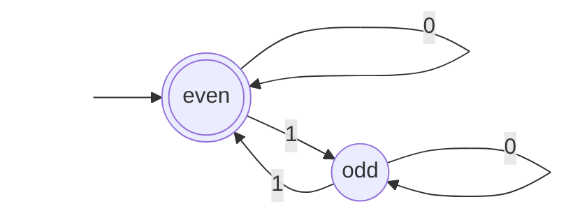

# COMP30026 Lectures 11–12 - Finite Automata and Regular Languages

来源：`lecture/w6l1-slides.pdf`（第 11 讲，14 页）、`lecture/w6l2-slides.pdf`（第 12 讲，15 页手写板书）；Apple Notes：CS/25S2/MoC — "LEC11-12 Finite Automata"。

这篇讲的是：**如果一台机器“不能分配新内存”，只能靠有限个状态记住过去，它能解决哪些问题？**

学习路线：[什么是计算模型](#topic-1) → [确定有限自动机](#topic-2) → [语言上的运算与封闭性](#topic-3) → [非确定有限自动机](#topic-4)。

重点：DFA 的五元组、“接受”的定义、正则语言的定义。难点：NFA 的计算树与 $\varepsilon$ 转移。易错：把 NFA 的“存在一条接受路径”理解成“所有路径都接受”；把 $L^0$ 当成空集。

截图编号是 PDF 页序。第 12 讲是手写板书，截图旁的说明会先转写板书，再解释它在说什么。

## 1. 什么是计算模型

### 为什么要学计算模型

第 11 讲从三个问题开场：大语言模型（LLM）能做一切吗？怎样设计安全的密码协议？怎样处理海量数据流？幻灯片的结论是：这些问题都关于**计算模型**——要回答“能不能做到”，先得说清楚机器被允许用什么资源。

### 问题与算法

- **计算问题（computational problem）= 规约（specification）**：对每个输入 $x$ ，正确输出**是什么**？
- **算法（algorithm）= 实现（implementation）**：对每个输入，**怎样**得到正确输出？

同一个问题可以有很多算法；本课后半段关心的是：某个问题在某种模型里**有没有**算法。

<!-- Sources: W6L1 p.7; Apple Notes LEC11-12 -->

### 资源与计算模型

算法要消耗资源：时间、空间（内存）、随机性、量子纠缠、对输入的访问方式……幻灯片底部一句话是本节的定义：**计算模型 = 资源约束**（computational model = resource constraints）。例如“只能从左到右读一遍输入、只有常数内存”就是一种模型。

理论计算机科学研究两件事：各种模型的能力与极限，以及资源之间的取舍。图中散开的四个词（空间、时间、随机性、量子纠缠）提示：放宽一种资源，有时可以节省另一种。

<!-- Sources: W6L1 p.9-10; Apple Notes LEC11-12 -->

### 先把一切简化

要证明“任何算法都做不到”似乎不可能（上一页的问题：怎样排除**每一个**可能的算法？），所以先简化。按幻灯片从上往下读：

- 输入是比特串（布尔串）；
- 输出只有 YES/NO——这类问题叫**判定问题（decision problem）**；
- 一个计算问题 = 所有答 YES 的输入构成的集合 = 一个**语言（language）**；
- 最简单的模型是**有限自动机（finite automaton, FA）**，关键特征是**无记忆性（memorylessness）**：不能分配新内存，相当于不能新建变量。

<!-- Sources: W6L1 p.11-13; Apple Notes LEC11-12 -->

之后两页用电影 *Memento*（主角无法形成新记忆）作比喻，并用计数器（tally counter）演示：一个只有固定几位的计数器，能记住的东西是有限的。

<!-- Sources: W6L1 p.14 -->

## 2. 确定有限自动机

第 12 讲第 1 页是公告与今日安排：先讲完有限自动机入门，再讲语言上的运算，最后讲非确定性（板书标注对应配套讲义第 4.1.5–4.3 节）。

### 五个组成部分

板书上半部分（绿色高亮）是定义。一个（确定）有限自动机 $M$ 由五部分组成：

| 部分 | 记号 | 说明 |
| --- | --- | --- |
| 字母表（alphabet） | $\Sigma$ | 有限的符号集合，例如 $\{0,1\}$ |
| 状态集（set of states） | $Q$ | 有限集合 |
| 初始状态（initial state） | $q_0\in Q$ | 读第一个字符前所在的状态 |
| 转移函数（transition function） | $\delta:Q\times\Sigma\to Q$ | $\delta(\text{当前状态},\text{下一字符})=\text{下一状态}$ |
| 接受状态（accept states） | $F\subseteq Q$ | 读完后停在这里就接受 |

<!-- Sources: W6L2 p.2; Apple Notes LEC11-12 -->

右上角红字举的字母表例子是 $\{0,1\}$ 、 $\{\text{"res"},\text{"inc"}\}$ （计数器的“清零”“加一”两个按钮）和游戏按键 $\{W,A,S,D\}$ ：**一个“字符”可以是任何有限集合里的符号**，不一定是单个字母。旁边的 $2^{\{0,1\}}=\{\emptyset,\{0\},\{1\},\{0,1\}\}$ 是幂集记号，第 4 节的 NFA 会用到。

板书下半部分是转移函数的两种画法：

- **状态转移表**（左）：行是状态、列是字符，格子里是下一状态；表左侧标出 $q_1$ 是接受状态。
- **状态图**（右）：圆圈是状态，箭头上标字符，`start` 箭头指向初始状态，双圈表示接受状态。图中 $q_0$ 读 0 到 $q_1$ 、读 1 到 $q_2$ ； $q_1$ 读 0 到 $q_2$ ； $q_2$ 读 1 回到 $q_1$ 。

**易错**：板书上的表只填了几格（ $q_3$ 一行全空），这是演示画法用的草图。严格的 DFA 要求 $\delta$ 对**每个**（状态，字符）都有定义；画图时省略的转移，习惯上理解为通往一个读什么都出不去的拒绝状态（“死状态”）。

**理解用例（自拟）**：下面的 DFA 接受“含偶数个 1 的二进制串”。状态 `even` 记住“目前读到偶数个 1”，它既是初始状态也是接受状态；这里每个状态对每个字符都有转移，是一张完整的表。

| 状态 | 读 0 | 读 1 |
| --- | --- | --- |
| →`even`（接受） | `even` | `odd` |
| `odd` | `odd` | `even` |

### 计算路径与接受

读入 $w=w_1w_2\cdots w_n$ 时，从 $r_0=q_0$ 出发，每读一个字符走一步： $r_i=\delta(r_{i-1},w_i)$ 。这串状态叫**计算路径**（computation path），最后停留的状态 $r_n$ 叫**结果状态（resulting state）**（图中红字箭头所指）。

**定义**：若结果状态属于 $F$ ，则 $M$ **接受** $w$ ；否则拒绝。 $M$ 接受的全部字符串构成的集合记作 $L(M)$ ，称为 $M$ 的语言。

<!-- Sources: W6L2 p.3; Apple Notes LEC11-12 -->

板书用这台机器跑输入 `0110`。先读出图中的转移：除了上一页的几条，新增 $q_1$ 读 1 走上方弧线到 $q_3$ 、 $q_3$ 读 1 回到 $q_1$ 、 $q_3$ 与 $q_2$ 读 0 都留在原地。逐字符走：

$$
q_0\xrightarrow{0}q_1\xrightarrow{1}q_3\xrightarrow{1}q_1\xrightarrow{0}q_2.
$$

**易错**：板书写的是 $q_0\to q_1\to q_3\to q_2$ ，漏掉了第三个字符后回到的 $q_1$ 。长度为 $n$ 的输入，计算路径应有 $n+1$ 个状态（这里是 5 个）。结果状态 $q_2$ 本身没错；若沿用上一页“ $q_1$ 是接受状态”，则 $q_2\notin F$ ， `0110` 被拒绝。

### 正则语言

板书两条定义：

1. 若 $L=L(M)$ ，就说有限自动机 $M$ **识别（recognizes）** $L$ ；
2. 语言 $L$ 是**正则的（regular）**，当且仅当**存在**某个有限自动机识别它。

注意“识别”要求两个方向都对： $L$ 中的串都被接受，**不在** $L$ 中的串都被拒绝。只接受 $L$ 的一部分，或多接受了别的串，都不算识别 $L$ 。

<!-- Sources: W6L2 p.4; Apple Notes LEC11-12 -->

### 有限自动机的两个关键特征

1. **无记忆**（memoryless）：状态就是全部记忆，而且状态个数是常数——不随输入变长而增加；
2. **输入是流**（input stream）：机器逐个读字符，不知道哪个字符是最后一个，也不能回头或往前看。

<!-- Sources: W6L2 p.5; Apple Notes LEC11-12 -->

下一页是课堂演示：在 Ed 上运行程序，并用 pythontutor.com 可视化它的内部状态，直观看到“状态就是全部记忆”。学生笔记把这一点比作马尔可夫性质：下一步只取决于当前状态和下一个字符。[第 9 篇](09-non-regularity.md)会把这个直觉变成严格的引理。

## 3. 语言上的运算与封闭性

设 $\Sigma^*$ 是由字母表 $\Sigma$ 组成的所有有限字符串的集合，语言就是 $\Sigma^*$ 的子集。板书介绍了五种运算：

| 运算 | 记号 | 含义 |
| --- | --- | --- |
| 补（complement） | $L^c=\Sigma^*\setminus L$ | 不在 $L$ 中的串 |
| 交（intersection） | $A\cap B$ | 同时在两者中 |
| 并（union） | $A\cup B$ | 至少在一个中 |
| 连接（concatenation） | $A\circ B=\{xy\mid x\in A,y\in B\}$ | 前半来自 $A$ 、后半来自 $B$ |
| 克林闭包（Kleene star） | $L^*$ | $L$ 中零个或多个串首尾相接 |

<!-- Sources: W6L2 p.7-9; Apple Notes LEC11-12 -->

### 补、交、并

三种运算用颜色对应：右上的大椭圆是 $\Sigma^*$ （所有串），里面的小圈是 $L$ ，绿色的环形区域就是补集 $L^c$ ；左下两个圈是 $A$ 和 $B$ ，粉色整片是并集 $A\cup B$ ，中间红色重叠部分是交集 $A\cap B$ 。

**易错**：补集是相对 $\Sigma^*$ 取的，所以同一个 $L$ 换了字母表，补集也会变。

### 连接

板书上半部分讲**连接**：先固定 $A$ 中的一个串 $a_1$ ，得到 $\{a_1\}\circ B=\{a_1b_1,a_1b_2,a_1b_3,\dots\}$ ；右边的连线图把 $A$ 中每个 $a_i$ 与 $B$ 中每个 $b_j$ 都连起来，每条线就是一个串 $a_ib_j$ 。所以

$$
A\circ B=(\{a_1\}\circ B)\cup(\{a_2\}\circ B)\cup\cdots
$$

例子： $A=\{0,00,000,\dots\}$ ， $B=\{1,11,111,\dots\}$ （全是 1 的串）。板书只写出了 $a_1=0$ 那一组 $\{01,011,0111,\dots\}$ ；完整的 $A\circ B$ 还包括 $001,0011,\dots$ ，即“若干个 0 后接若干个 1（都至少一个）”。右上角写着连接满足结合律 $(A\circ B)\circ C=A\circ(B\circ C)$ 。

<!-- Sources: W6L2 p.8 -->

两个特殊情形值得记住：

- $\{\varepsilon\}\circ L=L$ ：前半段只能选空串，等于什么都没加， $\{\varepsilon\}$ 是连接的“单位元”；
- $\emptyset\circ L=\emptyset$ ：前半段没有任何串可选，所以一个串也拼不出来。

**易错**： $\{\varepsilon\}$ （含一个空串的集合）和 $\emptyset$ （空集）在连接中的表现正好相反。

### 克林闭包

板书 W6L2 第 8 页下半部分与第 9 页讲**克林闭包**（Kleene star，也叫 Kleene closure）。

先定义幂： $L^0=\{\varepsilon\}$ 、 $L^1=L$ 、 $L^2=L\circ L$ ，一般地 $L^k=\underbrace{L\circ\cdots\circ L}_{k\text{ 次}}=L^{k-1}\circ L$ 。上图第二行把 $L^*$ 写成各次幂的并，并在下面标出 $L^2$ 、 $L^3$ ；第三行给出等价的集合写法：

$$
L^*=L^0\cup L^1\cup L^2\cup\cdots=\{\varepsilon\}\cup\{z\mid \exists k\ge1,\ x_1,\dots,x_k\in L,\ z=x_1x_2\cdots x_k\}.
$$

读法：一个串属于 $L^*$ ，当且仅当它是空串，或者能切成若干段、每段都属于 $L$ 。

<!-- Sources: W6L2 p.8-9 -->

**易错**：

- $L^0=\{\varepsilon\}$ （只含空串的集合），不是空集 $\emptyset$ 。所以任何 $L^*$ 都含空串 $\varepsilon$ ，连 $\emptyset^*=\{\varepsilon\}$ 也不例外。例： $\{a\}^*=\{\varepsilon,a,aa,\dots\}$ ， $\{0,1\}^*$ 是所有二进制串。
- 第 8 页右侧把 $L^*$ 简写成 $\{L^k:k\ge0\}$ ，字面上是“由语言组成的集合”；正确的意思是这些语言的**并** $\bigcup_{k\ge0}L^k$ ，以第 9 页的写法为准。

<!-- Sources: W6L2 p.8; Apple Notes LEC11-12 -->

### 封闭性

“封闭”（closed）的意思是：对正则语言做这种运算，结果还是正则语言。板书列出：

1. $L$ 正则 ⇒ $L^c$ 与 $L^*$ 正则；
2. $A,B$ 正则 ⇒ $A\cup B$ 、 $A\cap B$ 、 $A\circ B$ 正则。

连接、并、克林闭包合称**正则运算（regular operations）**。

<!-- Sources: W6L2 p.10; Apple Notes LEC11-12 -->

这些结论的构造性证明需要 NFA，放在[第 7 篇](07-nfa-determinisation-minimisation.md#topic-2)。其中补集最直接：DFA 的转移是完整的，把接受状态与非接受状态互换即可。

## 4. 非确定有限自动机

### 定义

板书标题注明这是“不带 $\varepsilon$ 转移的 NFA”。**非确定有限自动机（nondeterministic FA, NFA）**的五项里，只有绿色高亮的转移函数与 DFA 不同：

$$
\delta:Q\times\Sigma\to 2^Q, \qquad \delta(\text{当前状态},\text{下一字符})=\text{下一状态的集合}.
$$

$2^Q$ 是 $Q$ 的幂集（所有子集，包括 $\emptyset$ 与 $Q$ 本身），回顾第 2 节板书角落的 $2^{\{0,1\}}$ 。同一个状态读同一个字符，可以有零个、一个或多个后继，所以值必须是“状态的集合”。

<!-- Sources: W6L2 p.11-12; Apple Notes LEC11-12 -->

### 计算树

上半部分是一个 NFA：从 $q_0$ 读 0 或 1 都可以去 $q_1$ **或** $q_2$ （绿色高亮的两条 `0,1` 边），所以右下写着 $\delta(q_0,1)=\{q_1,q_2\}$ 。 $q_1$ 读 0 留在原地、读 1 到 $q_3$ ； $q_2$ 读 1 留在原地、读 0 到 $q_4$ ； $q_3,q_4$ 读什么都留在原地。

左下把输入 `001` 的走法画成一棵**计算树**（computation tree）：根是 $q_0$ ，读第一个 0 时分成两支。左支 $q_1\xrightarrow{0}q_1\xrightarrow{1}q_3$ ，右支 $q_2\xrightarrow{0}q_4\xrightarrow{1}q_4$ 。每个分叉代表一次非确定的选择，每条从根到叶的路径是一条**计算路径**；若某条路径中途转移集合为空，这条路径就“死掉”。右下的小树是一般示意：一个结点可以分出任意多支。

<!-- Sources: W6L2 p.12 -->

### 接受的定义

**定义**：NFA $N$ 接受 $w$ ，当且仅当**存在**一条接受的计算路径（读完 $w$ 后停在接受状态）。

<!-- Sources: W6L2 p.13; Apple Notes LEC11-12 -->

**易错**：只要有一条路径停在接受状态就接受；其他路径失败、卡住都不影响。反过来，拒绝需要**所有**路径都不接受——包括所有分支都卡住（转移为空集）的情形：此时不存在接受路径，所以拒绝。

### 空转移

$\varepsilon$ 转移（epsilon transition）允许机器**不读字符**就换状态。允许 $\varepsilon$ 转移时，转移函数的定义域扩成 $Q\times(\Sigma\cup\{\varepsilon\})$ 。

- 左图： $q_0$ 可以“免费”跳到 $q_1$ 或 $q_2$ ，三者都带 `0,1` 自环。下方的树显示输入 `01` 的开头：根 $q_0$ 分出三支——两支走 $\varepsilon$ 到 $q_1$ 、 $q_2$ ，一支不走 $\varepsilon$ 留在 $q_0$ ；然后每支各读入 0。
- 右图展示 $\varepsilon$ 的典型用途：新建起点 $r_0$ ，用 $\varepsilon$ 连到识别 $A$ 的 $M_1$ 和识别 $B$ 的 $M_2$ 的起点，就得到识别 $A\cup B$ 的 NFA。输入 `0110` 时，机器一开始就“猜”走进哪台子机器，只要有一台接受就接受。

<!-- Sources: W6L2 p.14 -->

最后一页解释怎样理解 $\varepsilon$ 。右上角写着 $1\varepsilon=1$ 、 $0\varepsilon=0$ ：空串拼上去不改变串。所以输入 `0110` 可以看成 $\varepsilon0\,1\varepsilon\varepsilon10$ ，在任意位置插入任意多个 $\varepsilon$ ；每个 $\varepsilon$ 都给机器一次不读字符就移动的机会（中间的三叉树）。中部那条路径 $q_0\xrightarrow{\varepsilon}q_1\xrightarrow{0}q_2\xrightarrow{1}q_1\xrightarrow{\varepsilon}q_2\xrightarrow{\varepsilon}q_2$ 是示意：读字符的步和 $\varepsilon$ 步可以交错出现。最下面一行说明：状态图里一条标着 `0,1` 的箭头只是两条箭头（一条标 0、一条标 1）的简写。

<!-- Sources: W6L2 p.15 -->

NFA 和 DFA 的表达能力相同（下一篇证明），NFA 的价值在于设计和证明更简单，例如上面的并集构造。

<!-- Sources: Apple Notes LEC11-12 -->

### 有限自动机的局限

有限自动机不能向前看，只有固定数量的比特记忆。像 $\{0^n1^n\mid n\ge0\}$ 这种需要“计数并配对”的语言，看起来就超出了它的能力——[第 9 篇](09-non-regularity.md)给出严格证明。

<!-- Sources: L14 p.29; Apple Notes LEC11-12 -->

## 本讲自测

1. 设计一个 DFA，识别“以 1 结尾的二进制串”，写出完整的转移表。
2. 用 W6L2 第 3 页的机器跑输入 `011`，写出完整的计算路径；若 $F=\{q_1\}$ ，它接受吗？
3. 设 $A=\{\varepsilon,0\}$ ， $B=\{0,00\}$ 。写出 $A\circ B$ ，并说明为什么 $|A\circ B|$ 不一定等于 $|A|\cdot|B|$ 。
4. 一个 NFA 读 `w` 时所有分支都在中途卡住，它接受 `w` 吗？如果其中一支停在接受状态、另一支卡住呢？
