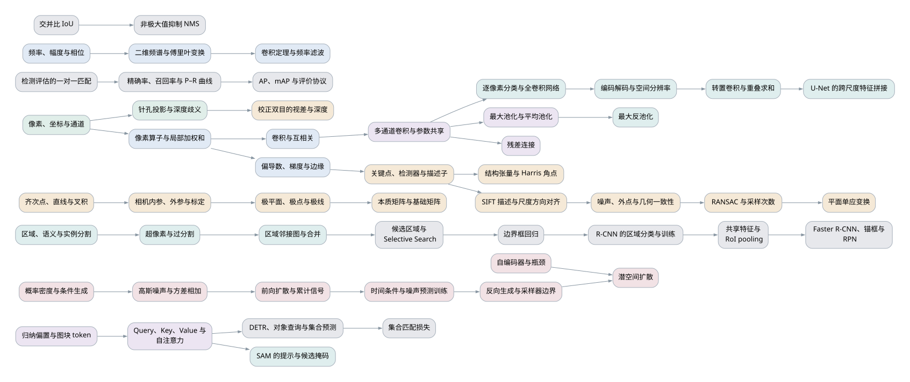

# COMP90086 词条百科与知识图

本索引收录 **121 个词条**。按 [专题主线](../LEARNING-PATHS.md) 学习，遇到不懂的前置概念，沿词条的“依赖”向前读；按 [逐讲核对记录](../SOURCE-AUDIT.md) 回查 PDF、转写和版本。原有逐讲笔记保留讲课路线与配图，词条提供独立定义、直接前置和可检验的学习目标。

分类与学习层级是两条独立维度：**讲义内容**在当前 PDF 中有依据；**只在 Workshop 出现**在核对的课程 PDF 中未找到对应教学展开、但练习明确介绍；**应用举例**是具体使用场景或操作实验。应用即便使用讲义概念，也单列可选，不代替概念定义。课堂口头补充写在相应讲义词条的说明中，不能伪称 PDF 原文。所有任务和数值验收只用于理解，标为自拟，不是原题或考试范围判断。

**关卡**承担关键推理或可复用的起点；**任务**练习已有概念或检查重要边界；**纯文案**提供背景，不强设独立交互。这里只完成笔记和教学设计，尚未生成或修改游戏关卡。

课程第 18 讲已取消，按原编号从第 17 讲接到第 19 讲，不设置占位词条或补充任务。

## 按专题查找

| 专题 | 词条数 | 学习入口 |
| --- | --- | --- |
| 1 | 9 | [图像、成像与表示](01-image-formation.md) |
| 2 | 11 | [空间与频率处理](02-processing.md) |
| 3 | 23 | [学习特征与表示](03-learning.md) |
| 4 | 17 | [匹配与三维几何](04-geometry.md) |
| 5 | 15 | [图像生成](05-generation.md) |
| 6 | 16 | [区域与像素分割](06-segmentation.md) |
| 7 | 15 | [检测、集合与评估](07-detection.md) |
| 8 | 15 | [可选专题：Workshop 与应用](08-optional.md) |

## 跨专题知识图

箭头从浅层概念指向使用它的概念。此图只展示跨专题骨架；**每个词条的完整直接依赖以词条和 [关系数据](knowledge-graph.json) 为准**。同一讲的阅读次序不等于必须依赖关系。

箭头从前置指向后续概念。颜色区分专题；本图展示主干连接，不把省略的边当作“没有依赖”。[打开全部 121 个词条的依赖图](knowledge-map-full.svg) 可放大查看；[主干图源](knowledge-map.dot) 与 [完整图源](knowledge-map-full.dot) 可用于重新导出。

## 全部词条

| 词条 | 出处 | 分类 | 层级 |
| --- | --- | --- | --- |
| [视觉任务与输出](01-image-formation.md#vision-task) | L01 p.6–8、26–30 | 讲义内容 | 关卡 |
| [像素、坐标与通道](01-image-formation.md#pixels) | L02 p.22–27 | 讲义内容 | 关卡 |
| [针孔投影与深度歧义](01-image-formation.md#projection) | L02 p.10–15 | 讲义内容 | 关卡 |
| [焦距、光圈与景深](01-image-formation.md#lens) | L02 p.12–17 | 讲义内容 | 任务 |
| [裁剪、重采样与插值](01-image-formation.md#sampling) | L02 p.34–40 | 讲义内容 | 关卡 |
| [朗伯反射与成像歧义](01-image-formation.md#reflectance) | L05 p.5–7、22–30 | 讲义内容 | 关卡 |
| [光谱、三色响应与颜色空间](01-image-formation.md#colour) | L05 p.9–20 | 讲义内容 | 任务 |
| [阴影、高光与材质](01-image-formation.md#material) | L05 p.31–35 | 讲义内容 | 纯文案 |
| [不变性、容忍度与等变性](01-image-formation.md#equivariance) | L05 p.36–53 | 讲义内容 | 任务 |
| [像素算子与局部加权和](02-processing.md#weighted-sum) | L03 p.6–16 | 讲义内容 | 关卡 |
| [卷积与互相关](02-processing.md#convolution) | L03 p.17–19 | 讲义内容 | 任务 |
| [平滑、锐化与高斯核](02-processing.md#filters) | L03 p.21–35 | 讲义内容 | 关卡 |
| [偏导数、梯度与边缘](02-processing.md#gradient) | L05 p.39–45 | 讲义内容 | 关卡 |
| [边界与输出尺寸](02-processing.md#padding) | L03 p.41–46 | 讲义内容 | 任务 |
| [空间可分离滤波与计算量](02-processing.md#separable) | L03 p.37–40 | 讲义内容 | 任务 |
| [频率、幅度与相位](02-processing.md#sinusoid) | L04 p.6–22 | 讲义内容 | 关卡 |
| [二维频谱与傅里叶变换](02-processing.md#fourier) | L04 p.24–35 | 讲义内容 | 关卡 |
| [卷积定理与频率滤波](02-processing.md#frequency-filter) | L04 p.37–44 | 讲义内容 | 关卡 |
| [硬截断与振铃](02-processing.md#ringing) | L04 p.45–50 | 讲义内容 | 任务 |
| [频域压缩](02-processing.md#compression) | L04 p.52–54 | 讲义内容 | 纯文案 |
| [分类表示与神经网络](03-learning.md#recognition) | L06 p.5–24 | 讲义内容 | 关卡 |
| [多通道卷积与参数共享](03-learning.md#channels) | L06 p.29–46 | 讲义内容 | 关卡 |
| [步幅、尺寸与感受野](03-learning.md#stride) | L06 p.47–53 | 讲义内容 | 任务 |
| [最大池化与平均池化](03-learning.md#pooling) | L07 p.6–14 | 讲义内容 | 关卡 |
| [Softmax 与交叉熵](03-learning.md#classification-loss) | L07 p.25–28 | 讲义内容 | 关卡 |
| [训练、验证与测试](03-learning.md#train-split) | L07 p.29、35–40 | 讲义内容 | 关卡 |
| [正则化、Dropout 与提前停止](03-learning.md#regularisation) | L07 p.16–23 | 讲义内容 | 任务 |
| [批次、学习率与增强](03-learning.md#optimisation) | L07 p.30–40 | 讲义内容 | 任务 |
| [小核堆叠与多尺度结构](03-learning.md#receptive-field) | L08 p.12–20 | 讲义内容 | 任务 |
| [残差连接](03-learning.md#residual) | L08 p.21–26 | 讲义内容 | 关卡 |
| [深度可分离卷积与模型缩放](03-learning.md#depthwise) | L08 p.27–32 | 讲义内容 | 任务 |
| [迁移学习与微调](03-learning.md#transfer) | L08 p.35–48 | 讲义内容 | 任务 |
| [归纳偏置与图块 token](03-learning.md#patches) | L09 p.5–14 | 讲义内容 | 关卡 |
| [Query、Key、Value 与自注意力](03-learning.md#attention) | L09 p.15–18、20 | 讲义内容 | 关卡 |
| [位置编码与 Transformer 块](03-learning.md#position) | L09 p.19–24 | 讲义内容 | 任务 |
| [注意力的成本与数据取舍](03-learning.md#attention-cost) | L09 p.26–34 | 讲义内容 | 纯文案 |
| [自监督与对比学习](03-learning.md#contrastive) | L10 p.5–9 | 讲义内容 | 关卡 |
| [CLIP 与零样本分类](03-learning.md#clip) | L10 p.11–17 | 讲义内容 | 任务 |
| [遮挡、CAM 与表示检查](03-learning.md#interpretability) | L10 p.19–30 | 讲义内容 | 任务 |
| [纹理偏置与分布变化](03-learning.md#robustness) | L10 p.35–43 | 讲义内容 | 纯文案 |
| [关键点、检测器与描述子](04-geometry.md#keypoint) | L11 p.6–11、24–25 | 讲义内容 | 关卡 |
| [结构张量与 Harris 角点](04-geometry.md#harris) | L11 p.12–21 | 讲义内容 | 关卡 |
| [SIFT 描述与尺度方向对齐](04-geometry.md#sift) | L11 p.25–29 | 讲义内容 | 任务 |
| [噪声、外点与几何一致性](04-geometry.md#outlier) | L12 p.5–9 | 讲义内容 | 关卡 |
| [Hough 参数空间投票](04-geometry.md#hough) | L12 p.11–16 | 讲义内容 | 关卡 |
| [RANSAC 与采样次数](04-geometry.md#ransac) | L12 p.18–20 | 讲义内容 | 关卡 |
| [描述子比值检验](04-geometry.md#ratio-test) | L12 p.22–24 | 讲义内容 | 任务 |
| [平面单应变换](04-geometry.md#homography) | L12 p.25–28 | 讲义内容 | 关卡 |
| [单视图深度线索](04-geometry.md#depth-cues) | L13 p.5–8 | 讲义内容 | 任务 |
| [校正双目的视差与深度](04-geometry.md#disparity) | L13 p.10–13 | 讲义内容 | 关卡 |
| [双目窗口代价与全局约束](04-geometry.md#stereo-matching) | L13 p.15–24 | 讲义内容 | 关卡 |
| [监督与双目自监督深度](04-geometry.md#learned-depth) | L13 p.27–30 | 讲义内容 | 任务 |
| [齐次点、直线与叉积](04-geometry.md#homogeneous) | L14 p.6–8 | 讲义内容 | 关卡 |
| [相机内参、外参与标定](04-geometry.md#calibration) | L14 p.10–13 | 讲义内容 | 关卡 |
| [极平面、极点与极线](04-geometry.md#epipolar) | L14 p.18–22 | 讲义内容 | 关卡 |
| [本质矩阵与基础矩阵](04-geometry.md#fundamental) | L14 p.20–26 | 讲义内容 | 关卡 |
| [双目校正、三角化与退化](04-geometry.md#rectification) | L14 p.16、28–31 | 讲义内容 | 任务 |
| [概率密度与条件生成](05-generation.md#probability) | L15 p.5–18 | 讲义内容 | 关卡 |
| [自编码器与瓶颈](05-generation.md#autoencoder) | L15 p.22–30 | 讲义内容 | 关卡 |
| [VAE、重参数化与两项损失](05-generation.md#vae) | L15 p.31–38 | 讲义内容 | 关卡 |
| [潜空间采样与编辑](05-generation.md#latent-sampling) | L15 p.39–46 | 讲义内容 | 任务 |
| [GAN 的生成器与判别器](05-generation.md#gan) | L16 p.7–14 | 讲义内容 | 关卡 |
| [对抗平衡与模式坍塌](05-generation.md#gan-stability) | L16 p.15、19、29–33 | 讲义内容 | 任务 |
| [记忆、逼真度与多样性](05-generation.md#generation-evaluation) | L16 p.21–33 | 讲义内容 | 关卡 |
| [条件 GAN 与循环一致性](05-generation.md#conditional-gan) | L16 p.35–40 | 讲义内容 | 任务 |
| [高斯噪声与方差相加](05-generation.md#gaussian-noise) | L17 p.10–13 | 讲义内容 | 关卡 |
| [前向扩散与累计信号](05-generation.md#forward-diffusion) | L17 p.10–14 | 讲义内容 | 关卡 |
| [时间条件与噪声预测训练](05-generation.md#noise-prediction) | L17 p.19–24 | 讲义内容 | 关卡 |
| [反向生成与采样器边界](05-generation.md#reverse-diffusion) | L17 p.21–28 | 讲义内容 | 关卡 |
| [潜空间扩散](05-generation.md#latent-diffusion) | L17 p.30、35 | 讲义内容 | 任务 |
| [条件扩散与补全](05-generation.md#conditional-diffusion) | L17 p.31–35 | 讲义内容 | 任务 |
| [区域、语义与实例分割](06-segmentation.md#segmentation) | L19 p.3–8、40–42 | 讲义内容 | 关卡 |
| [颜色聚类、K-means 与 GMM](06-segmentation.md#clustering) | L19 p.10–13 | 讲义内容 | 任务 |
| [Mean shift 的加权均值与模式](06-segmentation.md#mean-shift) | L19 p.14–24 | 讲义内容 | 关卡 |
| [空间颜色特征与带宽](06-segmentation.md#bandwidth) | L19 p.25–27 | 讲义内容 | 关卡 |
| [超像素与过分割](06-segmentation.md#superpixels) | L19 p.29–30、35、38 | 讲义内容 | 关卡 |
| [SLIC 的局部聚类与连通处理](06-segmentation.md#slic) | L19 p.31–33 | 讲义内容 | 关卡 |
| [区域邻接图与合并](06-segmentation.md#rag) | L19 p.36–38 | 讲义内容 | 关卡 |
| [可数物体与连续材质](06-segmentation.md#stuff-things) | L19 p.41 | 讲义内容 | 纯文案 |
| [GrabCut 与框内前景背景](06-segmentation.md#grabcut) | L19 p.43、47–49 | 讲义内容 | 任务 |
| [逐像素分类与全卷积网络](06-segmentation.md#fcn) | L20 p.8–13、26–30 | 讲义内容 | 关卡 |
| [编码解码与空间分辨率](06-segmentation.md#encoder-decoder) | L20 p.12–14、25 | 讲义内容 | 关卡 |
| [最大反池化](06-segmentation.md#unpooling) | L20 p.15 | 讲义内容 | 关卡 |
| [转置卷积与重叠求和](06-segmentation.md#transpose-conv) | L20 p.16–24 | 讲义内容 | 关卡 |
| [U-Net 的跨尺度特征拼接](06-segmentation.md#unet) | L20 p.32–36 | 讲义内容 | 关卡 |
| [SAM 的提示与候选掩码](06-segmentation.md#sam) | L20 p.38–42、44–47 | 讲义内容 | 任务 |
| [分割损失与掩码质量预测](06-segmentation.md#mask-loss) | L20 p.27、34、43 | 讲义内容 | 任务 |
| [检测框与滑动窗口](07-detection.md#detection) | L21 p.6–12 | 讲义内容 | 关卡 |
| [交并比 IoU](07-detection.md#iou) | L21 p.13–16 | 讲义内容 | 关卡 |
| [候选区域与 Selective Search](07-detection.md#proposals) | L21 p.18–23 | 讲义内容 | 关卡 |
| [边界框回归](07-detection.md#box-regression) | L21 p.26–29 | 讲义内容 | 关卡 |
| [R-CNN 的区域分类与训练](07-detection.md#rcnn) | L21 p.21–32 | 讲义内容 | 任务 |
| [共享特征与 RoI pooling](07-detection.md#roi-pooling) | L21 p.34–46 | 讲义内容 | 关卡 |
| [Faster R-CNN、锚框与 RPN](07-detection.md#rpn) | L21 p.47–54 | 讲义内容 | 关卡 |
| [YOLO v1 的网格预测](07-detection.md#yolo) | L22 p.5–9 | 讲义内容 | 关卡 |
| [DETR、对象查询与集合预测](07-detection.md#detr) | L22 p.10–15 | 讲义内容 | 关卡 |
| [集合匹配损失](07-detection.md#set-matching) | L22 p.12–14 | 讲义内容 | 关卡 |
| [非极大值抑制 NMS](07-detection.md#nms) | L22 p.17–22 | 讲义内容 | 关卡 |
| [检测评估的一对一匹配](07-detection.md#detection-matching) | L22 p.23–31 | 讲义内容 | 关卡 |
| [精确率、召回率与 P–R 曲线](07-detection.md#precision-recall) | L22 p.24–32 | 讲义内容 | 关卡 |
| [AP、mAP 与评价协议](07-detection.md#map) | L22 p.31–36 | 讲义内容 | 关卡 |
| [Mask R-CNN 与实例掩码](07-detection.md#instance-mask) | L19 p.42–45 | 讲义内容 | 任务 |
| [视觉词袋与空间信息](03-learning.md#bag-features) | L09 p.8–13 | 讲义内容 | 任务 |
| [PCA、t-SNE 与表示邻居](03-learning.md#embedding-view) | L10 p.20–23 | 讲义内容 | 任务 |
| [分类准确率与错误分析](03-learning.md#classification-metrics) | L08 p.5–10 | 讲义内容 | 任务 |
| [生成模型的质量与采样成本](05-generation.md#generation-cost) | L17 p.36 | 讲义内容 | 纯文案 |
| [OpenCV 的 BGR 与数组副本](08-optional.md#bgr) | 见词条中的 Notebook 章节 | 只在 Workshop 出现 | 任务 |
| [平均注意距离](08-optional.md#attention-distance) | 见词条中的 Notebook 章节 | 只在 Workshop 出现 | 任务 |
| [同图不同目标的 Grad-CAM 实验](08-optional.md#gradcam-practice) | 见词条中的 Notebook 章节 | 应用举例 | 任务 |
| [扩散的 1000 步实现实验](08-optional.md#diffusion-schedule-practice) | 见词条中的 Notebook 章节 | 应用举例 | 任务 |
| [Normalized cut 图分割实验](08-optional.md#normalised-cut-practice) | 见词条中的 Notebook 章节 | 只在 Workshop 出现 | 任务 |
| [从像素高度计算焦距](08-optional.md#camera-example) | 见词条中的 Notebook 章节 | 应用举例 | 任务 |
| [Workshop 5 补充：沿原题计算参数与输出](08-optional.md#cnn-parameter-practice) | 见词条中的 Notebook 章节 | 应用举例 | 任务 |
| [Workshop：把训练流程连起来](08-optional.md#mnist-practice) | 见词条中的 Notebook 章节 | 应用举例 | 任务 |
| [Workshop 5 补充：保留原设计的可分离 CNN](08-optional.md#separable-cnn-practice) | 见词条中的 Notebook 章节 | 应用举例 | 任务 |
| [Workshop 5 补充：滤波器与特征图不是同一件事](08-optional.md#feature-map-practice) | 见词条中的 Notebook 章节 | 应用举例 | 任务 |
| [Workshop 7：把窗口参数与评分参数分开](08-optional.md#harris-api-practice) | 见词条中的 Notebook 章节 | 应用举例 | 任务 |
| [Workshop 7：从描述子候选到书封面定位](08-optional.md#matching-practice) | 见词条中的 Notebook 章节 | 应用举例 | 任务 |
| [Workshop 8：调窗口时观察什么](08-optional.md#stereo-practice) | 见词条中的 Notebook 章节 | 应用举例 | 任务 |
| [Workshop 8：先标定，再检查极线](08-optional.md#calibration-practice) | 见词条中的 Notebook 章节 | 应用举例 | 任务 |
| [Workshop 9：从重建走向生成](08-optional.md#generation-practice) | 见词条中的 Notebook 章节 | 应用举例 | 任务 |
